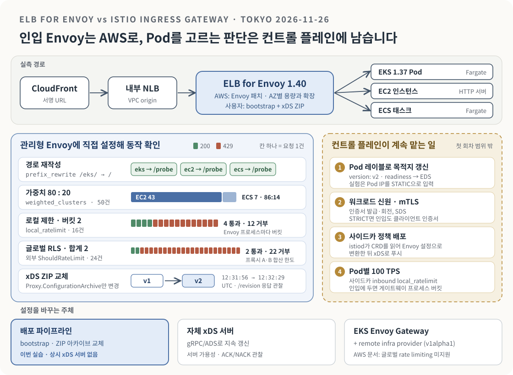

**ELB for Envoy**를 쓰면 AWS가 Envoy 프록시의 패치와 확장을 맡고, 사용자는 리스너와 라우팅 규칙을 정의합니다. Istio Ingress Gateway의 역할을 어디까지 맡길 수 있을까요? 도쿄에서 관리형 Envoy에 직접 설정을 적용해 보니 경로 재작성, 가중치 라우팅, 로컬 요청 제한이 모두 별도 xDS 서버 없이 동작했습니다. [AWS 출시 공지](https://aws.amazon.com/ko/about-aws/whats-new/2026/11/elastic-load-balancing-for-envoy-generally-available/)

주문 API를 기준으로 보면 경계가 선명해집니다. “주문 요청의 10%를 새 버전으로 보낸다”는 정책에서 Envoy는 목적지를 선택합니다. 새 버전의 Pod가 교체될 때마다 레이블과 준비 상태를 보고 목적지 목록을 갱신하는 쪽은 컨트롤 플레인입니다. “Pod 하나가 초당 100건을 받는다”는 정책은 요청이 **어느 Pod에 도착했는지** 아는 지점에서 집행해야 합니다.

## 요청 경로와 설정 경로

<figure class="diagram"><a href="/assets/data/elb-envoy-tokyo/topology.html"></a><figcaption>초록 실선은 HTTP 요청, 회색 선은 RLS 판정 호출, 보라색 점선은 설정 전달입니다. 그림을 누르면 확대할 수 있습니다. 확대 도구의 메뉴는 영어로 표시됩니다.</figcaption></figure>

| 궁금한 점 | 도쿄 실습에서의 답 |
| --- | --- |
| 인입 Envoy의 원본 설정은 어디에 있나? | `render_proxy.py`가 만드는 CloudFormation 템플릿입니다. `Proxy.ConfigurationFile`에는 bootstrap, `Proxy.ConfigurationArchive`에는 라우트와 업스트림을 담은 ZIP을 넣습니다. |
| xDS 파일은 어디서 읽나? | AWS가 ZIP을 프록시 파일시스템에 펼칩니다. bootstrap의 HTTP 리스너가 `/xds/routes.yaml`(RDS)을, 클러스터 설정이 `/xds/clusters.yaml`(CDS)을 참조합니다. 이 인입 프록시에는 상시 xDS 서버가 없습니다. |
| EKS 사이드카는 누가 만드나? | Deployment의 ReplicaSet이 새 Pod를 요청할 때 API 서버가 Istio 주입 웹훅을 호출합니다. 웹훅이 Pod 명세에 `istio-proxy`를 추가하고 kubelet이 실행합니다. 이번 Pod에서 `echo`는 앱 컨테이너, `istio-proxy`는 `restartPolicy: Always`인 네이티브 사이드카였습니다. 정책 변경은 istiod에서 xDS로 받습니다. |
| EC2와 ECS에도 Envoy가 생기나? | 이 실험의 EC2에는 HTTP 서버가, ECS 태스크에는 echo 컨테이너가 요청을 받았습니다. 둘 다 관리형 Envoy의 원격 업스트림으로 등록했으며 백엔드에 Envoy를 설치하지 않았습니다. EC2에 별도 프록시를 설치하거나 ECS 태스크에 사이드카를 명시하면 그때 추가 프로세스가 생깁니다. 실험에 사용한 RLS는 별도 ECS 태스크입니다. |

[관리형 프록시의 설정 생성 코드](/assets/data/elb-envoy-tokyo/render_proxy.py) · [Istio 주입 절차](https://docs.atomai.click/kubernetes-docs/ko/service-mesh/istio/advanced/07-sidecar-injection)

## `order/api`로 보낸다는 뜻

`order` 네임스페이스에 Deployment `api`가 있고 그 Pod에 `app: api`, `version: v1` 레이블이 있다고 가정합니다. Service `api`는 `app: api`를 선택하고 HTTP 포트 8080을 Pod의 8080으로 전달합니다. 같은 네임스페이스에 `app: api, version: v2`인 카나리 Pod를 추가하면 **하나의 Service가 두 버전을 모두 발견**합니다. `DestinationRule`의 두 subset이 버전을 구분합니다. 기본 클러스터 도메인에서 목적지 FQDN은 `api.order.svc.cluster.local`입니다. Deployment 이름만으로 이 연결이 생기지는 않습니다. [Kubernetes Docs의 DestinationRule과 subset 사례](https://docs.atomai.click/kubernetes-docs/ko/service-mesh/istio/traffic-management/03-destination-rule)

다음은 문서의 헤더 조작과 카나리 사례를 주문 API로 옮긴 **Istio 설정 예시**입니다. `istio-system/public-gateway`가 `orders.example.com`을 받는다고 가정합니다. 점검 경로를 먼저 매칭해 프록시가 503을 직접 반환하고, 일반 주문 요청만 백엔드로 보냅니다. [헤더 추가·수정 사례](https://docs.atomai.click/kubernetes-docs/ko/service-mesh/istio/traffic-management/01-gateway-virtualservice) · [직접 응답 사례](https://docs.atomai.click/kubernetes-docs/ko/service-mesh/istio/traffic-management/02-routing) · [가중치 변경 사례](https://docs.atomai.click/kubernetes-docs/ko/service-mesh/istio/traffic-management/04-traffic-splitting)

```yaml
apiVersion: networking.istio.io/v1
kind: DestinationRule
metadata: {name: api, namespace: order}
spec:
  host: api.order.svc.cluster.local
  subsets:
    - {name: stable, labels: {version: v1}}
    - {name: canary, labels: {version: v2}}
---
apiVersion: networking.istio.io/v1
kind: VirtualService
metadata: {name: orders, namespace: order}
spec:
  hosts: [orders.example.com]
  gateways: [istio-system/public-gateway]
  http:
    - match: [{uri: {exact: /orders/maintenance}}]
      directResponse:
        status: 503
        body: {string: "orders under maintenance"}
    - match: [{uri: {prefix: /orders/}}]
      headers:
        request:
          add: {x-order-hop: ingress}
          set: {x-order-source: public-api}
      route:
        - destination: {host: api.order.svc.cluster.local, subset: stable, port: {number: 8080}}
          weight: 90
        - destination: {host: api.order.svc.cluster.local, subset: canary, port: {number: 8080}}
          weight: 10
```

백엔드로 전달할 때 `add`는 기존 `x-order-hop` 값에 `ingress`를 추가하고, `set`은 클라이언트가 보낸 `x-order-source` 값을 `public-api`로 덮어씁니다. 헤더가 없으면 둘 다 생성합니다. 90:10을 70:30으로 바꿀 때는 `VirtualService`의 두 `weight`만 수정합니다. istiod가 같은 두 subset을 가리키는 새 라우트를 배포하므로 이 변경을 위해 Pod 수를 조정할 필요가 없습니다. 단계별 승격을 자동화할 때는 Argo Rollouts가 `VirtualService`의 가중치를 바꾸고, 갱신된 라우트를 Envoy에 전달하는 역할은 계속 istiod가 맡습니다. [Argo Rollouts와 Istio의 역할 분담](https://docs.atomai.click/kubernetes-docs/ko/service-mesh/istio/advanced/08-argo-rollouts)

ELB for Envoy에 직접 설정할 때는 RouteConfiguration의 `request_headers_to_add`에 `APPEND_IF_EXISTS_OR_ADD`와 `OVERWRITE_IF_EXISTS_OR_ADD`를 각각 사용합니다. 가중치는 `weighted_clusters`, 점검 응답은 `direct_response`로 표현합니다. 이 방식에서는 stable·canary 클러스터의 엔드포인트 목록을 직접 공급합니다. 도쿄 인입 실측에는 위 두 Istio 리소스의 동작을 Envoy 라우트로 직접 표현해 적용했습니다. 뒤의 Pod별 100 TPS 실험에는 Kubernetes의 실제 `EnvoyFilter`를 적용했습니다.

## EC2·ECS·EKS에서 같은 요청을 비교했습니다

도쿄 실측 환경의 진입 경로는 `CloudFront → 내부 NLB → 내부 ELB for Envoy`였습니다. 2026년 11월 26일 Envoy 1.40에서 EC2의 HTTP 서버, ECS Fargate 태스크, EKS 1.37의 `order/api`로 요청을 보냈습니다. EKS에는 임시 EC2 워커와 Istio 1.30.2를 사용했습니다. 두 Pod 모두 앱과 사이드카가 Ready였고 두 사이드카가 istiod의 LDS·RDS·CDS·EDS를 구독하는 것을 확인했습니다.

| 관리형 Envoy에서 적용한 설정 | EC2 | ECS | EKS |
| --- | --- | --- | --- |
| prefix rewrite 후 앱이 받은 경로 | `/capture/{id}` | `/capture/{id}` | `/capture/{id}` |
| 요청 헤더 `add` / `set` 후 앱이 받은 값 | `seed,ingress` / `public-api` | `seed,ingress` / `public-api` | `seed,ingress` / `public-api` |
| 인입 로컬 제한, 목적지별 16건 | 200 × 4, 429 × 12 | 200 × 4, 429 × 12 | 200 × 4, 429 × 12 |
| 글로벌 RLS, 세 목적지가 한도 3개 공유 | 200 × 1, 429 × 4 | 200 × 1, 429 × 4 | 200 × 1, 429 × 4 |
| 가중치 **60:30:10**, 120건 | **70** | **35** | **15** |
| 가중치 **10:30:60**, 120건 | **10** | **33** | **77** |

헤더 대조군에는 `x-order-hop: seed`와 `x-order-source: original`을 넣었습니다. 수정 경로에서는 첫 번째 헤더에 `ingress`가 추가되고 두 번째 값은 `public-api`로 바뀌었습니다. 표의 값은 **각 앱이 받은 요청을 되돌려 준 응답**입니다. 가중치 두 번을 측정할 때도 응답 본문의 백엔드 이름을 셌고, 두 표본 모두 EKS Pod 두 개에서 응답이 왔습니다. 점검 경로 `/matrix/maintenance`는 Envoy가 직접 `503 orders under maintenance`를 반환했습니다. [세 백엔드의 요청별 원자료](/assets/data/elb-envoy-tokyo/backend-matrix.json) · [검증 스크립트](/assets/data/elb-envoy-tokyo/probe.py)

**429를 어느 계층에서 냈는지도 확인했습니다.** 인입 로컬 제한은 경로별 버킷에 토큰 2개를 설정했고 429에 `x-lab-limit: local`이 붙었습니다. 글로벌 제한에서는 EC2 → ECS → EKS로 한 건씩 먼저 보내 서로 다른 세 앱의 200과 RLS의 `OK`를 확인했습니다. 같은 descriptor를 쓰는 후속 12건에는 모두 `OVER_LIMIT`과 429가 돌아왔습니다. 거부된 요청은 백엔드에 도달하지 않습니다. 뒤의 **Pod당 100 TPS** 실험은 인입 게이트웨이를 거치지 않고 Pod 인바운드에서 따로 측정했습니다.

**xDS 아카이브를 교체해 라우트를 갱신했습니다.** `/revision`은 12:31:56 UTC에 `v1`을 반환했습니다. 세 백엔드의 주소와 새 응답 문자열을 ZIP에 담아 같은 프록시 스택에 적용하자, 12:32:29 UTC에 보낸 요청에는 `v2`가 돌아왔습니다. CloudFormation 변경 세트에서 바뀐 속성은 `Proxy.ConfigurationArchive` 하나였습니다. 두 시각은 각각의 응답을 관찰한 시점입니다. [프록시 설정 업데이트 API](https://docs.aws.amazon.com/elasticloadbalancing/latest/elbproxy/update-proxy-configuration.html)

<details><summary>초기 Fargate 실험 결과 보기</summary>
<figure class="diagram"><a href="/assets/elb-envoy-istio-gateway-scope.svg"></a><figcaption>첫 회차에는 EKS Fargate Pod에 사이드카가 없었습니다. 두 목적지 가중치와 공유 한도 2건을 쓴 이 기록은 위 세 목적지 재측정 전의 결과입니다.</figcaption></figure>
</details>

## 글로벌 요청 제한도 관리형 Envoy에서 동작할까?

Istio에서는 `EnvoyFilter`로 게이트웨이에 `envoy.filters.http.ratelimit`을 추가하고, 라우트의 `rate_limits.actions`가 해당 요청의 descriptor를 만듭니다. 예를 들어 `order/api` 전체의 한도를 두려면 모든 게이트웨이가 같은 domain과 `generic_key=order-api`를 외부 **Rate Limit Service(RLS)**에 보냅니다. 매 요청에서 gRPC `ShouldRateLimit`을 호출하고, RLS가 `OVER_LIMIT`을 반환하면 프록시가 기본적으로 429를 돌려줍니다. `kubernetes-docs`의 사례는 여러 RLS 복제본이 Redis 카운터를 공유하는 구성입니다. [Kubernetes Docs의 글로벌 제한 사례](https://docs.atomai.click/kubernetes-docs/ko/service-mesh/istio/resilience/02-rate-limiting) · [Istio 공식 예제](https://istio.io/latest/docs/tasks/policy-enforcement/rate-limit/)

**직접 구성한 ELB for Envoy 1.40에서도 외부 RLS 호출이 동작했습니다.** Istio CRD를 전달하는 대신 bootstrap의 HTTP 필터 체인에서 router 앞에 같은 필터를 넣었습니다. 첫 회차의 `/global/` 라우트에는 `generic_key=shared-demo`를 지정했고, 필터의 `envoy_grpc.cluster_name`은 HTTP/2를 사용하는 RLS 업스트림을 가리켰습니다. 실험용 RLS 한 프로세스가 `envoy-blog` domain과 이 descriptor를 검사하고 첫 요청부터 60초 동안 합계 **2건**을 허용했습니다. [Envoy HTTP rate limit 필터](https://www.envoyproxy.io/docs/envoy/latest/configuration/http/http_filters/rate_limit_filter)

| RLS가 관찰한 Envoy 연결 출발지 | RLS `OK` → HTTP 200 | RLS `OVER_LIMIT` → HTTP 429 |
| --- | ---: | ---: |
| 프록시 A | 0 | 9 |
| 프록시 B | 2 | 13 |
| **합계** | **2** | **22** |

24건은 약 0.21초 안에 끝났습니다. RLS가 gRPC 연결에서 읽은 출발지와 판정을 응답 헤더에 넣어 두 프록시가 같은 한도를 썼는지 대조했습니다. 이번에는 단일 RLS의 메모리에 카운터를 뒀습니다. RLS까지 여러 대로 확장하려면 같은 키의 카운터를 공유해야 합니다. 이 실험의 `failure_mode_deny: true` 설정에서 RLS 호출 오류는 기본 500, 정상적인 한도 초과는 429입니다. 장애 시 요청을 통과시킬지 결정하는 것도 RLS 운영 설계에 포함됩니다. [실측에 사용한 필터·라우트 설정과 요청별 결과](/assets/data/elb-envoy-tokyo/global-ratelimit.json)

AWS가 **글로벌 rate limiting 미지원**이라고 명시한 대상은 EKS의 **Envoy Gateway + remote infrastructure provider 통합**입니다. 위 결과는 CloudFormation으로 직접 구성한 관리형 프록시에서 측정했습니다. AWS가 해당 통합의 정책 API까지 지원한다는 근거로 확대할 수는 없습니다. [AWS의 EKS 통합 제약](https://docs.aws.amazon.com/elasticloadbalancing/latest/elbproxy/kubernetes-overview.html#kubernetes-overview-differences)

## VirtualService와 DestinationRule을 Envoy 설정으로 풀면

Istio의 `Gateway`는 게이트웨이가 열 포트·호스트·TLS를 기술합니다. `VirtualService`는 어떤 요청을 어디로 보낼지 정하고, `DestinationRule`은 목적지의 subset과 연결 정책을 정의합니다. istiod는 이 선언과 서비스 레지스트리를 함께 읽어 프록시별 xDS 리소스를 만듭니다. 아래 대응 관계는 기존 정책을 옮길 때 확인할 단위입니다. [Istio Gateway](https://istio.io/latest/docs/reference/config/networking/gateway/) · [VirtualService](https://istio.io/latest/docs/reference/config/networking/virtual-service/) · [DestinationRule](https://istio.io/latest/docs/reference/config/networking/destination-rule/)

| Istio에서 적던 의도 | Envoy에서 준비할 설정 | 이번 실습에서 확인한 범위 |
| --- | --- | --- |
| 게이트웨이의 HTTP 포트와 라우트 바인딩 | Listener와 HTTP connection manager에서 RouteConfiguration 참조 | 8080 리스너와 파일 기반 RDS |
| URI prefix 매칭과 rewrite | Route의 `match.prefix`, `route.prefix_rewrite` | 세 백엔드가 돌려준 URI 확인 |
| 가중치 라우팅 | `weighted_clusters`와 각 목적지의 Cluster | EC2·ECS·EKS의 비중을 60:30:10에서 10:30:60으로 변경 |
| subset에 속한 Pod 선택 | subset별 Cluster를 만들고 레이블과 readiness를 반영해 엔드포인트 갱신 | 실험에서는 준비된 백엔드의 IPv4를 직접 입력 |
| 타임아웃·재시도, 커넥션 풀·이상 호스트 제외 | Route의 `timeout`·`retry_policy`, Cluster의 연결 설정·`circuit_breakers`·`outlier_detection` | 설정 위치를 대조한 항목 |
| TLS origination과 워크로드 신원 | upstream TLS context, 신뢰할 CA와 인증서 공급·갱신 경로. 동적 시크릿은 SDS | 실험의 업스트림은 HTTP |

가령 `/eks/probe` 요청에는 아래 규칙 하나가 적용됩니다. 매칭된 `/eks/`를 `/`로 바꾸고 `eks` 클러스터에 전달합니다. 그 클러스터의 실제 주소는 다른 파일에서 결정합니다. 따라서 라우트의 이름을 그대로 두고 Pod 주소만 갱신할 수 있습니다. [실습의 라우트와 클러스터 생성 코드](/assets/data/elb-envoy-tokyo/render_proxy.py)

```yaml
match:
  prefix: /eks/
route:
  cluster: eks
  prefix_rewrite: /
```

직접 만든 xDS 설정으로 많은 전달 동작을 표현할 수 있어도, Istio 전체의 의미를 일대일로 복사할 수는 없습니다. 네임스페이스별 가시성, 서비스 레이블 해석, 워크로드 인증서 발급·회전, 메시 내부 사이드카로의 정책 배포는 각각 상태를 관찰하고 결정을 내리는 주체가 필요합니다. 관리형 Envoy 자체에도 제약이 있습니다. 예를 들어 동적 모듈과 파일 액세스 로거는 지원하지 않고, 액세스 로그는 OpenTelemetry 또는 ALS 같은 네트워크 싱크로 보냅니다. AWS가 허용하는 스키마와 실제 Envoy 빌드에 포함된 확장도 구별해야 합니다. [관리형 Envoy 기능 제한](https://docs.aws.amazon.com/elasticloadbalancing/latest/elbproxy/envoy-limits.html)

## 별도 xDS 서버는 언제 필요한가

| 설정을 바꾸는 주체 | 팀이 운영하는 부분 | 맞는 상황 |
| --- | --- | --- |
| 배포 파이프라인이 bootstrap과 ZIP 아카이브 전달 | 설정 생성·검증, 주소 갱신, 배포와 롤백 | 대상과 정책이 드물게 바뀌는 인입 게이트웨이. 이번 실습 방식 |
| 자체 xDS 서버가 gRPC/ADS로 전달 | 서버 가용성과 신뢰 설정, 서비스 발견, 스냅샷 일관성, ACK/NACK 관찰 | Pod 교체나 카나리 배포에 맞춰 정책과 엔드포인트를 지속적으로 갱신 |
| EKS의 Envoy Gateway가 Gateway API를 xDS로 변환 | Envoy Gateway와 remote infrastructure provider 컨트롤러 운영, 정책 변환 | Kubernetes에서 Gateway·HTTPRoute를 관리하고 프록시 실행을 AWS에 위임 |

세 방식 모두 AWS는 Envoy 프로세스와 호스트의 패치, AZ별 용량과 확장을 맡습니다. 첫 번째 방식은 별도 상시 xDS 서버 없이 동작합니다. bootstrap에 모든 라우트를 넣을 수도 있고, 이번처럼 리스너를 고정한 채 `/xds/routes.yaml`(RDS)과 `/xds/clusters.yaml`(CDS)을 파일로 읽게 할 수도 있습니다. ZIP만 갱신하면 AWS가 파일을 교체하고, 감시 디렉터리를 설정한 Envoy가 새 내용을 읽습니다. bootstrap 자체를 바꾸면 hot restart가 일어나며 기존 연결의 drain 시간은 60초입니다. [Envoy 실행·설정 갱신 방식](https://docs.aws.amazon.com/elasticloadbalancing/latest/elbproxy/how-envoy-runs.html)

기존 Istio CRD를 그대로 유지하려면 이를 해석하는 istiod 등의 구성 경로와 관리형 프록시 사이의 연결, 신원 발급, SDS, 버전 호환성을 별도로 검증해야 합니다. AWS가 문서화한 EKS 통합은 Envoy Gateway에 `elb-envoy-remote-infra-provider`를 붙이는 방식입니다. 이 컨트롤러가 관리형 프록시를 만들고 Envoy Gateway가 xDS를 제공합니다. 출시 시점의 통합 API는 `v1alpha1`입니다. [EKS 통합의 동작과 제약](https://docs.aws.amazon.com/elasticloadbalancing/latest/elbproxy/kubernetes-overview.html)

## EKS 사이드카의 설정은 어디서 관리하나

사이드카 모드에서는 운영팀이 Git에 둔 `VirtualService`, `DestinationRule`, `EnvoyFilter` 등을 Kubernetes API에 적용합니다. 클러스터의 **istiod**가 이 리소스와 Service·EndpointSlice의 변경을 보고, 어느 워크로드에 어떤 리스너·라우트·클러스터·엔드포인트가 필요한지 계산합니다. Pod 안의 Istio 에이전트가 istiod와의 xDS 연결을 중계하고 `istio-proxy`가 설정을 받아 적용합니다. 워크로드 인증서는 에이전트가 로컬 SDS로 Envoy에 제공합니다. 사이드카 자동 주입은 새 Pod를 만들 때 일어나고, 이후의 라우트·필터 변경은 xDS를 통해 전달됩니다. [Istio 아키텍처와 xDS 흐름](https://docs.atomai.click/kubernetes-docs/ko/service-mesh/istio/03-architecture) · [사이드카 주입과 revision](https://docs.atomai.click/kubernetes-docs/ko/service-mesh/istio/advanced/07-sidecar-injection)

따라서 **관리형 인입 프록시와 Istio 사이드카를 함께 쓰면 설정의 소유자가 둘**입니다. 이번 방식에서 인입 설정은 프록시 스택과 xDS 아카이브로 배포합니다. EKS 내부의 사이드카 정책은 클러스터의 Istio 리소스로 관리합니다. 운영팀은 보통 `istio-system`에서 istiod Deployment의 복제본·리소스와 인증서 신뢰 체계를 관리합니다. 업그레이드는 새 control plane revision을 설치하고, 시험 네임스페이스를 새 revision에 연결한 뒤 Pod를 순차 재생성하는 방식으로 진행할 수 있습니다. `istioctl proxy-status`로 각 프록시가 연결된 istiod와 설정 동기화 상태를 확인합니다. 인입 프록시만 AWS로 옮겨도 사이드카를 쓰는 동안에는 istiod가 계속 필요합니다. 목적지 사이드카가 `STRICT` mTLS를 요구하면 외부 인입 프록시도 목적지가 신뢰하는 클라이언트 인증서와 TLS 설정을 갖춰야 합니다. 도쿄 실측의 업스트림은 평문 HTTP였습니다.

## `order/api`의 각 Pod를 100 TPS로 제한하려면

**가능합니다.** 여기서 TPS는 해당 Pod가 받는 HTTP 요청 수로 정의합니다. `order` 네임스페이스의 `app: api` Pod에 사이드카가 주입돼 있고 8080번 포트의 HTTP 요청을 사이드카가 가로채는 구성을 전제합니다. `order`에 아래 `EnvoyFilter`를 두면 들어오는 요청이 애플리케이션에 닿기 전에 선택된 각 Pod의 Envoy가 자체 버킷을 검사합니다. `workloadSelector`는 **Pod 템플릿의 레이블**을 봅니다. 카나리도 `app: api`면 함께 적용되므로 특정 Deployment에만 걸려면 그 Deployment의 Pod에 고유 레이블을 부여해 선택합니다. 아래 YAML을 도쿄 EKS의 `order` 네임스페이스에 적용하고, 두 Pod에서 실제 인바운드 필터 설정을 읽어 버킷 값을 확인했습니다. [Kubernetes Docs의 인바운드 로컬 제한 예제](https://docs.atomai.click/kubernetes-docs/ko/service-mesh/istio/resilience/02-rate-limiting) · [Istio EnvoyFilter 레퍼런스](https://istio.io/latest/docs/reference/config/networking/envoy-filter/)

```yaml
apiVersion: networking.istio.io/v1alpha3
kind: EnvoyFilter
metadata: {name: api-inbound-100rps, namespace: order}
spec:
  workloadSelector:
    labels: {app: api}
  configPatches:
    - applyTo: HTTP_FILTER
      match:
        context: SIDECAR_INBOUND
        listener:
          portNumber: 8080
          filterChain:
            filter:
              name: envoy.filters.network.http_connection_manager
              subFilter: {name: envoy.filters.http.router}
      patch:
        operation: INSERT_BEFORE
        value:
          name: envoy.filters.http.local_ratelimit
          typed_config:
            "@type": type.googleapis.com/envoy.extensions.filters.http.local_ratelimit.v3.LocalRateLimit
            stat_prefix: order_api_inbound
            token_bucket: {max_tokens: 100, tokens_per_fill: 100, fill_interval: 1s}
            filter_enabled: {default_value: {numerator: 100, denominator: HUNDRED}}
            filter_enforced: {default_value: {numerator: 100, denominator: HUNDRED}}
            response_headers_to_add:
              - header: {key: x-order-pod-limit, value: "true"}
                append_action: OVERWRITE_IF_EXISTS_OR_ADD
```

버킷 용량은 100개이고 설정한 보충률은 초당 100토큰입니다. 초기 버스트 동안에도 시간이 흐르면서 토큰을 다시 쓸 수 있습니다. 토큰을 얻지 못한 요청에 사이드카가 429를 반환합니다. 어떤 연속된 1초 구간에서도 반드시 100건 이하를 보장하는 슬라이딩 윈도와는 동작이 다릅니다. 같은 HTTP 필터 설정을 쓰는 Pod 3개에 부하가 고르게 분산되면 명목상 합계는 약 300요청/초입니다. 한 Pod로 트래픽이 몰리면 다른 Pod에 토큰이 남아 있어도 그 Pod에서는 429가 납니다. 같은 인바운드 HTTP 필터 인스턴스를 지나는 요청은 호출자가 달라도 버킷을 공유합니다. 평문과 mTLS가 서로 다른 필터 체인을 쓰는 배포라면 두 경로를 합친 한도도 따로 확인해야 합니다. 인입 ELB에만 로컬 필터를 두면 목적지 Pod를 선택하기 전에 **게이트웨이 프로세스**의 토큰을 소비하므로 Pod별 예산을 보장할 수 없습니다. 서비스 전체에 고정된 100요청/초가 필요하면 요청들이 같은 descriptor를 쓰도록 글로벌 RLS에 한도를 둡니다.

실제 측정에서는 사이드카가 없는 클라이언트 Job이 각 Pod IP의 8080으로 직접 140건씩 보냈습니다. 200 응답에서는 앱이 돌려준 Pod 이름을, 429에서는 `x-order-pod-limit: true`를 확인했습니다. 두 번째 라운드는 2.1초 이상 쉰 뒤 같은 순서로 실행했습니다.

| EKS 대상 | 첫 버스트 200 / 429 | 보충 후 200 / 429 |
| --- | --- | --- |
| Pod A | 107 / 33 (86 ms) | 101 / 39 (18 ms) |
| Pod B | 102 / 38 (32 ms) | 101 / 39 (18 ms) |

첫 Pod가 제한에 걸린 직후에도 두 번째 Pod는 102건을 허용했습니다. 짧은 버스트에서 성공 건수가 100을 넘은 결과 역시 토큰 버킷의 초기 용량과 측정 중 보충을 함께 봐야 설명할 수 있습니다. 이 수치는 각 Pod의 **평문 HTTP 인바운드**에서 측정했습니다. [버스트별 응답과 실제 Envoy 설정](/assets/data/elb-envoy-tokyo/backend-matrix.json) · [부하를 보낸 Job의 코드](/assets/data/elb-envoy-tokyo/check-pods/main.go)

예제의 세 Istio 리소스를 `istioctl 1.30.2 validate`로 검사했습니다. EnvoyFilter가 버전에 따라 바뀔 수 있는 프록시 내부 구조를 사용한다는 경고가 있으므로, 업그레이드할 때는 실제 인바운드 체인에 필터가 들어갔는지 다시 확인합니다. 적용 후에는 `kubectl -n order get pods -l app=api -L version`으로 대상 Pod를 확인하고 `istioctl proxy-config listeners POD이름 -n order -o json`에서 `order_api_inbound`를 찾습니다. 같은 메시의 클라이언트에서 각 Pod의 8080 인바운드로 부하를 보내면 초과 요청의 429와 `x-order-pod-limit: true`로 실제 집행 위치를 확인할 수 있습니다.

## Pod와 태스크의 주소가 바뀌면

첫 경로 재작성 실험에서는 Ready 상태의 Pod IP, EC2의 사설 IP, RUNNING 상태의 ECS 태스크 IP를 각각 `STATIC` 클러스터에 넣었습니다. 아래 명령은 세 주소를 받아 실측에 사용한 프록시 스택 템플릿을 만듭니다. 새 Pod나 태스크가 다른 IP를 받으면 새 주소로 템플릿을 다시 생성해 스택에 적용해야 합니다. [설정 생성 코드](/assets/data/elb-envoy-tokyo/render_proxy.py)

```bash
python3 render_proxy.py \
  --eks "$POD_IP" --ec2 "$INSTANCE_IP" --ecs "$TASK_IP" \
  --revision v2 > proxy.json
```

배포 때마다 엔드포인트가 바뀐다면 xDS의 Endpoint Discovery Service(EDS)로 이 갱신을 자동화할 수 있습니다. 이 경우 컨트롤 플레인이 Kubernetes의 EndpointSlice나 ECS의 서비스 발견 정보를 읽고, 요청을 받을 준비가 된 엔드포인트 목록을 Envoy에 전달합니다.

<h2 id="hybrid">온프레미스 Pod 50개, EKS Pod 10~300개라면</h2>

**Pod 한 개당 같은 비율을 원할 때는 환경별 `weight`를 갱신할 컨트롤러가 필요 없습니다.** 한 Route가 하나의 Envoy 업스트림 클러스터로 보내고, 그 클러스터에 두 환경의 Ready Pod가 같은 우선순위·가중치의 개별 엔드포인트로 들어가면 됩니다. `ROUND_ROBIN`에서 EKS의 기대 비중은 `EKS Ready Pod 수 / 전체 Ready Pod 수`입니다.

| 온프레미스 Ready Pod | EKS Ready Pod | 온프레미스 기대 비중 | EKS 기대 비중 |
| ---: | ---: | ---: | ---: |
| 50 | 10 | 83.3% | 16.7% |
| 50 | 50 | 50.0% | 50.0% |
| 50 | 300 | 14.3% | 85.7% |

**도쿄에서는 DNS 발견 방식으로 이 원리를 축소 실측했습니다.** 실제 온프레미스 대신 ECS 태스크 한 개를 고정 대상으로 두었습니다. 고정 대상과 EKS 주문 Pod를 각각 headless Service 이름으로 노출하고, 관리형 Envoy의 `STRICT_DNS` 클러스터 하나에 두 이름을 넣었습니다. 새 Pod가 Ready가 되면 Kubernetes가 EndpointSlice를 갱신하고 DNS가 그 IP를 반환합니다. Envoy는 2초 간격으로 이름을 다시 조회하도록 설정했습니다. 두 측정 사이에 바꾼 것은 EKS Deployment의 replicas뿐입니다. [Envoy STRICT_DNS](https://www.envoyproxy.io/docs/envoy/latest/intro/arch_overview/upstream/service_discovery) · [Kubernetes headless Service](https://kubernetes.io/docs/concepts/services-networking/service/#headless-services)

핵심 설정은 아래와 같습니다. 라우트는 `cluster: hybrid-demo` 하나를 가리키고, 개별 사이트 가중치는 선언하지 않습니다. 실제 실험에서는 EKS의 CoreDNS를 사용할 리졸버도 명시했습니다.

```yaml
name: hybrid-demo
type: STRICT_DNS
lb_policy: ROUND_ROBIN
dns_lookup_family: V4_ONLY
dns_refresh_rate: 2s
connect_timeout: 2s
load_assignment:
  cluster_name: hybrid-demo
  endpoints:
    - lb_endpoints:
        - endpoint:
            address:
              socket_address: {address: fixed-site.order.svc.cluster.local, port_value: 8080}
        - endpoint:
            address:
              socket_address: {address: elastic-site.order.svc.cluster.local, port_value: 8080}
```

| 동일한 Envoy 설정으로 120건씩 요청 | 고정 대상 | EKS 합계 | EKS Pod별 실제 응답 |
| --- | ---: | ---: | --- |
| 고정 1개 + EKS Ready Pod 1개 | 60 | 60 | 60 |
| 고정 1개 + EKS Ready Pod 3개 | 30 | 90 | 30 · 30 · 30 |

두 표본 모두 120건이 성공했습니다. EKS 응답의 Pod 이름과 Ready EndpointSlice 명단도 일치했습니다. 위의 50개·300개 표는 같은 조건을 가정한 계산값이고, 실제 두 사이트 간 링크나 350개 Pod의 DNS 응답을 시험한 수치는 아닙니다. [실측 설정·EndpointSlice 명단·요청별 결과](/assets/data/elb-envoy-tokyo/hybrid-dns.json)

이 방식을 실제 두 사이트에 쓰려면 Envoy가 양쪽 Pod IP에 접속할 수 있고, 두 DNS 이름을 구분해서 해석하며 각 사이트의 전체 Ready 주소를 받아야 합니다. 일반 Service의 ClusterIP 한 개나 사이트별 게이트웨이 주소 한 개씩만 보이면 이 공식으로 분배되지 않습니다. 기존 멀티클러스터 컨트롤 플레인이 EDS로 개별 엔드포인트를 전달하는 환경에서도 같은 원리를 적용할 수 있습니다. Pod 처리 용량이 서로 다르거나 locality 우선·장애 조치 정책을 쓰면 요청 비중도 달라집니다.

반대로 **사이트별 트래픽 비율 자체를 운영자가 통제**하려면 두 업스트림을 유지하고 `weighted_clusters`를 사용합니다. 예를 들어 EKS 비용 때문에 트래픽을 최대 60%로 제한한다면 300개까지 확장해도 85.7%를 보내면 안 됩니다. 고정 비율이면 선언한 값만으로 충분합니다. 가변 정책이면 두 클러스터의 Ready EndpointSlice를 감시해 `min(Ready 비율, 60%)`로 RDS를 갱신하는 컨트롤러를 둘 수 있습니다. 관측이 끊겼을 때 마지막 유효 값을 유지할지, 실제 장애일 때 어느 사이트로 넘길지도 그 정책의 일부입니다.

기존 게이트웨이에서 **어떤 정책을 유지할지**가 전환 기준입니다. 외부 요청의 경로 재작성·가중치 라우팅·로컬 버스트 제한이 주된 용도라면, 이번 실험처럼 Envoy 데이터 플레인을 클러스터 밖으로 옮길 수 있습니다. 릴리스마다 Pod 레이블로 카나리를 고르거나 메시 mTLS 신원과 네임스페이스 정책까지 사용한다면, 그 의미를 관리할 컨트롤 플레인과의 통합이 마이그레이션의 중심입니다. 도쿄에서는 인입 데이터 경로와 istiod에 연결된 두 사이드카의 인바운드 제한을 검증했습니다. 워크로드 간 STRICT mTLS와 인증서 교체는 별도 검증 항목입니다.
