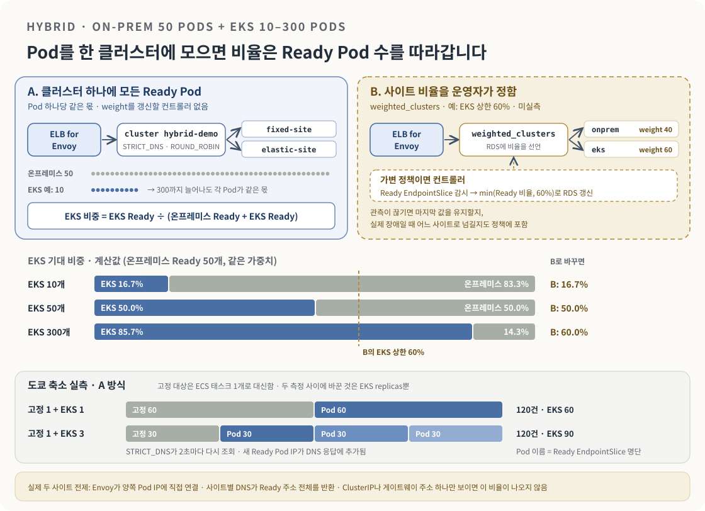
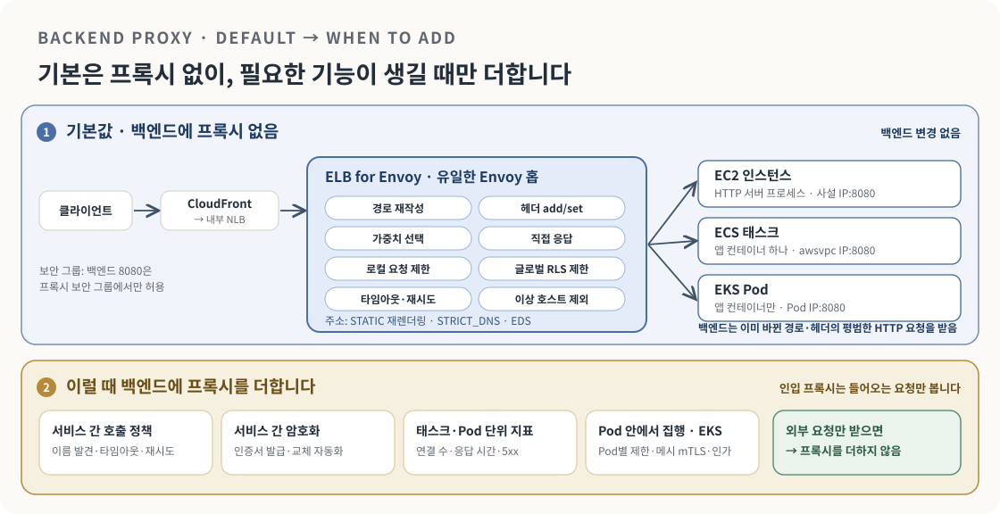
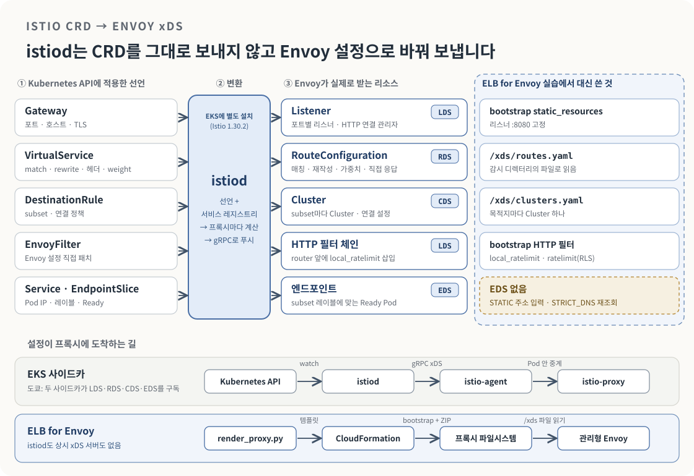
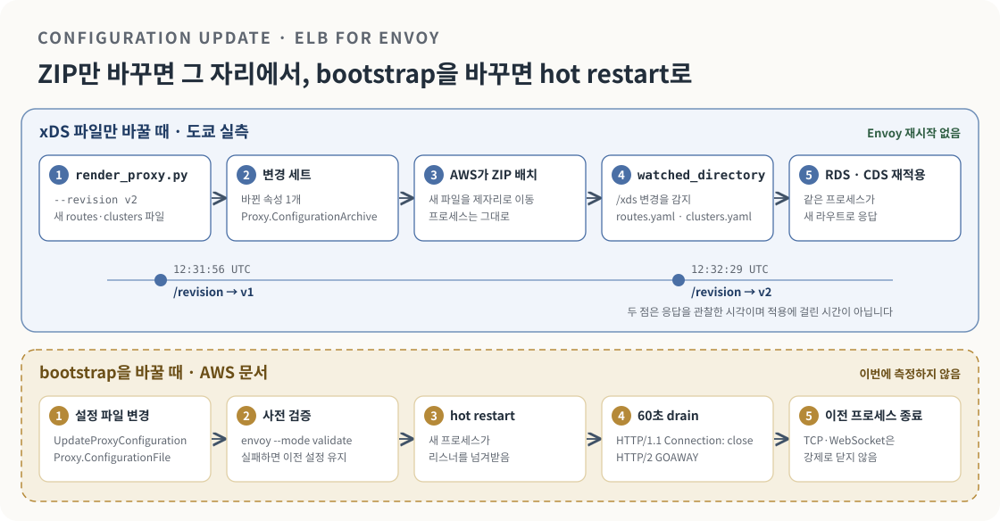
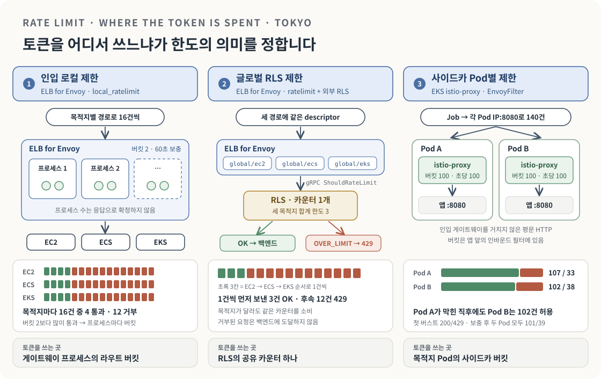

**ELB for Envoy**를 쓰면 AWS가 Envoy 프록시의 패치와 확장을 맡고, 사용자는 리스너와 라우팅 규칙을 정의합니다. Istio Ingress Gateway의 역할을 어디까지 맡길 수 있을까요? 관리형 Envoy에 설정을 직접 넣으면 경로 재작성, 가중치 라우팅, 요청 제한을 별도 xDS 서버 없이 쓸 수 있습니다. 글의 수치는 도쿄 리전에서 직접 측정한 값입니다. [AWS 출시 공지](https://aws.amazon.com/ko/about-aws/whats-new/2026/11/elastic-load-balancing-for-envoy-generally-available/)

**Istio YAML을 계속 쓸 수 있는 조건은 그 정책을 해석하는 컨트롤 플레인이 대상 프록시에 연결돼 있다는 것입니다.** ELB for Envoy는 `VirtualService`나 `DestinationRule`을 직접 읽지 않습니다. AWS의 EKS 통합을 선택하면 Envoy Gateway가 `Gateway`·`HTTPRoute`와 정책을 xDS로 변환합니다. 이 글에서는 주문 API의 리스너, 경로, subset을 이 모델로 옮깁니다. 예제의 인입 프록시는 파일 기반 xDS로 설정을 읽고, EKS Pod의 사이드카는 istiod에서 설정을 받습니다. [AWS의 Kubernetes 통합](https://docs.aws.amazon.com/elasticloadbalancing/latest/elbproxy/kubernetes.html)

<h2 id="migration">온프레미스 Pod 50개, EKS Pod 10~300개라면</h2>

**EKS에 준비된 용량과 지금 EKS에 맡길 트래픽은 별개의 결정입니다.** 같은 용량의 Ready Pod를 하나의 풀에 넣으면 EKS의 첫 10개가 받는 기대 비중은 10/60, 약 **16.7%**입니다. 그러나 클러스터 이전 첫날 새 환경에 **5%만** 보내고 싶다면 두 사이트를 별도 backend로 두고 가중치를 **95:5**로 설정합니다. Pod 10개를 그대로 두고도 두 결과가 나오는 이유입니다.

<h3 id="hybrid">Ready Pod 수에 비례해 나누기</h3>

**마이그레이션의 카나리 단계가 끝나고 Pod당 같은 몫을 주기로 했다면 환경별 `weight`를 갱신할 컨트롤러가 필요 없습니다.** 한 Route가 하나의 Envoy 업스트림 클러스터로 보내고, 그 클러스터에 두 환경의 Ready Pod가 같은 우선순위·가중치의 개별 엔드포인트로 들어가면 됩니다. `ROUND_ROBIN`에서 EKS의 기대 비중은 `EKS Ready Pod 수 / 전체 Ready Pod 수`입니다.

<figure class="diagram"><a href="/assets/elb-envoy-hybrid-packets.svg"></a><figcaption><b>Ready Pod당 같은 몫.</b> 패킷 하나가 요청 하나이고, 도착한 Pod에서 고리가 번집니다. EKS 10개 → 50개 → 300개를 24초 주기로 반복합니다. 비중은 계산값이고, 측정값은 바로 아래에 있습니다.</figcaption></figure>

**DNS 발견만으로 이 분배를 만들 수 있습니다.** 두 사이트의 Pod를 각각 headless Service 이름으로 노출하고, 관리형 Envoy의 `STRICT_DNS` 클러스터 하나에 두 이름을 넣습니다. 새 Pod가 Ready가 되면 Kubernetes가 EndpointSlice를 갱신하고 DNS가 그 IP를 반환하므로, Envoy가 이름을 다시 조회하는 순간(예제는 2초) 분배 대상에 들어갑니다. EKS의 replicas만 바꿔도 분배가 따라온다는 뜻입니다. [Envoy STRICT_DNS](https://www.envoyproxy.io/docs/envoy/latest/intro/arch_overview/upstream/service_discovery) · [Kubernetes headless Service](https://kubernetes.io/docs/concepts/services-networking/service/#headless-services)

핵심 설정은 아래와 같습니다. 라우트는 `cluster: hybrid-demo` 하나를 가리키고, 개별 사이트 가중치는 선언하지 않습니다. 클러스터 밖의 Envoy가 이 이름을 풀려면 EKS CoreDNS를 가리키는 리졸버도 지정해야 합니다.

```yaml
name: hybrid-demo
type: STRICT_DNS
lb_policy: ROUND_ROBIN
dns_lookup_family: V4_ONLY
dns_refresh_rate: 2s
connect_timeout: 2s
load_assignment:
  cluster_name: hybrid-demo
  endpoints:
    - lb_endpoints:
        - endpoint:
            address:
              socket_address: {address: fixed-site.order.svc.cluster.local, port_value: 8080}
        - endpoint:
            address:
              socket_address: {address: elastic-site.order.svc.cluster.local, port_value: 8080}
```

<figure class="diagram"><a href="/assets/elb-envoy-hybrid-distribution.svg"></a><figcaption>고정 사이트를 ECS 태스크 1개로 대신하고 EKS Pod를 1개에서 3개로 늘린 측정입니다. 위 애니메이션의 50개·300개도 같은 원리입니다.</figcaption></figure>

고정 1개 + EKS 1개일 때 120건이 60:60, EKS만 3개로 늘리자 30:30·30·30으로 나뉘었고, 응답한 Pod 이름은 Ready EndpointSlice 명단과 일치했습니다. 350개 Pod 규모라면 DNS 응답 크기와 두 사이트 사이 링크의 지연·대역폭을 따로 확인해야 합니다. [설정·EndpointSlice 명단·요청별 결과](/assets/data/elb-envoy-tokyo/hybrid-dns.json)

이 방식을 실제 두 사이트에 쓰려면 Envoy가 양쪽 Pod IP에 접속할 수 있고, 두 DNS 이름을 구분해서 해석하며 각 사이트의 전체 Ready 주소를 받아야 합니다. 일반 Service의 ClusterIP 한 개나 사이트별 게이트웨이 주소 한 개씩만 보이면 이 공식으로 분배되지 않습니다. 기존 멀티클러스터 컨트롤 플레인이 EDS로 개별 엔드포인트를 전달하는 환경에서도 같은 원리를 적용할 수 있습니다. Pod 처리 용량이 서로 다르거나 locality 우선·장애 조치 정책을 쓰면 요청 비중도 달라집니다.

반대로 **사이트별 트래픽 비율 자체를 운영자가 통제**하려면 두 업스트림을 유지하고 `weighted_clusters`를 사용합니다. 예를 들어 EKS 비용 때문에 트래픽을 최대 60%로 제한한다면 300개까지 확장해도 85.7%를 보내면 안 됩니다. 고정 비율이면 선언한 값만으로 충분합니다. 가변 정책이면 두 클러스터의 Ready EndpointSlice를 감시해 `min(Ready 비율, 60%)`를 계산하는 컨트롤러를 둘 수 있습니다. Gateway API를 쓰면 이 컨트롤러는 `HTTPRoute.backendRefs.weight`를 갱신하고 xDS 생성은 Envoy Gateway에 맡깁니다. 직접 구성한 `weighted_clusters`에서는 RDS 가중치를 갱신합니다. 관측이 끊겼을 때 마지막 유효 값을 유지할지, 실제 장애일 때 어느 사이트로 넘길지도 그 정책의 일부입니다.

<h3 id="blue-green">Blue에서 천천히 빼고 Green으로 천천히 올리는 방법</h3>

<figure class="diagram"><a href="/assets/elb-envoy-bluegreen-packets.svg"></a><figcaption><b>Blue/Green 이전은 weight가 몫을 정합니다.</b> Green Pod 수는 10개로 두고 다섯 단계를 30초 주기로 반복합니다. 패킷 수는 비율을 보여 주기 위한 예시이며, 다섯 비율의 xDS 번역은 <a href="/assets/data/elb-envoy-tokyo/order-gateway-xds.json">Envoy Gateway 1.10 오프라인 번역 결과</a>로 확인했습니다.</figcaption></figure>

1. **두 클러스터를 동시에 연결합니다.** 이전 중에도 계속 살아 있을 인입 Gateway에서 Blue(기존)와 Green(신규)을 서로 다른 backend로 식별합니다. `HTTPRoute.backendRefs`에서 `api-blue`와 `api-green`을 참조하려면 라우트를 관리하는 클러스터에서 두 이름이 실제 대상으로 해석되고, 프록시에서 양쪽으로 연결돼야 합니다. 같은 이름의 Service를 두 클러스터에 만드는 것만으로 원격 엔드포인트가 발견되지는 않습니다. `ReferenceGrant`는 네임스페이스 간 참조를 승인할 때 쓰며 클러스터 간 발견을 제공하지 않습니다.
2. **100:0에서 시작해 Green을 5%로 엽니다.** 0%인 동안에도 별도 시험 호스트나 헤더 매칭 라우트로 Green의 인증, 데이터 읽기·쓰기와 응답을 확인할 수 있습니다. mTLS를 쓴다면 Green 서버의 CA·SAN과 Gateway의 클라이언트 인증서를 이 단계에서 대조합니다. [95:5 mTLS 검증 결과](#mtls)
3. **동일한 요청을 비교하며 75:25, 50:50, 0:100으로 진행합니다.** 각 단계에서 라우트의 `Accepted`·`ResolvedRefs`와 실제 Blue/Green 응답 수를 확인합니다. Green의 오류율, p95 지연, 포화도와 429 비율을 Blue와 비교해 다음 단계로 갈지 결정합니다. 가중치는 개별 요청의 선택 비율이라 짧은 표본에서 정확히 5%가 나올 필요는 없습니다.
4. **0% 뒤에 Blue를 드레인합니다.** 새 요청이 Green으로 가도 이미 열린 WebSocket이나 장기 gRPC 스트림, 처리 중인 주문은 Blue에 남을 수 있습니다. 활성 연결과 미완료 요청을 확인한 뒤 Blue를 줄입니다. 예를 들어 50:50에서 Green의 오류율이 올라가면 승격을 멈추고 75:25, 95:5로 되돌릴 수 있습니다. 이를 위해 Blue의 용량과 데이터 호환성을 유지합니다. EKS가 300개까지 확장된 시점에 온프레미스 50개가 현재 부하를 전부 감당할 수 있는지는 별도 판단입니다.

첫 카나리 승격 때 변경하는 `HTTPRoute` 규칙은 두 backend의 가중치뿐입니다.

```yaml
backendRefs:
  - {name: api-blue, port: 8080, weight: 95}
  - {name: api-green, port: 8080, weight: 5}
```

위의 백분율은 이전 계획의 예시이며, 다섯 비율 모두 Envoy Gateway 1.10이 xDS 가중치로 그대로 번역합니다. 가중치가 실제 요청 분배로 이어지는 모습은 [세 백엔드 측정](#backends)에 있습니다. [가중치 번역 결과](/assets/data/elb-envoy-tokyo/order-gateway-xds.json)

## 요청 경로와 설정 경로

**기본 구성에서 Envoy는 ELB for Envoy 하나입니다.** 요청은 ELB for Envoy에서 EC2 앱, ECS 태스크의 앱 컨테이너, EKS Pod의 앱 컨테이너로 바로 가고, 설정은 CloudFormation이 bootstrap과 xDS ZIP으로 전달합니다. EKS 제어 플레인(Kubernetes API)은 Pod를 띄울 뿐 요청 경로에 들어오지 않습니다. 아래 그림에서 회색 칸은 **필요할 때만 켜는 옵션**입니다. EKS Pod에 Istio 사이드카를 쓰기로 하면 같은 Pod에 `istio-proxy`가 추가되고, 플랫폼 팀이 설치한 `istiod`가 그 사이드카에 설정을 보냅니다. 글로벌 요청 제한을 쓰면 ELB for Envoy가 외부 RLS에 판정을 묻습니다.

<figure class="diagram"><svg class="rcp" xmlns="http://www.w3.org/2000/svg" viewBox="0 0 1120 650" role="img" aria-labelledby="rcp-title rcp-desc" style="display:block;width:100%;height:auto;margin:24px auto;background:#fff;border:1px solid var(--border);border-radius:7px;padding:16px;box-sizing:border-box;filter:var(--art-dim)"><title id="rcp-title">요청 경로와 설정 경로 · 옵션은 필요할 때만</title><desc id="rcp-desc">요청 경로와 설정 경로. 기본 구성에서는 요청이 클라이언트에서 CloudFront와 내부 NLB를 지나 ELB for Envoy로 가고, ELB for Envoy가 EC2 앱, ECS 태스크의 앱 컨테이너, EKS Pod의 앱 컨테이너로 바로 보낸다. 설정은 CloudFormation이 bootstrap과 xDS ZIP으로 ELB for Envoy에 전달한다. 회색으로 표시한 두 옵션은 필요할 때만 켠다. Istio 사이드카를 켜면 EKS Pod에 istio-proxy가 추가되어 요청이 istio-proxy를 거쳐 앱으로 가고, 플랫폼 팀이 설치한 istiod가 Kubernetes API의 Istio 리소스를 읽어 istio-proxy에 xDS로 설정을 보낸다. 얻는 것은 Pod별 인바운드 제한과 메시 mTLS, 대가는 istiod 운영과 둘로 나뉘는 설정 소유자다. 외부 RLS를 켜면 ELB for Envoy가 요청마다 RLS에 판정을 물어 서비스 전체가 한 한도를 공유한다.</desc><defs><marker id="rcp-req" markerWidth="10" markerHeight="10" refX="7" refY="4" orient="auto"><path d="M0 0 8 4 0 8" fill="none" stroke="#4f8a68" stroke-width="1.6"/></marker><marker id="rcp-cfg" markerWidth="10" markerHeight="10" refX="7" refY="4" orient="auto"><path d="M0 0 8 4 0 8" fill="none" stroke="#7b5ea7" stroke-width="1.6"/></marker><marker id="rcp-off" markerWidth="10" markerHeight="10" refX="7" refY="4" orient="auto"><path d="M0 0 8 4 0 8" fill="none" stroke="#c3c7cc" stroke-width="1.6"/></marker><marker id="rcp-gray" markerWidth="10" markerHeight="10" refX="7" refY="4" orient="auto"><path d="M0 0 8 4 0 8" fill="none" stroke="#5f6670" stroke-width="1.6"/></marker></defs><style>.rcp .on{opacity:0;transition:opacity .25s} .rcp .off{transition:opacity .25s} .rcp .opt{cursor:pointer;outline:none} .rcp:has(.t-sc:hover,.t-sc:focus,.o-sc:hover,.o-sc:focus) .o-sc .on, .rcp:has(.t-rls:hover,.t-rls:focus,.o-rls:hover,.o-rls:focus) .o-rls .on{opacity:1} .rcp:has(.t-sc:hover,.t-sc:focus,.o-sc:hover,.o-sc:focus) .o-sc .off, .rcp:has(.t-rls:hover,.t-rls:focus,.o-rls:hover,.o-rls:focus) .o-rls .off{opacity:0} .rcp:has(.t-sc:hover,.t-sc:focus,.o-sc:hover,.o-sc:focus) .direct-eks{opacity:.15} .rcp:has(.t-sc:hover,.t-sc:focus,.o-sc:hover,.o-sc:focus) .t-sc .on, .rcp:has(.t-rls:hover,.t-rls:focus,.o-rls:hover,.o-rls:focus) .t-rls .on{opacity:1} .rcp:has(.opt:hover,.opt:focus) .hint{opacity:0} .rcp .direct-eks,.rcp .hint{transition:opacity .25s}</style><rect width="1120" height="650" rx="20" fill="#fbfaf7"/><g font-family="Noto Sans CJK KR, Pretendard, sans-serif"><text x="42" y="49" fill="#5f6670" font-size="18" font-weight="600" letter-spacing="2">REQUEST PATH · CONFIG PATH · OPTIONS ARE GRAY</text><text x="42" y="93" fill="#222e3b" font-size="27" font-weight="700">기본은 Envoy 하나 · 회색 칸은 고를 때만 켜집니다</text><path d="M790 128 L826 128" stroke="#4f8a68" stroke-width="3"/><text x="834" y="133" fill="#5f6670" font-size="13">HTTP 요청</text><path d="M920 128 L956 128" stroke="#7b5ea7" stroke-width="2.4" stroke-dasharray="6 4"/><text x="964" y="133" fill="#5f6670" font-size="13">설정 전달</text><text x="44" y="133" fill="#222e3b" font-size="14" font-weight="700">옵션 켜 보기</text><g class="opt t-sc" tabindex="0" role="button" aria-label="① Istio 사이드카 · EKS만 켜 보기"><g class="off"><rect x="150" y="112" width="214" height="32" rx="16" fill="#ffffff" stroke="#c3c7cc" stroke-width="1.5"/><text x="257.0" y="133" fill="#9aa0a6" font-size="13" font-weight="700" text-anchor="middle">① Istio 사이드카 · EKS만</text></g><g class="on"><rect x="150" y="112" width="214" height="32" rx="16" fill="#f6f0e1" stroke="#b58938" stroke-width="1.8"/><text x="257.0" y="133" fill="#6b4f17" font-size="13" font-weight="700" text-anchor="middle">① Istio 사이드카 · EKS만</text></g></g><g class="opt t-rls" tabindex="0" role="button" aria-label="② 외부 RLS 켜 보기"><g class="off"><rect x="376" y="112" width="150" height="32" rx="16" fill="#ffffff" stroke="#c3c7cc" stroke-width="1.5"/><text x="451.0" y="133" fill="#9aa0a6" font-size="13" font-weight="700" text-anchor="middle">② 외부 RLS</text></g><g class="on"><rect x="376" y="112" width="150" height="32" rx="16" fill="#f6f0e1" stroke="#b58938" stroke-width="1.8"/><text x="451.0" y="133" fill="#6b4f17" font-size="13" font-weight="700" text-anchor="middle">② 외부 RLS</text></g></g><rect x="44" y="336" width="96" height="48" rx="10" fill="#ffffff" stroke="#d6d6cf" stroke-width="1.5"/><text x="92.0" y="365.0" fill="#222e3b" font-size="14" font-weight="700" text-anchor="middle">클라이언트</text><path d="M142 360 L166 360" stroke="#4f8a68" stroke-width="2.2" fill="none" marker-end="url(#rcp-req)"/><rect x="170" y="336" width="132" height="48" rx="10" fill="#ffffff" stroke="#d6d6cf" stroke-width="1.5"/><text x="236.0" y="357.0" fill="#222e3b" font-size="14" font-weight="700" text-anchor="middle">CloudFront</text><text x="236.0" y="375.0" fill="#5f6670" font-size="11" text-anchor="middle">→ 내부 NLB</text><path d="M304 360 L330 360" stroke="#4f8a68" stroke-width="2.2" fill="none" marker-end="url(#rcp-req)"/><rect x="334" y="316" width="190" height="88" rx="10" fill="#e3ecf8" stroke="#4a6fa5" stroke-width="1.5"/><text x="429.0" y="357.0" fill="#1f3b63" font-size="14" font-weight="700" text-anchor="middle">ELB for Envoy</text><text x="429.0" y="375.0" fill="#5f6670" font-size="11" text-anchor="middle">라우트·헤더·가중치·제한</text><rect x="334" y="486" width="190" height="54" rx="10" fill="#f3eef9" stroke="#7b5ea7" stroke-width="1.5"/><text x="429.0" y="510.0" fill="#222e3b" font-size="14" font-weight="700" text-anchor="middle">CloudFormation</text><text x="429.0" y="528.0" fill="#5f6670" font-size="11" text-anchor="middle">bootstrap + xDS ZIP</text><path d="M429 484 L429 408" stroke="#7b5ea7" stroke-width="2" fill="none" marker-end="url(#rcp-cfg)" stroke-dasharray="6 4"/><rect x="620" y="176" width="230" height="52" rx="10" fill="#ffffff" stroke="#4a6fa5" stroke-width="1.5"/><text x="735.0" y="199.0" fill="#222e3b" font-size="14" font-weight="700" text-anchor="middle">EC2 인스턴스</text><text x="735.0" y="217.0" fill="#5f6670" font-size="11" text-anchor="middle">앱 프로세스</text><rect x="620" y="246" width="230" height="52" rx="10" fill="#ffffff" stroke="#4a6fa5" stroke-width="1.5"/><text x="735.0" y="269.0" fill="#222e3b" font-size="14" font-weight="700" text-anchor="middle">ECS 태스크</text><text x="735.0" y="287.0" fill="#5f6670" font-size="11" text-anchor="middle">앱 컨테이너 하나</text><path d="M526 330 C580 330 580 202 616 202" stroke="#4f8a68" stroke-width="2.2" fill="none" marker-end="url(#rcp-req)"/><path d="M526 340 C590 340 590 272 616 272" stroke="#4f8a68" stroke-width="2.2" fill="none" marker-end="url(#rcp-req)"/><rect x="620" y="318" width="300" height="132" rx="14" fill="#ffffff" stroke="#4a6fa5" stroke-width="1.6"/><text x="636" y="340" fill="#222e3b" font-size="15" font-weight="700">EKS Pod</text><text x="904" y="340" fill="#5f6670" font-size="11" text-anchor="end">VPC CNI가 준 Pod IP</text><rect x="780" y="362" width="126" height="56" rx="10" fill="#ffffff" stroke="#4a6fa5" stroke-width="1.5"/><text x="843.0" y="387.0" fill="#222e3b" font-size="14" font-weight="700" text-anchor="middle">앱 컨테이너</text><text x="843.0" y="405.0" fill="#5f6670" font-size="11" text-anchor="middle">주문 API</text><g class="direct-eks"><path d="M526 360 C600 360 640 352 760 352 L838 352 L838 358" stroke="#4f8a68" stroke-width="2.2" fill="none" marker-end="url(#rcp-req)"/></g><g class="opt o-sc" tabindex="0" role="button" aria-label="Istio 사이드카 옵션 켜 보기"><g class="off"><rect x="636" y="362" width="128" height="56" rx="10" fill="#f1f2f3" stroke="#c3c7cc" stroke-width="1.5" stroke-dasharray="5 4"/><text x="700.0" y="387.0" fill="#9aa0a6" font-size="14" font-weight="700" text-anchor="middle">istio-proxy</text><text x="700.0" y="405.0" fill="#9aa0a6" font-size="11" text-anchor="middle">사이드카</text><path d="M526 372 C580 372 590 390 632 390" stroke="#c3c7cc" stroke-width="2.2" fill="none" marker-end="url(#rcp-off)" stroke-dasharray="5 4"/><path d="M766 390 L776 390" stroke="#c3c7cc" stroke-width="2.2" fill="none" marker-end="url(#rcp-off)" stroke-dasharray="5 4"/><rect x="950" y="330" width="146" height="56" rx="10" fill="#f1f2f3" stroke="#c3c7cc" stroke-width="1.5" stroke-dasharray="5 4"/><text x="1023.0" y="355.0" fill="#9aa0a6" font-size="14" font-weight="700" text-anchor="middle">Istio 리소스</text><text x="1023.0" y="373.0" fill="#9aa0a6" font-size="11" text-anchor="middle">VirtualService 등</text><rect x="950" y="430" width="146" height="56" rx="10" fill="#f1f2f3" stroke="#c3c7cc" stroke-width="1.5" stroke-dasharray="5 4"/><text x="1023.0" y="455.0" fill="#9aa0a6" font-size="14" font-weight="700" text-anchor="middle">istiod</text><text x="1023.0" y="473.0" fill="#9aa0a6" font-size="11" text-anchor="middle">istio-system · 플랫폼 팀</text><path d="M1023 388 L1023 426" stroke="#c3c7cc" stroke-width="2" fill="none" marker-end="url(#rcp-off)" stroke-dasharray="6 4"/><path d="M948 458 C880 458 760 470 700 422" stroke="#c3c7cc" stroke-width="2" fill="none" marker-end="url(#rcp-off)" stroke-dasharray="6 4"/><text x="860" y="486" fill="#9aa0a6" font-size="12" font-weight="700" text-anchor="middle">xDS</text><text x="700" y="438" fill="#9aa0a6" font-size="11" font-weight="700" text-anchor="middle">옵션</text><text x="1023" y="512" fill="#9aa0a6" font-size="11" font-weight="700" text-anchor="middle">옵션</text></g><g class="on"><rect x="636" y="362" width="128" height="56" rx="10" fill="#eaf3ec" stroke="#4f8a68" stroke-width="1.5"/><text x="700.0" y="387.0" fill="#2f5e43" font-size="14" font-weight="700" text-anchor="middle">istio-proxy</text><text x="700.0" y="405.0" fill="#5f6670" font-size="11" text-anchor="middle">사이드카</text><path d="M526 372 C580 372 590 390 632 390" stroke="#4f8a68" stroke-width="2.2" fill="none" marker-end="url(#rcp-req)"/><path d="M766 390 L776 390" stroke="#4f8a68" stroke-width="2.2" fill="none" marker-end="url(#rcp-req)"/><rect x="950" y="330" width="146" height="56" rx="10" fill="#ffffff" stroke="#d6d6cf" stroke-width="1.5"/><text x="1023.0" y="355.0" fill="#222e3b" font-size="14" font-weight="700" text-anchor="middle">Istio 리소스</text><text x="1023.0" y="373.0" fill="#5f6670" font-size="11" text-anchor="middle">VirtualService 등</text><rect x="950" y="430" width="146" height="56" rx="10" fill="#f3eef9" stroke="#7b5ea7" stroke-width="1.5"/><text x="1023.0" y="455.0" fill="#7b5ea7" font-size="14" font-weight="700" text-anchor="middle">istiod</text><text x="1023.0" y="473.0" fill="#5f6670" font-size="11" text-anchor="middle">istio-system · 플랫폼 팀</text><path d="M1023 388 L1023 426" stroke="#7b5ea7" stroke-width="2" fill="none" marker-end="url(#rcp-cfg)" stroke-dasharray="6 4"/><path d="M948 458 C880 458 760 470 700 422" stroke="#7b5ea7" stroke-width="2" fill="none" marker-end="url(#rcp-cfg)" stroke-dasharray="6 4"/><text x="860" y="486" fill="#7b5ea7" font-size="12" font-weight="700" text-anchor="middle">xDS</text></g></g><g class="opt o-rls" tabindex="0" role="button" aria-label="외부 RLS 옵션 켜 보기"><g class="off"><rect x="334" y="176" width="190" height="56" rx="10" fill="#f1f2f3" stroke="#c3c7cc" stroke-width="1.5" stroke-dasharray="5 4"/><text x="429.0" y="201.0" fill="#9aa0a6" font-size="14" font-weight="700" text-anchor="middle">외부 RLS</text><text x="429.0" y="219.0" fill="#9aa0a6" font-size="11" text-anchor="middle">서비스 전체 공유 한도</text><path d="M429 314 L429 236" stroke="#c3c7cc" stroke-width="1.8" fill="none" marker-end="url(#rcp-off)" stroke-dasharray="4 4"/><text x="440" y="278" fill="#9aa0a6" font-size="11">ShouldRateLimit</text><text x="512" y="196" fill="#9aa0a6" font-size="11" font-weight="700" text-anchor="end">옵션</text></g><g class="on"><rect x="334" y="176" width="190" height="56" rx="10" fill="#ffffff" stroke="#b58938" stroke-width="1.5"/><text x="429.0" y="201.0" fill="#222e3b" font-size="14" font-weight="700" text-anchor="middle">외부 RLS</text><text x="429.0" y="219.0" fill="#5f6670" font-size="11" text-anchor="middle">서비스 전체 공유 한도</text><path d="M429 314 L429 236" stroke="#5f6670" stroke-width="1.8" fill="none" marker-end="url(#rcp-gray)" stroke-dasharray="4 4"/><text x="440" y="278" fill="#5f6670" font-size="11">ShouldRateLimit</text></g></g><text x="44" y="470" fill="#1f3b63" font-size="14" font-weight="700">기본 구성</text><text x="44" y="492" fill="#222e3b" font-size="12">요청: ELB for Envoy → 앱</text><text x="44" y="512" fill="#222e3b" font-size="12">설정: CloudFormation 하나</text><text x="44" y="532" fill="#5f6670" font-size="12">Istio 설치 · 백엔드 변경 없음</text><rect x="24" y="562" width="1072" height="72" rx="12" fill="#ffffff" stroke="#d6d6cf" stroke-width="1.2"/><g class="hint"><text x="560" y="604" fill="#5f6670" font-size="13" text-anchor="middle">회색 칸이나 위의 옵션에 마우스를 올리거나 탭하면 켜지고, 얻는 것과 대가가 여기에 나타납니다</text></g><g class="o-sc"><g class="on"><text x="44" y="590" fill="#2f5e43" font-size="14" font-weight="700">① 사이드카를 켜면: Pod별 인바운드 제한 · 메시 mTLS·AuthorizationPolicy · 호출 구간 라우팅</text><text x="44" y="614" fill="#6b4f17" font-size="13">대가: istiod 설치·업그레이드 · 주입은 새 Pod부터 · 설정 소유자가 둘(CloudFormation + Istio 리소스)</text></g></g><g class="o-rls"><g class="on"><text x="44" y="590" fill="#2f5e43" font-size="14" font-weight="700">② 외부 RLS를 켜면: 여러 프록시와 목적지가 한 한도를 공유</text><text x="44" y="614" fill="#6b4f17" font-size="13">대가: 요청마다 gRPC 판정 · RLS 가용성과 장애 시 통과/거부 정책 · 여러 대면 Redis 같은 공유 카운터</text></g></g></g></svg><figcaption>회색 칸이나 위쪽 옵션에 마우스를 올리면(모바일에서는 탭하면) 옵션이 켜지고, 아래 칸에 얻는 것과 대가가 나타납니다. <a href="/assets/elb-envoy-request-config-paths.svg">그림만 따로 보기</a></figcaption></figure>

| 궁금한 점 | 이 글 예제에서의 답 |
| --- | --- |
| 인입 Envoy의 원본 설정은 어디에 있나? | `render_proxy.py`가 만드는 CloudFormation 템플릿입니다. `Proxy.ConfigurationFile`에는 bootstrap, `Proxy.ConfigurationArchive`에는 라우트와 업스트림을 담은 ZIP을 넣습니다. |
| xDS 파일은 어디서 읽나? | AWS가 ZIP을 프록시 파일시스템에 펼칩니다. bootstrap의 HTTP 리스너가 `/xds/routes.yaml`(RDS)을, 클러스터 설정이 `/xds/clusters.yaml`(CDS)을 참조합니다. 이 인입 프록시에는 상시 xDS 서버가 없습니다. |
| EKS에 사이드카를 쓰면 누가 넣나? | 쓰기로 한 경우에만 넣습니다. 네임스페이스에 주입 레이블이 있으면 Deployment의 ReplicaSet이 새 Pod를 요청할 때 API 서버가 Istio 주입 웹훅을 호출합니다. 웹훅이 Pod 명세에 `istio-proxy`를 추가하고 kubelet이 실행합니다. 예제 Pod에서 `echo`는 앱 컨테이너, `istio-proxy`는 `restartPolicy: Always`인 네이티브 사이드카였습니다. 정책 변경은 별도 `istio-system/istiod` Deployment의 Pod에서 xDS로 받습니다. |
| EC2와 ECS에도 Envoy가 생기나? | 아닙니다. 예제의 EC2에서는 HTTP 서버가, ECS 태스크에서는 echo 컨테이너가 요청을 받습니다. 둘 다 관리형 Envoy의 원격 업스트림이며 백엔드에 Envoy를 설치하지 않습니다. ECS 서비스에서 Service Connect를 켜면 그때 ECS가 새 태스크에 관리형 프록시 컨테이너를 추가합니다. 언제 필요한지는 [바로 아래](#backend-proxy)에 정리했습니다. 예제의 RLS는 별도 ECS 태스크입니다. |

[관리형 프록시의 설정 생성 코드](/assets/data/elb-envoy-tokyo/render_proxy.py) · [Istio 주입 절차](https://docs.atomai.click/kubernetes-docs/ko/service-mesh/istio/advanced/07-sidecar-injection)

<h2 id="backend-proxy">EC2·ECS·EKS 백엔드에 프록시가 필요할까</h2>

**기본값은 백엔드에 프록시를 두지 않는 구성입니다. EKS도 마찬가지입니다.** EC2의 HTTP 서버 프로세스, ECS Fargate 태스크의 앱 컨테이너, 사이드카가 없는 EKS Pod 모두 별도 프록시 없이 관리형 Envoy의 요청을 받습니다. 아래에서는 기본 구성의 동작, 프록시를 더하는 기준, 더했을 때 얻는 기능과 제약을 차례로 봅니다. EC2·ECS에 Istio를 직접 설치하는 구성은 이 글에서 다루지 않습니다.

<figure class="diagram"><a href="/assets/elb-envoy-backend-proxy-flow.svg"></a><figcaption>① 기본 구성과 ② 프록시를 더하는 기준입니다. 더했을 때 얻는 기능은 아래 비교 그림에 있습니다.</figcaption></figure>

### 기본값: Envoy는 ELB for Envoy 하나입니다

요청은 `CloudFront → 내부 NLB → ELB for Envoy`를 지나 **EC2의 사설 IP, ECS 태스크의 `awsvpc` IP, EKS Pod IP의 8080으로 곧바로** 갑니다. 경로 매칭과 재작성, 헤더 추가·덮어쓰기, 가중치 선택, 직접 응답, 로컬·글로벌 요청 제한은 이 한 번의 Envoy 홉에서 모두 끝납니다. 백엔드는 이미 바뀐 경로와 헤더를 가진 평범한 HTTP 요청을 받으므로 앱이나 태스크 정의, Pod 명세를 바꿀 필요가 없습니다. 백엔드 보안 그룹은 8080을 ELB for Envoy의 보안 그룹에서 오는 연결에만 열면 됩니다.

EKS에서는 VPC CNI가 Pod에 VPC IP를 주므로 ELB for Envoy가 EC2·ECS와 같은 방식으로 Pod에 연결합니다. 네임스페이스에 Istio 주입 레이블이 없으면 웹훅이 사이드카를 넣지 않고, Pod에는 앱 컨테이너만 뜹니다. 뒤에 나오는 Pod별 100 TPS처럼 사이드카가 필요한 경우에만 레이블을 켭니다.

ELB for Envoy가 백엔드 주소를 아는 방법은 세 가지입니다. `STATIC` 클러스터에 주소를 적고 바뀔 때 설정을 다시 렌더링하거나, `STRICT_DNS`로 이름을 주기적으로 다시 조회하거나(위 [하이브리드 예제](#hybrid)), 컨트롤 플레인이 EDS로 목록을 보냅니다. Pod IP는 배포마다 바뀌므로 EKS에서는 headless Service와 `STRICT_DNS`, 또는 EDS가 현실적입니다. 타임아웃·재시도와 이상 호스트 제외도 백엔드가 아니라 ELB for Envoy의 Route·Cluster 설정에 둡니다. [예제 EC2 워크로드와 보안 그룹](/assets/data/elb-envoy-tokyo/workloads.yaml) · [예제 ECS 태스크 정의](/assets/data/elb-envoy-tokyo/ecs.yaml)

### 이럴 때 백엔드에 프록시를 더합니다

인입 프록시는 **밖에서 들어오는 요청만** 봅니다. 아래 기능이 필요해지면 백엔드 쪽에 프록시를 둘 이유가 생깁니다.

- 백엔드가 **다른 서비스를 호출하는 구간**에도 이름 기반 발견, 타임아웃, 재시도를 일관되게 걸고 싶을 때
- 서비스 간 트래픽을 **암호화**하고 인증서 발급·교체를 자동화하고 싶을 때
- 서비스 간 호출의 연결 수, 응답 시간, 5xx 같은 **태스크·Pod 단위 지표**가 필요할 때
- EKS에서 Pod별 인바운드 제한, 메시 mTLS·`AuthorizationPolicy`처럼 **Pod 안에서 집행해야 하는 정책**을 쓸 때

외부 요청을 받기만 하고 경로·헤더·가중치·제한이 인입에서 끝난다면 프록시를 더하지 않아도 됩니다. 백엔드 구간 mTLS도 앱이 클라이언트 인증서를 요구하도록 구성하면 사이드카 없이 할 수 있습니다. [구간별 mTLS](#mtls)

### 프록시 유무에 따른 제약 비교

<figure class="diagram"><a href="/assets/elb-envoy-backend-constraints.svg"></a><figcaption>왼쪽 열이 기본값입니다. Service Connect 항목은 AWS 문서 기준입니다.</figcaption></figure>

**EKS는 Istio 사이드카를 주입 웹훅이 넣습니다.** 사이드카를 두면 Pod별 100 TPS처럼 Pod 안에서 집행하는 정책과 메시 mTLS·인가를 쓸 수 있습니다. 대신 istiod를 운영하고, 주입은 새로 만든 Pod부터 적용됩니다. 목적지 사이드카가 `STRICT` mTLS를 요구하면 인입 프록시도 메시가 신뢰하는 클라이언트 인증서를 갖춰야 합니다. 사이드카 없이 메시 기능을 쓰는 Istio ambient 모드도 있습니다. 노드마다 ztunnel DaemonSet을 두는 방식이므로 Fargate처럼 DaemonSet을 쓸 수 없는 노드 구성에서는 따로 검토해야 합니다.

**ECS는 Service Connect가 AWS 관리형 선택지입니다.** 서비스에 Service Connect를 켜면 ECS가 새 태스크마다 프록시 컨테이너를 추가합니다. 이 컨테이너는 태스크 정의에 나타나지 않고 사용자가 직접 설정할 수 없습니다. 앱이 같은 Cloud Map 네임스페이스의 엔드포인트 이름으로 연결할 때만 프록시를 거치며, 같은 VPC의 IP·AWS 서비스 엔드포인트·외부로 가는 트래픽은 거치지 않습니다. ELB for Envoy가 받는 인입 요청의 경로·헤더·제한은 계속 ELB for Envoy 설정이 정합니다.

| Service Connect로 얻는 것 | 내용 |
| --- | --- |
| 서비스 발견·분산 | Cloud Map 네임스페이스의 논리 이름으로 호출, 엔드포인트의 태스크 사이 round-robin |
| 타임아웃 | 서비스 설정의 `idleTimeout`, `perRequestTimeout` |
| 암호화 | AWS Private CA로 인증서를 자동 발급하고 Secrets Manager로 교체. 기본 수명 7일, 5일마다 교체 |
| 관측 | `ActiveConnectionCount`, `NewConnectionCount`, `TargetResponseTime`, `ClientTLSNegotiationErrorCount`, `HTTPCode_Target_5XX_Count`를 CloudWatch로 |
| 비용·제약 | 태스크에 CPU 256 unit·메모리 64MiB 이상 추가 권장. 서비스가 만든 태스크만, 서비스당 네임스페이스 하나. Fargate는 플랫폼 1.4.0 이상 |

**EC2에 직접 띄운 프로세스에는 Service Connect가 붙지 않습니다.** 프록시 없이 두는 것이 기본이며, 서비스 간 TLS가 필요하면 앱이 TLS를 종료하고 ELB for Envoy가 upstream TLS로 연결합니다. 호출 구간의 재시도·타임아웃은 앱 라이브러리에서 처리합니다. 같은 EC2 용량에서 Service Connect 기능을 쓰려면 앱을 ECS 서비스(EC2 launch type, ECS 최적화 AMI, `awsvpc` 또는 `bridge` 네트워크 모드)로 옮깁니다.

[Service Connect 구성 요소와 프록시 동작](https://docs.aws.amazon.com/AmazonECS/latest/developerguide/service-connect-concepts-deploy.html) · [Service Connect TLS](https://aws.amazon.com/blogs/containers/secure-amazon-elastic-container-service-workloads-with-amazon-ecs-service-connect/) · [Service Connect 타임아웃 설정](https://docs.aws.amazon.com/AWSCloudFormation/latest/TemplateReference/aws-properties-ecs-service-timeoutconfiguration.html) · [ECS 서비스 연결 방식과 네트워크 모드](https://docs.aws.amazon.com/AmazonECS/latest/developerguide/interconnecting-services.html)

<h2 id="gateway-api">주문 API를 Istio에서 Gateway API로 옮기면</h2>

Istio의 `Gateway`는 외부에서 받을 포트와 호스트를, `VirtualService`는 주문 요청의 경로를 정했습니다. 전환 후에는 **플랫폼 팀의 `Gateway`가 리스너를 열고 앱 팀의 `HTTPRoute`가 그 리스너에 붙습니다.** `DestinationRule`의 `stable`·`canary` subset은 `order` 네임스페이스의 Service 두 개로 풀어냅니다. `api-stable`은 `app: api, version: v1`을, `api-canary`는 `app: api, version: v2`를 선택합니다. 두 Service의 포트와 targetPort는 모두 8080입니다. [기존 Istio subset 사례](https://docs.atomai.click/kubernetes-docs/ko/service-mesh/istio/traffic-management/03-destination-rule) · [Gateway API HTTPRoute](https://gateway-api.sigs.k8s.io/reference/api-types/httproute/)

AWS remote provider v1.0.0 호환표는 Envoy Gateway 1.10, Gateway API 1.6.1, Envoy 1.40을 명시합니다. 아래 예제는 AWS 가이드대로 Remote 모드로 구성한 Envoy Gateway와 `elb-proxy-aws` GatewayClass, `order` 네임스페이스를 전제로 합니다. **내부 ELB를 만들려면** 같은 네임스페이스의 `ELBProxyConfiguration`이 `targetRefs`로 이 Gateway를 가리키고 프록시 IAM 역할과 `ipv4Addressability: internal`을 지정해야 합니다. AWS 측 설정과 Service까지 포함한 파일에서 예시 역할 ARN을 교체할 수 있습니다. [주문 API 전체 YAML](/assets/data/elb-envoy-tokyo/order-gateway-api.yaml) · [AWS 설치·연결 단계](https://docs.aws.amazon.com/elasticloadbalancing/latest/elbproxy/kubernetes-get-started.html) · [릴리스 호환표](https://github.com/aws/elb-envoy-remote-infra-provider/blob/v1.0.0/docs/compatibility.md)

```yaml
apiVersion: gateway.networking.k8s.io/v1
kind: Gateway
metadata: {name: orders-ingress, namespace: order}
spec:
  gatewayClassName: elb-proxy-aws
  listeners:
    - name: http
      protocol: HTTP
      port: 80
      hostname: orders.example.com
      allowedRoutes: {namespaces: {from: Same}}
---
apiVersion: gateway.networking.k8s.io/v1
kind: HTTPRoute
metadata: {name: orders, namespace: order}
spec:
  parentRefs: [{name: orders-ingress, sectionName: http}]
  hostnames: [orders.example.com]
  rules:
    - matches: [{path: {type: PathPrefix, value: /orders}}]
      filters:
        - type: RequestHeaderModifier
          requestHeaderModifier:
            add: [{name: x-order-hop, value: ingress}]
            set: [{name: x-order-source, value: public-api}]
        - type: URLRewrite
          urlRewrite: {path: {type: ReplacePrefixMatch, replacePrefixMatch: /}}
      timeouts: {request: 3s}
      backendRefs:
        - {name: api-stable, port: 8080, weight: 90}
        - {name: api-canary, port: 8080, weight: 10}
```

예를 들어 `orders.example.com/orders/123`에 들어온 요청은 선택된 앱에 `/123`으로 도착합니다. `add`는 기존 `x-order-hop`에 값을 더하고 `set`은 `x-order-source`를 덮어씁니다. 비중을 90:10에서 70:30으로 옮길 때는 두 `backendRefs.weight`를 수정합니다. 예제는 `HTTPRoute`와 Gateway가 같은 네임스페이스에 있어 `allowedRoutes.namespaces.from: Same`을 사용합니다.

점검 URI `/orders/maintenance`는 별도 `HTTPRoute`의 `Exact` 매치가 일반 `PathPrefix`보다 구체적입니다. 이 규칙은 `ExtensionRef`로 Envoy Gateway의 `HTTPRouteFilter`를 참조해 백엔드 호출 없이 503을 반환합니다. `BackendTrafficPolicy`는 일반 주문 라우트 `orders`만 대상으로 인입 로컬 한도 100요청/초를 설정합니다. 따라서 점검 응답, 게이트웨이 한도, [뒤에 나오는](#pod-limit) **목적지 Pod당 100 TPS**가 각각 어느 경로에 적용되는지 구분할 수 있습니다. [직접 응답 확장](https://gateway.envoyproxy.io/docs/tasks/traffic/direct-response/) · [로컬 요청 제한](https://gateway.envoyproxy.io/docs/tasks/traffic/local-rate-limit/)

**배포 전에 번역 결과로 확인할 수 있습니다.** 위 리소스를 릴리스 CRD 스키마로 검사한 뒤 `egctl v1.10.0 x translate`로 xDS를 만들어 보면, 두 backend의 90:10 가중치, 요청 헤더와 rewrite, 3초 타임아웃, 503 본문과 100토큰/초 버킷이 모두 들어 있습니다. 이 버전에서 일반 라우트는 Envoy 클러스터 하나를 가리키고, 90과 10은 EDS 엔드포인트 그룹의 가중치로 나타납니다. 운영자가 편집하는 값은 두 `backendRefs.weight`뿐입니다. [검증한 xDS 발췌](/assets/data/elb-envoy-tokyo/order-gateway-xds.json)

<h2 id="mtls">ELB for Envoy와 백엔드 사이 mTLS는 누가 누구를 인증하나?</h2>

**Green이 Ready여도 Gateway와 서로의 인증서를 신뢰해야 주문을 받을 수 있습니다.** `클라이언트 ⇄ Gateway ⇄ Blue 또는 Green`에서 Gateway가 HTTPS를 종료하면 두 개의 TLS 연결이 생깁니다. 첫 연결에서 Gateway는 서버이고, 두 번째 연결에서는 클라이언트입니다. 백엔드가 TLS로 확인하는 호출자도 Gateway입니다. 최종 사용자를 인가해야 한다면 애플리케이션 토큰 같은 사용자 신원을 별도로 검증합니다.

| 구간 | 서로를 인증하는 설정 | 인증서 운영 주체 |
| --- | --- | --- |
| **클라이언트 ⇄ Gateway** | 클라이언트는 `orders.example.com`의 서버 인증서를 검증합니다. Gateway의 HTTPS 리스너는 `tls.certificateRefs`로 서버 인증서를 제시하고, `Gateway.spec.tls.frontend.default.validation`에서 클라이언트 CA와 `mode: AllowValidOnly`를 지정합니다. | 플랫폼 팀이 서버용 TLS Secret과 신뢰할 클라이언트 CA를 배포합니다. 호출자는 해당 CA가 서명한 클라이언트 인증서를 제시합니다. 앞단에서 TLS가 이미 종료됐다면 Gateway가 확인할 수 있는 상대는 새 TLS 연결을 연 피어입니다. |
| **Gateway ⇄ Blue/Green 백엔드** | 각 Service의 `BackendTLSPolicy`로 해당 서버의 CA와 DNS SAN을 검증합니다. Gateway는 `spec.tls.backend.clientCertificateRef`의 클라이언트 인증서를 제시하고, 양쪽 백엔드도 이 인증서를 **요구하고 검증**해야 합니다. | 플랫폼 팀이 Gateway의 클라이언트 인증서를, 각 사이트 운영팀이 서버 인증서와 신뢰할 Gateway CA를 관리합니다. EC2·ECS·EKS 앱이 직접 TLS를 처리할 수도 있습니다. |
| **Istio 워크로드 ⇄ 워크로드** | 사이드카 모드에서는 송신 Envoy의 자동 mTLS 또는 `DestinationRule`의 `ISTIO_MUTUAL`과 수신 측 `PeerAuthentication`의 `STRICT`를 사용합니다. `AuthorizationPolicy`로 허용할 서비스 계정 신원을 제한할 수 있습니다. | Istio 에이전트가 워크로드 인증서를 발급받아 SDS로 공급·회전합니다. 인입 Gateway의 인증서를 설정해도 메시 전체의 Pod별 SPIFFE 신원이 자동으로 발급되지는 않습니다. |

`BackendTLSPolicy`는 **Gateway가 어느 백엔드 서버를 신뢰할지** 정합니다. 서버가 Gateway를 식별하려면 반대 방향의 신뢰도 필요합니다. 예제에서는 Blue와 Green의 서버 CA를 분리하고, 두 서버가 같은 Gateway 클라이언트 CA를 신뢰하게 했습니다. 각 백엔드의 HTTPS 포트는 실제로 mTLS를 요구하도록 구성해야 합니다. 앞의 평문 echo 서버에 YAML만 적용해서는 이 구성이 완성되지 않습니다. [Gateway·HTTPRoute·두 BackendTLSPolicy 전체 YAML](/assets/data/elb-envoy-tokyo/order-gateway-mtls.yaml) · [Gateway API TLS 가이드](https://gateway-api.sigs.k8s.io/guides/user-guides/tls/)

<h3 id="backend-mtls">ELB for Envoy ↔ EC2·ECS·EKS 구간</h3>

이 구간에서 **ELB for Envoy는 TLS 클라이언트**입니다. 백엔드의 서버 인증서를 CA와 이름으로 검증하고, 자기 클라이언트 인증서를 제시합니다. 백엔드는 그 인증서를 요구하고 신뢰하는 CA로 검증합니다. 설정하는 곳은 구성 방식에 따라 다릅니다.

- **EKS 통합(Gateway API)**: 위의 `BackendTLSPolicy`와 `clientCertificateRef`를 적으면 Envoy Gateway가 xDS로 바꿉니다.
- **직접 구성(CloudFormation)**: 같은 내용을 백엔드별 Cluster의 `transport_socket`에 직접 적습니다. 위 Gateway API 예제를 Envoy Gateway 1.10으로 번역하면 백엔드마다 `sni`, SAN 정확 일치 검증, 서버 CA, Gateway 클라이언트 인증서가 들어간 `UpstreamTlsContext`가 생깁니다. 상시 xDS 서버가 없는 관리형 프록시에서는 인증서와 CA를 ZIP에 담고 파일 기반 SDS로 읽게 합니다.

```yaml
# clusters.yaml의 api-green Cluster (Envoy Gateway 번역 결과를 파일 SDS로 옮긴 예)
transport_socket:
  name: envoy.transport_sockets.tls
  typed_config:
    "@type": type.googleapis.com/envoy.extensions.transport_sockets.tls.v3.UpstreamTlsContext
    sni: api-green.order.svc.cluster.local
    common_tls_context:
      tls_certificate_sds_secret_configs:
        - name: gateway-client
          sds_config: {path_config_source: {path: /tls/gateway-client.yaml, watched_directory: {path: /tls}}, resource_api_version: V3}
      combined_validation_context:
        default_validation_context:
          match_typed_subject_alt_names:
            - {san_type: DNS, matcher: {exact: api-green.order.svc.cluster.local}}
        validation_context_sds_secret_config:
          name: green-ca
          sds_config: {path_config_source: {path: /tls/green-ca.yaml, watched_directory: {path: /tls}}, resource_api_version: V3}
```

**이름 검증을 빠뜨리지 않아야 합니다.** Envoy는 SAN 매처가 없으면 신뢰하는 CA가 서명한 인증서를 이름과 관계없이 받아들입니다. `STATIC` 클러스터처럼 IP로 연결할 때는 연결 주소에서 검증할 이름이 나오지 않으므로 `sni`와 `match_typed_subject_alt_names`를 직접 적습니다. Gateway API에서는 `BackendTLSPolicy.validation.hostname`이 이 두 값을 채웁니다. 클라이언트 인증서나 CA를 바꿀 때는 ZIP만 교체하면 AWS가 파일을 바꾸고, 감시 디렉터리를 지정한 Envoy가 재시작 없이 새 인증서를 읽습니다. 위 YAML은 번역 결과를 옮긴 예시이며, 관리형 프록시에 적용해 측정하지는 않았습니다. [ELB for Envoy의 설정 아카이브와 인증서 교체](https://docs.aws.amazon.com/elasticloadbalancing/latest/elbproxy/how-envoy-runs.html) · [Envoy UpstreamTlsContext](https://www.envoyproxy.io/docs/envoy/latest/api-v3/extensions/transport_sockets/tls/v3/tls.proto)

백엔드 쪽에서 mTLS를 처리하는 곳은 백엔드마다 다릅니다.

| 백엔드 | 서버 쪽 mTLS를 처리하는 곳 | 고려할 점 |
| --- | --- | --- |
| **EC2** | 앱 프로세스가 서버 인증서를 제시하고, Gateway 클라이언트 CA로 상대 인증서를 검증합니다. | 인스턴스마다 인증서를 배포·교체하는 경로(AMI, SSM 등)가 필요합니다. 서버 인증서의 SAN에는 ELB가 검증할 이름을 넣습니다. |
| **ECS 태스크** | 앱 컨테이너가 같은 방식으로 TLS를 종료합니다. 인증서는 Secrets Manager 등에서 태스크에 넣습니다. | Service Connect의 TLS는 Service Connect 프록시끼리의 구간에 쓰는 기능입니다. ELB for Envoy는 Service Connect 프록시가 아니므로 이 구간을 대신하지 않습니다. |
| **EKS · 사이드카 없음** | 앱 컨테이너가 TLS를 종료합니다. EC2·ECS와 같습니다. | 인증서는 Secret으로 마운트하고 교체 주기를 정합니다. |
| **EKS · 사이드카 `STRICT`** | 사이드카가 메시 mTLS를 요구합니다. | ELB for Envoy가 메시 CA가 발급한 클라이언트 인증서와 SPIFFE 신원을 갖추고 `AuthorizationPolicy`에서 허용돼야 합니다. 그 대신 해당 포트만 `PERMISSIVE`로 두거나, 클러스터 안 Istio 게이트웨이를 한 단 거치는 방법도 있습니다. |
| **EKS · 사이드카 기본값(`PERMISSIVE`)** | 사이드카가 평문 요청도 받습니다. | 이 구간을 암호화해야 한다면 위 `STRICT` 행의 방법 중 하나를 고릅니다. |

어느 백엔드든 **양쪽 인증서의 수명과 교체 주기, 만료 경보**를 함께 운영해야 합니다. 서버 인증서는 각 사이트 팀이, ELB의 클라이언트 인증서와 신뢰할 서버 CA는 플랫폼 팀이 맡는 식으로 소유자를 먼저 정해 둡니다.

**95:5에서 Green의 CA만 틀리면 어떤 응답이 나올까요?** Envoy Gateway 1.10이 번역한 TLS 설정과 라우트를 로컬 Envoy 1.40.0에 올리고, CA가 다른 두 TLS 서버에 200건씩 보낸 결과입니다. 관리형 ELB가 아니라 같은 Envoy 버전으로 재현했으며, 주소와 인증서는 로컬 테스트용입니다.

| 가중치 Blue:Green = 95:5 | Blue 앱이 반환한 200 | Green 앱이 반환한 200 | Gateway가 반환한 503 |
| --- | ---: | ---: | ---: |
| 두 사이트의 CA와 서버 이름이 일치 | 190 | 10 | 0 |
| Gateway에 Green 서버의 CA를 잘못 지정 | 190 | 0 | 10 |

두 번째 행에서 Green 앱이 받은 HTTP 요청은 **0건**이었습니다. 연결이 앱에 닿기 전에 TLS 검증이 실패했습니다. 단일 사이트 검사에서도 Gateway의 업스트림 클라이언트 인증서를 빼거나 Green의 DNS SAN과 다른 이름을 지정하면 503이었습니다. 반대로 **인입 클라이언트의 인증서**가 없거나 신뢰하지 않는 CA가 발급한 인증서를 내면 HTTP 응답 전에 TLS 핸드셰이크가 종료됐습니다. 정상 요청에서 두 앱이 확인한 URI SAN은 모두 테스트용 Gateway 신원 `spiffe://example.test/gateway/orders`였습니다. [mTLS 요청 결과](/assets/data/elb-envoy-tokyo/order-gateway-mtls-results.json)

**이전 순서에도 신뢰 설정을 포함합니다.** Green이 0%일 때 시험 라우트로 정상 신원은 통과하고 허용하지 않은 신원은 거부되는지 확인합니다. CA까지 교체한다면 양쪽에 필요한 기존 CA와 새 CA의 신뢰 루트를 겹쳐 배포한 뒤 새 인증서로 바꾸고, Blue로 되돌릴 기간과 기존 연결의 드레인이 끝난 후 이전 루트를 제거합니다. Blue와 Green이 각각 Istio `STRICT` 메시라면 같은 서비스 이름이어도 두 메시의 CA는 다를 수 있습니다. 메시가 신뢰하는 클라이언트 인증서와 올바른 SPIFFE 신원, 수신 사이드카의 TLS 협상 및 인가 정책까지 확인합니다. 기존 Istio 인입 게이트웨이를 경유해 해당 게이트웨이의 워크로드 신원으로 백엔드를 호출하는 구성도 가능합니다. 관리형 ELB에서의 인증서 공급과 회전, Istio 메시 간 신뢰 연동은 이전 전에 따로 확인해야 합니다. [AWS remote provider의 TLS 인증서 공급](https://github.com/aws/elb-envoy-remote-infra-provider/blob/v1.0.0/docs/guide/tls.md) · [Istio mTLS와 워크로드 신원](https://docs.atomai.click/kubernetes-docs/ko/service-mesh/istio/security/01-mtls)

<h2 id="backends">관리형 Envoy 하나로 EC2·ECS·EKS에 같은 정책 적용하기</h2>

**한 프록시 설정이 백엔드 종류와 관계없이 같은 결과를 냅니다.** 진입 경로는 `CloudFront → 내부 NLB → 내부 ELB for Envoy`이고, Envoy 1.40에서 EC2의 HTTP 서버, ECS Fargate 태스크, EKS 1.37의 `order/api`(Istio 1.30.2 사이드카)로 요청을 보냈습니다.

| 관리형 Envoy에서 적용한 설정 | EC2 | ECS | EKS |
| --- | --- | --- | --- |
| prefix rewrite 후 앱이 받은 경로 | `/capture/{id}` | `/capture/{id}` | `/capture/{id}` |
| 요청 헤더 `add` / `set` 후 앱이 받은 값 | `seed,ingress` / `public-api` | `seed,ingress` / `public-api` | `seed,ingress` / `public-api` |
| 인입 로컬 제한, 목적지별 16건 | 200 × 4, 429 × 12 | 200 × 4, 429 × 12 | 200 × 4, 429 × 12 |
| 글로벌 RLS, 세 목적지가 한도 3개 공유 | 200 × 1, 429 × 4 | 200 × 1, 429 × 4 | 200 × 1, 429 × 4 |
| 가중치 **60:30:10**, 120건 | **70** | **35** | **15** |
| 가중치 **10:30:60**, 120건 | **10** | **33** | **77** |

표의 값은 **각 앱이 받은 요청을 되돌려 준 응답**입니다. 클라이언트가 `x-order-hop: seed`와 `x-order-source: original`을 보내면 앱에는 `seed,ingress`와 `public-api`가 도착합니다. 가중치는 요청마다 적용되는 선택 비율이라 60:30:10을 120건에 적용해도 정확히 72:36:12가 되지는 않습니다. 점검 경로 `/matrix/maintenance`는 백엔드를 부르지 않고 Envoy가 직접 `503 orders under maintenance`를 반환합니다. [세 백엔드의 요청별 원자료](/assets/data/elb-envoy-tokyo/backend-matrix.json) · [검증 스크립트](/assets/data/elb-envoy-tokyo/probe.py)

**429에 표식을 달면 어느 계층이 거부했는지 바로 알 수 있습니다.** 예제의 인입 로컬 제한(경로별 토큰 2개)은 429에 `x-lab-limit: local`을 붙입니다. 글로벌 제한은 세 목적지가 RLS 카운터 하나(한도 3)를 함께 쓰므로, 목적지가 달라도 세 건이 통과한 뒤에는 모두 `OVER_LIMIT`과 429가 됩니다. 거부된 요청은 백엔드에 도달하지 않습니다. Pod별 한도는 인입이 아니라 [Pod 인바운드](#pod-limit)에서 집행합니다.

**라우트는 ZIP 아카이브만 바꿔 재시작 없이 갱신됩니다.** 새 응답 문자열을 담은 ZIP을 같은 프록시 스택에 적용하면 `/revision` 응답이 `v1`에서 `v2`로 바뀌고, CloudFormation 변경 세트에서 바뀌는 속성은 `Proxy.ConfigurationArchive` 하나입니다. 두 응답을 관찰한 시각은 12:31:56과 12:32:29 UTC로, 적용에 걸린 시간 자체를 잰 값은 아닙니다. [프록시 설정 업데이트 API](https://docs.aws.amazon.com/elasticloadbalancing/latest/elbproxy/update-proxy-configuration.html)

## 글로벌 요청 제한도 관리형 Envoy에서 동작할까?

Istio에서는 `EnvoyFilter`로 게이트웨이에 `envoy.filters.http.ratelimit`을 추가하고, 라우트의 `rate_limits.actions`가 해당 요청의 descriptor를 만듭니다. 예를 들어 `order/api` 전체의 한도를 두려면 모든 게이트웨이가 같은 domain과 `generic_key=order-api`를 외부 **Rate Limit Service(RLS)**에 보냅니다. 매 요청에서 gRPC `ShouldRateLimit`을 호출하고, RLS가 `OVER_LIMIT`을 반환하면 프록시가 기본적으로 429를 돌려줍니다. `kubernetes-docs`의 사례는 여러 RLS 복제본이 Redis 카운터를 공유하는 구성입니다. [Kubernetes Docs의 글로벌 제한 사례](https://docs.atomai.click/kubernetes-docs/ko/service-mesh/istio/resilience/02-rate-limiting) · [Istio 공식 예제](https://istio.io/latest/docs/tasks/policy-enforcement/rate-limit/)

**직접 구성한 ELB for Envoy 1.40에서도 외부 RLS를 호출할 수 있습니다.** Istio CRD 대신 bootstrap의 HTTP 필터 체인에서 router 앞에 같은 필터를 넣고, 라우트의 `rate_limits`에 descriptor를 지정합니다. 필터의 `envoy_grpc.cluster_name`은 HTTP/2를 쓰는 RLS 업스트림을 가리켜야 합니다. 아래는 RLS 한 프로세스가 `envoy-blog` domain의 `generic_key=shared-demo`에 60초 동안 합계 **2건**을 허용하도록 둔 예입니다. [Envoy HTTP rate limit 필터](https://www.envoyproxy.io/docs/envoy/latest/configuration/http/http_filters/rate_limit_filter)

| RLS가 관찰한 Envoy 연결 출발지 | RLS `OK` → HTTP 200 | RLS `OVER_LIMIT` → HTTP 429 |
| --- | ---: | ---: |
| 프록시 A | 0 | 9 |
| 프록시 B | 2 | 13 |
| **합계** | **2** | **22** |

두 프록시 인스턴스가 약 0.21초 동안 보낸 24건이 한도 2건을 함께 썼습니다. 예제는 단일 RLS의 메모리 카운터를 썼으므로, RLS를 여러 대로 늘리려면 Redis 같은 공유 카운터가 필요합니다. `failure_mode_deny: true`로 두면 RLS 호출 오류는 500, 정상적인 한도 초과는 429가 됩니다. RLS 장애 때 요청을 통과시킬지도 미리 정해 둡니다. [필터·라우트 설정과 요청별 결과](/assets/data/elb-envoy-tokyo/global-ratelimit.json)

AWS가 **글로벌 rate limiting 미지원**이라고 명시한 대상은 EKS의 **Envoy Gateway + remote infrastructure provider 통합**입니다. 외부 RLS가 필요하다면 EKS 통합 대신 CloudFormation으로 관리형 프록시를 직접 구성하는 경로를 선택합니다. [AWS의 EKS 통합 제약](https://docs.aws.amazon.com/elasticloadbalancing/latest/elbproxy/kubernetes-overview.html#kubernetes-overview-differences)

## Istio 기능별로 무엇을 옮기고 무엇을 별도로 운영하나

| 기존 Istio에서 하던 일 | Gateway API 또는 Envoy Gateway에서 설정할 곳 | 적용 범위와 차이 |
| --- | --- | --- |
| Istio `Gateway`의 호스트·포트·TLS 종료 | 표준 `Gateway.spec.listeners`의 `hostname`·`port`·`tls.certificateRefs` | 게이트웨이 인증서를 Secret으로 참조합니다. HTTP 예제에는 TLS 리스너를 추가해야 합니다. |
| `VirtualService`의 경로·헤더 매칭, add/set/remove, 재작성 | `HTTPRoute.rules.matches`·`RequestHeaderModifier`·`ResponseHeaderModifier`·`URLRewrite` | `PathPrefix`는 경로 요소 단위로 매칭합니다. 정규식, 경계 경로, 필터 조합은 기존 요청 예제로 대조합니다. |
| subset별 가중치·카나리 | 레이블 selector가 다른 Service + `HTTPRoute.backendRefs.weight` | `DestinationRule`의 subset 이름과 Pod 레이블 선택을 두 Service에 옮깁니다. 목적지 가중치와 Pod 수는 독립입니다. |
| `directResponse`로 점검 응답 | `HTTPRoute`의 `ExtensionRef` → Envoy Gateway `HTTPRouteFilter.spec.directResponse` | 표준 Gateway API 1.6.1의 기본 필터 목록에는 direct response가 없습니다. 예제는 확장으로 503을 생성합니다. |
| 요청 타임아웃·재시도·미러링 | `HTTPRoute.rules.timeouts`·`RequestMirror`, Envoy Gateway `BackendTrafficPolicy.spec.retry` | 전체 요청 시간과 backend 요청 시간을 구분합니다. 주문 쓰기 API에 재시도를 옮길 때는 중복 처리 가능성을 확인합니다. |
| 연결 풀·회로 차단·이상 호스트 제외·부하 분산 방식 | `BackendTrafficPolicy`의 `circuitBreaker`·`healthCheck.passive`·`loadBalancer` | Istio의 `DestinationRule.trafficPolicy`를 동작별로 나눠 Gateway 또는 HTTPRoute에 붙입니다. 카운터의 기준과 제외·복귀 조건도 대조합니다. |
| 오류·지연 주입 | Envoy Gateway `BackendTrafficPolicy.spec.faultInjection.abort`·`delay` | 대상 Route를 좁혀 적용할 수 있습니다. 미러링은 별도 `RequestMirror` 필터이며 복제 요청을 받는 앱이 실제 쓰기를 수행하는지도 확인합니다. |
| EnvoyFilter 기반 요청 제한 | 인입 로컬은 `BackendTrafficPolicy.spec.rateLimit.local` | 인입 프록시 인스턴스별 한도입니다. AWS remote provider의 글로벌 RLS 정책은 미지원입니다. 외부 RLS는 관리형 프록시를 직접 구성할 때 쓸 수 있습니다(앞 절). |
| 백엔드 TLS·JWT·접근 정책 | `BackendTLSPolicy`는 서버 CA·이름 검증, `Gateway.spec.tls.backend.clientCertificateRef`는 Gateway의 클라이언트 인증서, `SecurityPolicy`는 인입 JWT·인가 | 백엔드에서 클라이언트 인증서를 요구해야 mTLS가 됩니다. 메시의 `PeerAuthentication`과 워크로드 신원도 별도로 운영합니다. [구간별 mTLS](#mtls) |
| Pod별 인바운드 한도 | 사이드카 모드에서는 기존 Istio `EnvoyFilter`를 `SIDECAR_INBOUND`에 적용 | 인입 `HTTPRoute`로 이전해도 각 Pod에 버킷이 생기지 않습니다. [Pod별 한도](#pod-limit)는 사이드카에 남습니다. |

`HTTPRoute`는 인입 정책의 선언이고 Envoy Gateway가 이를 xDS로 변환합니다. Istio의 확장을 옮길 때는 어떤 프록시에서 실행했는지부터 확인하는 편이 좋습니다. 같은 100 TPS라도 게이트웨이와 주문 Pod에 적용할 때 보호하는 대상이 달라집니다. [Envoy Gateway 정책 API](https://gateway.envoyproxy.io/docs/api/extension_types/) · [BackendTLSPolicy](https://gateway-api.sigs.k8s.io/reference/api-types/policy/backendtlspolicy/) · [AWS remote provider의 기능별 지원](https://github.com/aws/elb-envoy-remote-infra-provider/blob/v1.0.0/docs/compatibility.md)

<figure class="diagram"><a href="/assets/elb-envoy-crd-to-xds.svg"></a><figcaption>Envoy가 받는 것은 CRD가 아니라 LDS·RDS·CDS·EDS 리소스입니다. istiod는 EKS에 따로 설치한 컨트롤 플레인이며 ELB for Envoy에 포함되어 있지 않습니다. 오른쪽 점선 칸이 인입 프록시에서 istiod 대신 쓰는 방법입니다.</figcaption></figure>

## 별도 xDS 서버는 언제 필요한가

| 설정을 바꾸는 주체 | 팀이 운영하는 부분 | 맞는 상황 |
| --- | --- | --- |
| 배포 파이프라인이 bootstrap과 ZIP 아카이브 전달 | 설정 생성·검증, 주소 갱신, 배포와 롤백 | 대상과 정책이 드물게 바뀌는 인입 게이트웨이. 이 글의 예제 방식 |
| 자체 xDS 서버가 gRPC/ADS로 전달 | 서버 가용성과 신뢰 설정([연결 인증·인가](#xds-auth)), 서비스 발견, 스냅샷 일관성, ACK/NACK 관찰 | Pod 교체나 카나리 배포에 맞춰 정책과 엔드포인트를 지속적으로 갱신 |
| EKS의 Envoy Gateway가 Gateway API를 xDS로 변환 | Envoy Gateway와 remote infrastructure provider 컨트롤러 운영, 정책 변환 | Kubernetes에서 Gateway·HTTPRoute를 관리하고 프록시 실행을 AWS에 위임 |

세 방식 모두 AWS는 Envoy 프로세스와 호스트의 패치, AZ별 용량과 확장을 맡습니다. 첫 번째 방식은 별도 상시 xDS 서버 없이 동작합니다. bootstrap에 모든 라우트를 넣을 수도 있고, 예제처럼 리스너를 고정한 채 `/xds/routes.yaml`(RDS)과 `/xds/clusters.yaml`(CDS)을 파일로 읽게 할 수도 있습니다. ZIP만 갱신하면 AWS가 파일을 교체하고, 감시 디렉터리를 설정한 Envoy가 새 내용을 읽습니다. bootstrap 자체를 바꾸면 hot restart가 일어나며 기존 연결의 drain 시간은 60초입니다. [Envoy 실행·설정 갱신 방식](https://docs.aws.amazon.com/elasticloadbalancing/latest/elbproxy/how-envoy-runs.html)

<figure class="diagram"><a href="/assets/elb-envoy-config-update.svg"></a><figcaption>위 줄은 측정한 동작, 아래 줄은 AWS 문서에 설명된 동작입니다. 검증에 실패한 bootstrap은 적용되지 않고 이전 설정이 계속 요청을 처리합니다.</figcaption></figure>

기존 Istio CRD를 그대로 유지하려면 이를 해석하는 istiod 등의 구성 경로와 관리형 프록시 사이의 연결, 신원 발급, SDS, 버전 호환성을 별도로 검증해야 합니다. AWS가 문서화한 EKS 통합은 Envoy Gateway에 `elb-envoy-remote-infra-provider`를 붙이는 방식입니다. 이 컨트롤러가 관리형 프록시를 만들고 Envoy Gateway가 xDS를 제공합니다. 출시 시점의 통합 API는 `v1alpha1`입니다. [EKS 통합의 동작과 제약](https://docs.aws.amazon.com/elasticloadbalancing/latest/elbproxy/kubernetes-overview.html)

<h2 id="xds-auth">자체 xDS 서버에 붙일 때 연결은 어떻게 인증하고 인가하나?</h2>

**ELB for Envoy가 xDS 서버에 자기를 증명할 수단은 설정 아카이브에 넣은 클라이언트 인증서입니다.** Kubernetes의 사이드카는 Pod의 서비스 계정 토큰으로 istiod에서 워크로드 인증서를 받습니다. 관리형 프록시에는 그런 토큰이 없고, 옆에 에이전트를 띄우거나 Envoy CLI 플래그를 바꿀 수도 없습니다. bootstrap의 `node`에서 지정할 수 있는 값은 `node.cluster`뿐이고(생략하면 프록시 이름), `node.id`는 AWS가 인스턴스 ID로 채웁니다. 그래서 첫 자격 증명은 `configurationArchive`로 넣을 수밖에 없습니다. AWS 문서는 xDS 인증 방식을 따로 정하지 않습니다. 다만 제어 플레인용 TLS 인증서를 아카이브 파일에서 `watched_directory`로 읽어 재시작 없이 교체하는 방법을 안내합니다. AWS의 EKS 통합도 Envoy Gateway 접속용 클라이언트 인증서·키·CA를 아카이브에 담아 Envoy Gateway Pod IP의 18000 포트로 mTLS 연결합니다. 아래는 여기에 프록시별 인증서와 서버 쪽 인가를 더한 구성입니다. [How the proxy runs Envoy](https://docs.aws.amazon.com/elasticloadbalancing/latest/elbproxy/how-envoy-runs.html) · [remote provider의 설정 전달 방식](https://github.com/aws/elb-envoy-remote-infra-provider/blob/v1.0.0/docs/how-it-works.md#how-the-proxy-gets-its-configuration)

정적 공유 키(bearer 토큰)는 권하지 않습니다. 아카이브에 비밀 값을 넣는 일 자체는 피할 수 없으니, 정할 것은 **무엇을 넣느냐**입니다.

| 증명 수단 | 장점 | 한계 |
| --- | --- | --- |
| **프록시별 클라이언트 인증서 + mTLS** (권장) | 개인 키가 네트워크로 전송되지 않는 소유 증명입니다. SAN에 프록시 이름을 넣으면 서버가 인가에 씁니다. 만료가 인증서에 들어 있습니다. | 발급·교체 파이프라인과 만료 경보가 필요합니다. |
| 정적 토큰 + gRPC `initial_metadata` | 구현이 쉽습니다. | 스트림을 열 때마다 서버로 보내는 bearer 값이라, 로그나 서버에서 새면 누구나 재사용합니다. 만료와 사용 범위를 따로 만들어야 하고, TLS가 없으면 평문입니다. |
| 프록시 IAM 역할 | 신원이 AWS에 있습니다. | ELB for Envoy 문서에서 xDS 연결을 프록시 역할로 인증하는 방법은 찾지 못했습니다. 프록시 역할은 로그 전송과 Envoy 필터가 AWS 서비스를 호출할 때 쓰는 권한입니다. |

**아카이브를 지키는 경계는 IAM과 KMS입니다.** 아카이브는 항상 저장 시 암호화됩니다. 고객 관리형 KMS 키를 지정하면 데이터 키가 프록시 ARN 암호화 컨텍스트에 묶여, 다른 프록시의 설정은 복호화하지 못합니다. `GetProxyConfigurationContents`는 `includeConfigArchive`로 아카이브 내용을 돌려주므로 **개인 키를 읽을 수 있는 API**입니다. `GetProxy`와 분리돼 있으니 메타데이터 조회 권한과 나눠 부여합니다. 이 액션의 조건 키는 `aws:ResourceTag/${TagKey}`뿐이라 설정 파일만 읽게 하고 아카이브는 막는 식의 구분은 IAM으로 할 수 없습니다. [고객 관리형 키 암호화](https://docs.aws.amazon.com/elasticloadbalancing/latest/elbproxy/proxy-encryption.html) · [GetProxyConfigurationContents](https://docs.aws.amazon.com/elasticloadbalancing/elb-proxy/latest/APIReference/API_GetProxyConfigurationContents.html)

**읽기 전용 정책이 이 API를 포함할 수 있습니다.** AWS 관리형 정책 `ElasticLoadBalancingReadOnly`(v3, 2026-11-27 확인)는 `elasticloadbalancing:Get*`를 허용하므로 `GetProxyConfigurationContents`도 허용됩니다(IAM 정책 시뮬레이터 결과 `allowed`). `ReadOnlyAccess`는 ELB에 `Describe*`만 허용해 포함하지 않습니다. 기본값인 AWS 소유 키에서는 KMS가 이 읽기를 막지 않습니다. 고객 관리형 키를 쓰면 이 호출에 호출자의 `kms:Decrypt`도 필요하므로 키 권한이 없는 읽기 전용 역할은 걸러집니다. 단, 키 정책이 계정 root에 `kms:*`를 위임하면 IAM으로 `kms:Decrypt`를 가진 관리자 역할은 여전히 읽을 수 있습니다. 그래서 키 사용 여부와 관계없이 SCP나 권한 경계에 배포 역할만 예외로 둔 명시적 `Deny`를 함께 둡니다. 반대로 `CreateProxy`·`UpdateProxyConfiguration`을 호출할 수 있는 주체는 프록시가 쓸 신원을 정할 수 있습니다. 관리형 프록시에서는 IAM이 신원의 뿌리입니다.

```yaml
# bootstrap의 xds_cluster (ELB가 받는 필드만 사용)
# 아카이브는 Envoy 파일시스템 루트에 풀리므로 ZIP 안의 xds-auth/xds-client.yaml이 /xds-auth/xds-client.yaml로 읽힙니다.
transport_socket:
  name: envoy.transport_sockets.tls
  typed_config:
    "@type": type.googleapis.com/envoy.extensions.transport_sockets.tls.v3.UpstreamTlsContext
    sni: xds.example.test
    common_tls_context:
      tls_certificate_sds_secret_configs:
      - name: xds_client
        sds_config:
          path_config_source: {path: /xds-auth/xds-client.yaml, watched_directory: {path: /xds-auth}}
          resource_api_version: V3
      validation_context_sds_secret_config:      # 서버 CA와 SAN(xds.example.test) 검증
        name: xds_server_ca
        sds_config:
          path_config_source: {path: /xds-auth/xds-server-ca.yaml, watched_directory: {path: /xds-auth}}
          resource_api_version: V3
```

**인가는 서버에서 인증서와 `node`를 짝지어 합니다.** `node.cluster`와 `node.id`는 프록시가 스스로 보내는 값입니다. 그대로 믿으면 인증서 하나로 다른 게이트웨이의 설정을 요청할 수 있습니다. 프록시마다 인증서를 따로 발급하고, SAN이 `spiffe://example.test/elb-proxy/order-gw`인 인증서는 `node.cluster: order-gw`의 리소스만 받게 합니다. 확인은 첫 메시지만이 아니라 `node`가 실린 **모든 요청**에서 합니다. go-control-plane은 이후 메시지에 `node`가 오면 그 값으로 바꾸기 때문입니다(`pkg/server/sotw/v3/ads.go`). AWS의 EKS 통합은 클러스터의 모든 프록시에 같은 인증서를 넣으므로, 인증서만으로는 프록시를 구분할 수 없습니다.

**Delta xDS도 같은 규칙으로 막아야 합니다.** ADS gRPC 서비스를 등록하면 SotW(`StreamAggregatedResources`)와 함께 Delta(`DeltaAggregatedResources`)도 열립니다. go-control-plane v0.14.0은 Delta 콜백을 지정하지 않으면 Delta 요청을 그대로 허용합니다. SotW에만 인가를 넣은 서버에 `order-gw` 인증서로 Delta 요청을 보내면 `pay-gw`의 리스너를 받았습니다. bootstrap이 SotW(`api_type: GRPC`)를 쓴다면 서버에서 Delta를 거부하고, Delta를 쓴다면 Delta 콜백에도 같은 검사를 넣습니다.

로컬 Envoy 1.40.0에 ELB가 받는 필드만 쓴 bootstrap을 올리고, 위 규칙(Delta는 거부)을 넣은 go-control-plane v0.14.0 서버에 연결한 결과입니다. 관리형 프록시가 아니라 같은 Envoy 버전으로 재현했고, 인증서는 테스트용입니다.

| 경우 | 결과 |
| --- | --- |
| `order-gw` 인증서, `node.cluster: order-gw` | `control_plane.connected_state` 1, 리스너 수신, 요청 200 |
| 같은 인증서로 `node.cluster: pay-gw` 주장 | 시도 7번(서버 재시작 전후)이 모두 거부. 리스너 없음 |
| 클라이언트 인증서 없음 | TLS 단계에서 거부. 설정 0건 |
| 같은 인증서로 Delta xDS 요청 | 서버가 Delta 스트림을 거부. 리스너 0건 |
| 라우트가 xDS 포트를 가리키는 **새 클러스터** | 503 `remote connection failure` |
| 라우트가 **`xds_cluster` 자체**를 가리킴 | 외부 호출자가 `order-gw` 리스너 설정을 받음. `pay-gw` 요청과 Delta 요청은 거부 |

[실측 결과](/assets/data/elb-envoy-tokyo/xds-auth-results.json) · [bootstrap 전체](/assets/data/elb-envoy-tokyo/xds-auth-bootstrap.yaml) · [인가 규칙을 넣은 xDS 서버](/assets/data/elb-envoy-tokyo/xds-auth-server.go)

**보안 그룹으로는 xDS 연결과 프록시를 거친 요청을 구분할 수 없습니다.** AWS 문서에 따르면 프록시의 보안 그룹 규칙은 프록시로 들어오는 트래픽과 프록시가 보내는 트래픽을 모두 제어합니다. 보안 그룹은 프록시 단위로 지정하므로 xDS 연결과 백엔드로 가는 연결의 출발지는 같은 보안 그룹입니다. EKS 통합도 공유 백엔드 SG 하나를 출발지로 삼아 노드 SG에 18000(xDS), 18002(Wasm), 백엔드 포트를 엽니다. 보안 그룹이 답할 수 있는 질문은 "프록시에서 온 연결인가"까지입니다. 위 마지막 행처럼 라우트가 `xds_cluster`를 가리키면 외부 요청이 **프록시의 인증서를 단 채** xDS 서버에 도착하므로 mTLS로도 막히지 않습니다. 그래서 경계를 세 겹으로 둡니다. [How proxies work](https://docs.aws.amazon.com/elasticloadbalancing/latest/elbproxy/how-proxies-work.html) · [remote provider의 보안 그룹](https://github.com/aws/elb-envoy-remote-infra-provider/blob/v1.0.0/docs/deploy/security_groups.md)

1. **xDS 서버 SG는 프록시 SG에서 오는 xDS 포트만 받습니다.** 다른 백엔드와 SG·포트를 같이 쓰지 않습니다.
2. **라우트가 제어 플레인을 가리키지 못하게 합니다.** 배포 파이프라인에서 라우트가 참조하는 클러스터 이름을 검사해 `xds_cluster` 같은 제어 플레인용 이름을 막습니다. admin 주소(`127.0.0.1`)를 가리키는 클러스터도 꼭 필요한 경로만 둡니다. AWS 문서는 `/config_dump`가 설정 속 비밀 값을 드러낼 수 있다고 경고합니다. 목적지를 요청이 정하는 `dynamic_forward_proxy`·`ORIGINAL_DST` 클러스터는 쓰지 않고, 백엔드용 업스트림 TLS에 xDS 클라이언트 인증서를 재사용하지 않습니다.
3. **프록시별 인증서와 SAN 인가로 피해 범위를 좁힙니다.** 위 재현에서 라우트로 들어온 호출자도 그 프록시 자신의 설정까지만 받았습니다. SDS로 백엔드 키까지 xDS에 실어 보낸다면 새는 범위도 그만큼 커집니다.

보조 신호도 있습니다. Envoy 자신의 ADS 스트림에는 `x-envoy-internal`·`x-forwarded-for`가, 라우트를 거친 스트림에는 `x-forwarded-proto`·`x-request-id`가 실렸습니다. 서버가 `x-request-id`가 있는 스트림을 거부할 수도 있지만, 이 헤더는 HTTP 연결 관리자 설정에 따라 달라지므로 경계로 삼지는 않습니다.

**인증서 교체는 아카이브만 바꾸면 되고, 새 인증서는 다음 연결부터 쓰입니다.** 감시 디렉터리로 옮긴 새 인증서는 3초 뒤 Envoy의 `/certs`에 나타나지만, 이미 열린 ADS 스트림은 이전 인증서를 유지합니다. 재연결된 스트림은 새 인증서를 쓰고, Envoy 프로세스는 바뀌지 않습니다(위 재현 결과). 서버는 교체 기간 동안 이전 인증서와 새 인증서를 모두 받아야 하고, CA까지 바꾼다면 두 CA를 함께 신뢰합니다. 오래 열린 스트림도 다시 연결되게 하려면 gRPC 서버의 `MaxConnectionAge`와 `MaxConnectionAgeGrace`를 함께 둡니다. grpc-go에서 `MaxConnectionAgeGrace`의 기본값은 무한대여서 `MaxConnectionAge`만으로는 열린 스트림이 닫히지 않습니다. 관리형 프록시에서의 인증서 교체는 측정하지 않았고, 아카이브만 바꿀 때 재시작 없이 파일이 교체되는 동작은 앞의 [설정 갱신 실측](/assets/elb-envoy-config-update.svg)과 같습니다.

## EKS 제어 플레인, istiod, CRD의 운영 주체

`istiod`는 **EKS 기준으로 데이터 플레인에 배치된 워크로드**이고 **Istio 기준으로는 메시 제어 플레인**입니다. 예제에서는 `istio-system` 네임스페이스에 `Deployment/istiod`와 `Service/istiod`를 설치했습니다. 이 Deployment의 `discovery` 컨테이너가 EC2 워커에서 실행됐습니다. `order` 네임스페이스의 각 주문 Pod가 그 서비스에 연결됩니다. [EKS 클러스터 구성](https://docs.aws.amazon.com/eks/latest/userguide/clusters.html) · [Istio의 컨트롤 플레인](https://istio.io/latest/docs/ops/deployment/architecture/)

| 구성 요소 | 실제 위치와 범위 | 운영 책임 |
| --- | --- | --- |
| `kube-apiserver` · etcd | AWS 관리 EKS **제어 플레인**. Kubernetes API가 요청을 받고 etcd에 상태를 저장 | AWS가 제어 플레인 인프라와 가용성을 운영합니다. 고객 플랫폼 팀은 클러스터 버전·접근 권한과 어떤 리소스를 적용할지 관리합니다. |
| Istio CRD 정의 | Kubernetes API에 등록하는 **클러스터 범위** 객체. `istio-system`에 속하지 않음 | 플랫폼 팀이 Istio 설치 시 등록하고 버전 업그레이드 시 스키마 호환성을 관리합니다. Helm이라면 `istio/base`가 기본 CRD를 제공합니다. |
| `Deployment/istiod` · `Service/istiod` | `istio-system`. Pod는 EKS 워커에 배치되고 Service가 연결 주소를 제공 | 직접 설치한 Istio는 플랫폼 팀이 설치·업그레이드하고 복제본·자원·인증서 신뢰 체계를 관리합니다. K8s가 Pod를 스케줄하고 재시작합니다. |
| `VirtualService` · `DestinationRule` · `EnvoyFilter` 인스턴스 | 예제의 `order` 네임스페이스. 정의된 종류의 **정책 객체** | 권한을 부여받은 앱 팀 또는 플랫폼 팀이 GitOps·kubectl로 적용합니다. istiod가 API를 감시하고 해당 게이트웨이·사이드카에 맞는 설정을 생성합니다. |
| `istio-proxy` · `echo` | EKS **데이터 플레인**의 동일한 `order/api` Pod | 주입 웹훅이 프록시 컨테이너를 Pod 명세에 추가하고 kubelet이 실행합니다. 애플리케이션 팀은 앱을, 플랫폼 팀은 주입 정책과 프록시 버전을 관리합니다. |

**CRD와 정책 객체의 차이**는 조회 명령에서 드러납니다. `envoyfilters.networking.istio.io` CRD는 어떤 필드를 받을지와 인스턴스의 범위를 정합니다. 이 CRD의 `spec.scope: Namespaced`는 **생성할 EnvoyFilter가 네임스페이스에 속한다**는 뜻입니다. 예제 정책의 이름은 `order/api-inbound-100rps`입니다. 같은 원리로 `virtualservices.networking.istio.io`와 `destinationrules.networking.istio.io`는 클러스터에 한 번 등록하고, 각 팀은 권한이 있는 네임스페이스에서 인스턴스를 만듭니다. [Kubernetes의 CRD 범위](https://kubernetes.io/docs/tasks/extend-kubernetes/custom-resources/custom-resource-definitions/) · [Istio Helm 설치](https://istio.io/latest/docs/setup/install/helm/)

```bash
kubectl get crd envoyfilters.networking.istio.io -o jsonpath='{.spec.scope}'
kubectl -n order get envoyfilter api-inbound-100rps
kubectl -n istio-system get deployment/istiod service/istiod
istioctl proxy-status
```

클러스터 범위의 `MutatingWebhookConfiguration/istio-sidecar-injector`는 `istio-system`의 `Service/istiod`, 경로 `/inject`를 가리킵니다. 새 Pod가 생성될 때 주입 대상과 맞으면 API 서버가 웹훅을 호출합니다. 이후 istiod가 Service·EndpointSlice·Istio 정책 변경을 읽고, Pod의 Istio 에이전트가 중계하는 xDS 연결을 통해 Envoy에 새 설정을 전달합니다. 워크로드 인증서는 에이전트가 로컬 SDS로 제공합니다. `VirtualService` 수정만으로 기존 Pod를 다시 만들 필요는 없습니다. 인입 ELB도 같은 설정을 받으려면 그 프록시가 해당 컨트롤 플레인의 클라이언트로 연결되어 있어야 합니다.

목적지 사이드카에 `STRICT` mTLS를 요구한다면 외부 인입 프록시에도 목적지가 신뢰하는 클라이언트 인증서와 TLS 설정이 필요합니다. `PeerAuthentication`이 없는 기본 상태(PERMISSIVE)에서는 사이드카가 평문 요청도 받습니다.

<h2 id="pod-limit"><code>order/api</code>의 각 Pod를 100 TPS로 제한하려면</h2>

**가능합니다.** 여기서 TPS는 해당 Pod가 받는 HTTP 요청 수로 정의합니다. `order` 네임스페이스의 `app: api` Pod에 사이드카가 주입돼 있고 8080번 포트의 HTTP 요청을 사이드카가 가로채는 구성을 전제합니다. `order`에 아래 `EnvoyFilter`를 두면 들어오는 요청이 애플리케이션에 닿기 전에 선택된 각 Pod의 Envoy가 자체 버킷을 검사합니다. `workloadSelector`는 **Pod 템플릿의 레이블**을 봅니다. 카나리도 `app: api`면 함께 적용되므로 특정 Deployment에만 걸려면 그 Deployment의 Pod에 고유 레이블을 부여해 선택합니다. 적용한 뒤에는 각 Pod의 인바운드 리스너에서 버킷 값을 확인할 수 있습니다(아래 명령). [Kubernetes Docs의 인바운드 로컬 제한 예제](https://docs.atomai.click/kubernetes-docs/ko/service-mesh/istio/resilience/02-rate-limiting) · [Istio EnvoyFilter 레퍼런스](https://istio.io/latest/docs/reference/config/networking/envoy-filter/)

```yaml
apiVersion: networking.istio.io/v1alpha3
kind: EnvoyFilter
metadata: {name: api-inbound-100rps, namespace: order}
spec:
  workloadSelector:
    labels: {app: api}
  configPatches:
    - applyTo: HTTP_FILTER
      match:
        context: SIDECAR_INBOUND
        listener:
          portNumber: 8080
          filterChain:
            filter:
              name: envoy.filters.network.http_connection_manager
              subFilter: {name: envoy.filters.http.router}
      patch:
        operation: INSERT_BEFORE
        value:
          name: envoy.filters.http.local_ratelimit
          typed_config:
            "@type": type.googleapis.com/envoy.extensions.filters.http.local_ratelimit.v3.LocalRateLimit
            stat_prefix: order_api_inbound
            token_bucket: {max_tokens: 100, tokens_per_fill: 100, fill_interval: 1s}
            filter_enabled: {default_value: {numerator: 100, denominator: HUNDRED}}
            filter_enforced: {default_value: {numerator: 100, denominator: HUNDRED}}
            response_headers_to_add:
              - header: {key: x-order-pod-limit, value: "true"}
                append_action: OVERWRITE_IF_EXISTS_OR_ADD
```

버킷 용량은 100개이고 설정한 보충률은 초당 100토큰입니다. 초기 버스트 동안에도 시간이 흐르면서 토큰을 다시 쓸 수 있습니다. 토큰을 얻지 못한 요청에 사이드카가 429를 반환합니다. 어떤 연속된 1초 구간에서도 반드시 100건 이하를 보장하는 슬라이딩 윈도와는 동작이 다릅니다. 같은 HTTP 필터 설정을 쓰는 Pod 3개에 부하가 고르게 분산되면 명목상 합계는 약 300요청/초입니다. 한 Pod로 트래픽이 몰리면 다른 Pod에 토큰이 남아 있어도 그 Pod에서는 429가 납니다. 같은 인바운드 HTTP 필터 인스턴스를 지나는 요청은 호출자가 달라도 버킷을 공유합니다. 평문과 mTLS가 서로 다른 필터 체인을 쓰는 배포라면 두 경로를 합친 한도도 따로 확인해야 합니다. 인입 ELB에만 로컬 필터를 두면 목적지 Pod를 선택하기 전에 **게이트웨이 프로세스**의 토큰을 소비하므로 Pod별 예산을 보장할 수 없습니다. 서비스 전체에 고정된 100요청/초가 필요하면 요청들이 같은 descriptor를 쓰도록 글로벌 RLS에 한도를 둡니다.

<figure class="diagram"><a href="/assets/elb-envoy-ratelimit-placement.svg"></a><figcaption>같은 “한도”라도 토큰을 쓰는 곳이 다릅니다. 세 칸 모두 측정값이며, 세 번째 칸은 인입 게이트웨이를 거치지 않고 Pod 인바운드로 직접 보낸 결과입니다.</figcaption></figure>

아래는 `istio-proxy`와 `echo`가 함께 뜬 `2/2 Ready` Pod 두 개에, 사이드카가 없는 클라이언트가 각 Pod IP:8080으로 140건씩 보낸 결과입니다. 200 응답의 Pod 이름과 429의 `x-order-pod-limit: true`로 어느 Pod가 거부했는지 구분하고, 2초 넘게 쉰 뒤 한 번 더 보냈습니다.

| EKS 대상 | 첫 버스트 200 / 429 | 보충 후 200 / 429 |
| --- | --- | --- |
| Pod A | 107 / 33 (86 ms) | 101 / 39 (18 ms) |
| Pod B | 102 / 38 (32 ms) | 101 / 39 (18 ms) |

**한 Pod가 막혀도 다른 Pod의 예산은 그대로입니다.** Pod A가 제한에 걸린 직후에도 Pod B는 102건을 허용했습니다. 짧은 버스트에서 100건을 넘게 통과하는 것은 초기 용량 100개에 그사이 보충된 토큰이 더해지기 때문입니다. 초당 100건을 절대 넘기면 안 되는 백엔드라면 이 여유를 감안해 한도를 낮춰 잡습니다. [버스트별 응답과 실제 Envoy 설정](/assets/data/elb-envoy-tokyo/backend-matrix.json) · [부하를 보낸 Job의 코드](/assets/data/elb-envoy-tokyo/check-pods/main.go)

배포 전에는 `istioctl validate`로 `EnvoyFilter`를 검사합니다. EnvoyFilter가 버전에 따라 바뀔 수 있는 프록시 내부 구조를 사용한다는 경고가 있으므로, 업그레이드할 때는 실제 인바운드 체인에 필터가 들어갔는지 다시 확인합니다. 적용 후에는 `kubectl -n order get pods -l app=api -L version`으로 대상 Pod를 확인하고 `istioctl proxy-config listeners POD이름 -n order -o json`에서 `order_api_inbound`를 찾습니다. 같은 메시의 클라이언트에서 각 Pod의 8080 인바운드로 부하를 보내면 초과 요청의 429와 `x-order-pod-limit: true`로 실제 집행 위치를 확인할 수 있습니다.

## Pod와 태스크의 주소가 바뀌면

가장 단순한 방법은 Ready 상태의 Pod IP, EC2의 사설 IP, RUNNING 상태의 ECS 태스크 IP를 `STATIC` 클러스터에 넣는 것입니다. 대신 새 Pod나 태스크가 다른 IP를 받을 때마다 템플릿을 다시 만들어 스택에 적용해야 합니다. 예제의 생성 스크립트는 세 주소를 받아 프록시 스택 템플릿을 만듭니다. [설정 생성 코드](/assets/data/elb-envoy-tokyo/render_proxy.py)

```bash
python3 render_proxy.py \
  --eks "$POD_IP" --ec2 "$INSTANCE_IP" --ecs "$TASK_IP" \
  --revision v2 > proxy.json
```

배포 때마다 엔드포인트가 바뀐다면 xDS의 Endpoint Discovery Service(EDS)로 이 갱신을 자동화할 수 있습니다. 이 경우 컨트롤 플레인이 Kubernetes의 EndpointSlice나 ECS의 서비스 발견 정보를 읽고, 요청을 받을 준비가 된 엔드포인트 목록을 Envoy에 전달합니다.

<h2 id="conclusion">결론: Istio Ingress Gateway를 완전히 대체할 수 있을까</h2>

**인입 게이트웨이의 데이터 플레인은 대체할 수 있습니다. Istio 리소스를 그대로 쓰는 운영 방식까지 대체하지는 않습니다.** 외부 요청을 받아 경로를 고르고, 헤더를 바꾸고, 비율을 나누고, 한도를 걸고, 백엔드와 mTLS로 연결하는 일은 ELB for Envoy 설정으로 모두 할 수 있습니다. Envoy 프로세스의 패치와 AZ별 확장은 AWS가 맡습니다. 다만 ELB for Envoy는 `VirtualService`·`DestinationRule`·`EnvoyFilter`를 읽지 않고 컨트롤 플레인도 제공하지 않습니다. 기존 정책은 Gateway API(EKS 통합)로 옮기거나 Envoy 설정(xDS)으로 직접 다시 써야 합니다.

### ELB for Envoy로 옮겨지는 인입 기능

| Istio 인입 게이트웨이에서 하던 일 | ELB for Envoy에서 쓰는 설정 | 이 글의 근거 |
| --- | --- | --- |
| 호스트·포트·TLS 종료 | Listener, ACM 인증서 연결 / Gateway의 `listeners` | AWS 문서 |
| 경로 매칭·재작성, 헤더 add/set | Route의 `prefix_rewrite`·`request_headers_to_add` / `URLRewrite`·`RequestHeaderModifier` | EC2·ECS·EKS 측정 |
| 가중치 카나리, Blue/Green 이전 | `weighted_clusters` / `backendRefs.weight` | 측정, 번역 확인 |
| 점검용 직접 응답 | `direct_response` / Envoy Gateway `HTTPRouteFilter` | 측정 |
| 인입 로컬 요청 제한 | `local_ratelimit` / `BackendTrafficPolicy` | 측정 |
| 서비스 전체 공유 한도 | 외부 RLS 호출(직접 구성) | 측정 |
| ELB ↔ 백엔드 mTLS | `UpstreamTlsContext` / `BackendTLSPolicy` + `clientCertificateRef` | 번역 결과, 로컬 재현 |
| 무중단 라우트 갱신 | xDS ZIP 교체 | 측정 |

### 백엔드에 프록시를 더해야 하는 경우

기본은 백엔드에 프록시가 없는 구성입니다. 아래 기능이 필요한 백엔드에만 더합니다.

- **EKS · Istio 사이드카**: Pod별 인바운드 한도, 메시 `STRICT` mTLS와 `AuthorizationPolicy`, Pod가 다른 서비스를 호출하는 구간의 라우팅·재시도·텔레메트리, `STRICT` 메시 서비스 호출. 사이드카를 두면 istiod 운영이 따라오고, 인입 프록시도 메시가 신뢰하는 클라이언트 인증서를 갖춰야 합니다.
- **ECS · Service Connect**: 서비스 사이의 이름 기반 발견, 타임아웃, AWS Private CA 기반 TLS, 태스크 단위 트래픽 지표. ELB ↔ 태스크 구간의 mTLS는 Service Connect가 아니라 앱 컨테이너가 처리합니다.
- **EC2**: 직접 띄운 프로세스에는 관리형 선택지가 없습니다. 앱이 TLS와 호출 정책을 처리하거나, ECS 서비스로 옮겨 Service Connect를 씁니다.

### ELB for Envoy만으로는 대체되지 않는 것

| 기능 | 대체되지 않는 이유 | 대안 |
| --- | --- | --- |
| Istio CRD를 그대로 적용 | ELB for Envoy는 CRD를 읽지 않고 xDS 컨트롤 플레인을 제공하지 않습니다. | Gateway API로 옮겨 Envoy Gateway가 번역하게 하거나, xDS를 직접 작성합니다. |
| Pod 레이블로 subset을 고르고 엔드포인트를 자동 갱신 | 컨트롤 플레인이 없으면 주소를 직접 적어야 합니다. | 버전별 Service + Envoy Gateway, headless Service + `STRICT_DNS`, 자체 EDS |
| 메시 워크로드 신원의 자동 발급·회전 | 관리형 프록시에는 Istio 에이전트가 없고, bootstrap의 `node` 필드는 `node.cluster`만 받습니다. | 메시 CA 인증서를 ZIP으로 공급·교체하거나, 클러스터 안 Istio 게이트웨이를 거칩니다. |
| 목적지 Pod별 한도 | 인입 프록시는 Pod를 고르기 전에 자기 토큰을 씁니다. | 사이드카의 인바운드 `local_ratelimit` |
| 메시 내부(동서) 트래픽 정책 | 인입 프록시는 밖에서 들어오는 요청만 봅니다. | 사이드카, ECS는 Service Connect |
| EKS 통합에서 글로벌 요청 제한 | AWS가 EKS 통합의 글로벌 rate limiting을 지원하지 않는다고 명시합니다. | 관리형 프록시를 직접 구성하고 외부 RLS를 호출합니다. |
| 일부 Envoy 확장과 운영 방식 | 동적 모듈, file·stdout·stderr 액세스 로거, V8이 아닌 Wasm 런타임, Envoy CLI 플래그를 지원하지 않습니다. Lua는 일부 표준 라이브러리만 쓸 수 있습니다. | OpenTelemetry·gRPC·fluentd 액세스 로거, V8 Wasm, 프록시 속성으로 로그 레벨 지정 |

[관리형 Envoy의 기능 제한](https://docs.aws.amazon.com/elasticloadbalancing/latest/elbproxy/envoy-limits.html) · [bootstrap에서 받는 필드](https://docs.aws.amazon.com/elasticloadbalancing/latest/elbproxy/how-envoy-runs.html) · [EKS 통합의 제약](https://docs.aws.amazon.com/elasticloadbalancing/latest/elbproxy/kubernetes-overview.html#kubernetes-overview-differences)

### 정리

외부 요청의 경로·가중치·한도·TLS가 게이트웨이의 주된 역할이라면 ELB for Envoy로 옮겨 프록시 운영을 AWS에 맡기는 이점이 큽니다. 인입 경로에는 istiod도 사이드카도 필요 없습니다. 반대로 Pod 레이블 기반 카나리, 메시 `STRICT` mTLS, `EnvoyFilter` 확장에 기대고 있다면 그 정책을 해석할 컨트롤 플레인(Envoy Gateway 또는 기존 istiod)과 사이드카 운영은 그대로 남습니다. 옮기기 전에는 네 가지를 확인합니다. 사이드카가 `STRICT`일 때 인입 프록시가 들어갈 방법, ELB와 백엔드 양쪽 인증서의 교체 경로, 글로벌 한도를 둘 구성 방식, 네트워크 액세스 로거로 바꿀 로그 수집 경로입니다.
