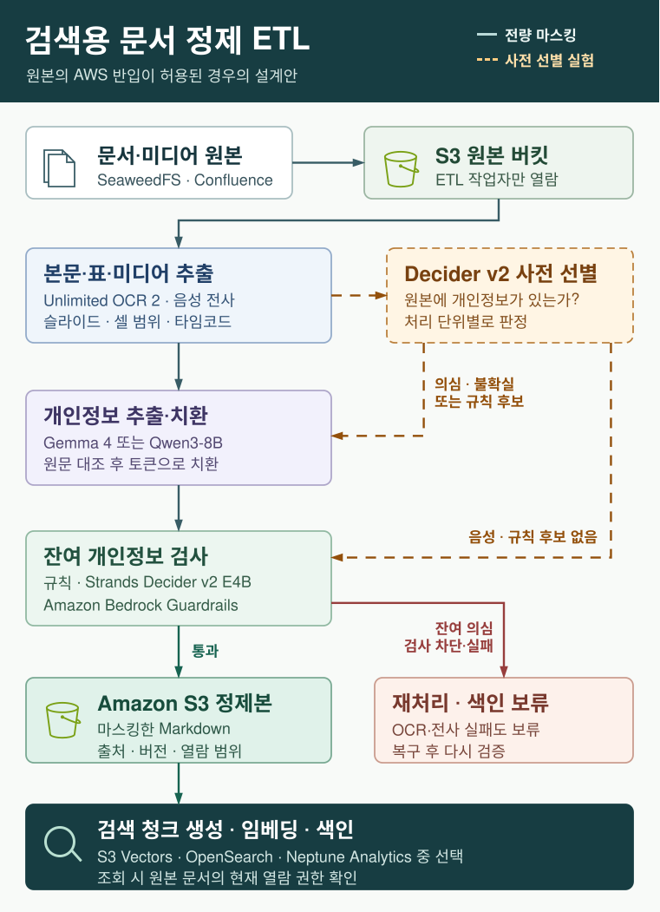

# 금융 문서 개인정보 마스킹, 생성 LLM과 판정 모델을 미세 조정 전후로 비교했습니다: Gemma 4와 Strands Decider v2 실측

<p class="lead">금융 데모 부스에서 돌리는 문서 분석 파이프라인은 OCR 결과에서 개인정보를 찾아 토큰으로 바꾼 뒤에야 분석 LLM에 넘깁니다. 이 개인정보 탐지 단계(Stage 3)는 지금 QLoRA로 조정한 Gemma 4 26B-A4B가 L40S 한 장에서 맡고 있습니다. 최근 RAGTruth 환각 검출 실험에서 Strands Decider v2가 질문 하나에 0.05~0.13초로 답하는 것을 보고, 더 가벼운 판정 모델로 이 단계를 바꾸거나 보강할 수 있는지 궁금해졌습니다. 그래서 2026년 11월 25일에 L40S 한 장에서 두 가지를 측정했습니다. 첫째, 추출 모델(Gemma 4 26B-A4B, Qwen3-8B)을 미세 조정 전후로 비교했습니다. 둘째, 예/아니오 판정을 같은 크기의 일반 Gemma 4와 Strands Decider v2로 학습 전후에 비교했습니다(12B는 학습 전만). 운영 Gemma를 판정기로 쓴 기준선도 함께 봤습니다. 문서와 개인정보는 모두 LLM이 지어낸 가짜이고, 운영 적용 전에 방향을 잡기 위한 개발 단계 측정입니다.</p>

<div class="callout warn"><strong>먼저 결론: 값을 찾아 가리는 일은 미세 조정한 생성 LLM이, 예/아니오는 학습 데이터가 없을 때 판정 모델이 유리했습니다</strong><strong>추출.</strong> Stage 3에서 가릴 문자열을 찾는 두 생성 LLM은 모두 미세 조정의 효과가 컸습니다. 게이트를 통과한 문서에 남은 개인정보 글자는 Qwen3-8B가 1,369자에서 119자로, Gemma 4 26B-A4B가 422자에서 26자로 줄었습니다. 출력 토큰이 줄어 문서당 지연도 짧아졌습니다. <strong>예/아니오 판정.</strong> 학습 없이 쓰면 판정 모델이 같은 크기의 일반 Gemma 4보다 대체로 나았습니다(E2B의 유출 검사만 차이 없음). E4B 기준으로 후보 구간 판정은 98.2% 대 79.8%, 마스킹 후 유출 검사는 92.7% 대 66.3%(balanced accuracy)이고, 12B는 99.3% 대 97.4%, 95.7% 대 86.8%였습니다. 같은 합성 학습 데이터 8,144행으로 학습하면 일반 LLM LoRA와 Decider 학습이 모두 98~100%에 이르러, 이 평가셋으로는 둘을 가를 수 없었습니다. 학습한 Decider는 문턱값을 0.5로 둬도 정확도가 그대로였습니다. 정리하면, 판정 모델의 강점은 학습 데이터 없이도 바로 쓸 수 있다는 데 있습니다. 데이터가 있으면 일반 LLM도 이 평가셋의 천장 근처까지 올라왔습니다. 운영 파이프라인은 바꾸지 않았고, 모두 합성 문서로 한 오프라인 측정입니다.</div>

<nav class="toc" markdown="1">

**목차**

1. [파이프라인에서 Stage 3가 하는 일](#pipeline)
2. [시험 환경과 데이터](#env)
3. [Stage 3 추출: 미세 조정 전후](#extract)
4. [판정 모델을 놓을 두 자리](#tasks)
5. [과제 A: 후보 구간 판정](#span)
6. [과제 B: 마스킹 후 유출 검사](#leak)
7. [질문 언어와 부정형 질문](#phrasing)
8. [지연과 GPU 메모리](#latency)
9. [미세 조정 비교: 일반 LLM LoRA와 Decider 학습](#finetune)
10. [그래서 어디에 쓰나](#where)
    - [대용량 문서에서 검색용 정제본 만들기](#etl)
11. [이번 측정의 한계](#limits)
12. [자료](#refs)

</nav>

<h2 id="pipeline">1. 파이프라인에서 Stage 3가 하는 일</h2>

파이프라인은 일곱 단계입니다. 문서를 읽고(1) OCR을 하고(2), Stage 3에서 개인정보를 찾아 `[PERSON_1]`, `[PHONE_2]` 같은 토큰으로 바꿉니다. Stage 4는 마스킹된 텍스트를 Amazon Bedrock Guardrails로 한 번 더 검사하고, 검증이 빠지거나 차단되면 분석으로 넘어가지 않습니다(fail-closed). Stage 5는 토큰과 원문의 매핑을 TTL이 있는 테이블에 저장하고, Stage 6 분석 LLM은 Stage 3가 찾은 값이 토큰으로 바뀐 텍스트를 받습니다. 탐지가 놓친 값은 그대로 남을 수 있어서 Stage 4 검사를 둡니다. Stage 7에서 결과에 원문을 되돌립니다.

Stage 3 모델이 내야 하는 답은 "문서에 개인정보가 있다"가 아니라 **어떤 문자열이 어떤 유형의 개인정보인지의 목록**입니다. 오케스트레이터는 그 목록으로 원문 위치를 찾아 토큰으로 바꿉니다. 모델이 낸 값 중 원문에 없는 것은 버리고(환각 필터), 다음 검사를 통과하지 못한 문서는 거부합니다.

- 같은 값이 다른 곳에 남아 있지 않은지(residue 게이트)
- 가려지지 않은 숫자열이 없는지(uncovered digit run 게이트)
- 개인 구간 경계가 애매하지 않은지(ambiguous boundary)

Strands Decider v2 같은 판정 모델은 상태(state)와 질문을 받아 예/아니오(`noul`), 선택(`choice`), 점수(`score`) 중 하나를 확률로 돌려줍니다. 한 번의 forward로 답을 읽고 토큰을 생성하지 않아 빠르지만, 출력이 질문당 확률 하나라 **어느 글자를 가려야 하는지**는 알려 주지 않습니다. 그래서 Stage 3 자체를 대신할 수는 없고, 이 글에서는 판정 모델을 Stage 3의 탐지 결과와 마스킹 결과, 예/아니오로 답할 수 있는 두 자리에 놓고 측정했습니다.

<figure class="diagram"><a href="/assets/pii-decision-placement.svg"></a><figcaption>과제 A는 Stage 3의 후보를, 과제 B는 마스킹이 끝난 텍스트를 판정 모델에 묻습니다.</figcaption></figure>

<h2 id="env">2. 시험 환경과 데이터</h2>

| 구분 | 내용 |
|---|---|
| GPU | `g6e.4xlarge` 한 대(공개 모델 측정), 학습 비교는 `g6e.2xlarge` 한 대. 둘 다 NVIDIA L40S 48 GB, 서울 리전, 기존 데모 VPC의 private 서브넷, 공인 IP 없음, inbound 규칙 없는 보안 그룹, 접속은 SSM만 사용 |
| 추출 모델 1 | Gemma 4 26B-A4B-it + Stage 3 QLoRA 병합본. vLLM 0.20.1, online FP8, `--reasoning-parser gemma4`, thinking off. 운영과 같은 이미지 digest와 인자 |
| 추출 모델 2 | Qwen3-8B + Stage 3 LoRA 병합본(11월 초까지 운영, 지금은 롤백용). vLLM 0.20.1, bf16, Qwen3-0.6B draft로 speculative decoding 3토큰 |
| 추출 base 모델 | 위 두 모델의 미세 조정 전 원본(`google/gemma-4-26B-A4B-it`, `Qwen/Qwen3-8B`)을 같은 서빙 인자로 측정 |
| 판정 모델 | `StrandsAgents/strands-decider-{E2B,E4B,12B}-gemma4-v2-2611`, bf16. 패키지는 GitHub main(`6d85079`, `0.4.1.dev12`), torch 2.15.0, transformers 5.24.1 |
| 판정 기준선 | 위 Gemma 4 Stage 3 모델을 그대로 판정기로 사용. 최대 1토큰만 생성하고, 그 토큰의 logprob에서 `Yes`/`No` 확률을 읽음. 질문 끝에 "Answer with one word: Yes or No."를 덧붙임 |
| 일반 LLM 판정기 | `google/gemma-4-{E2B,E4B,12B}-it`. 같은 크기의 Decider가 출발한 바로 그 revision. transformers로 다음 토큰의 `Yes`/`No` 확률을 읽음(9절) |

26B-A4B Decider는 bf16 가중치가 52 GB라 L40S 한 장에 올라가지 않아 뺐습니다. 31B도 같은 이유로 뺐습니다.

**데이터.** 공개 데이터셋에는 한국어 금융 OCR 문서와 개인정보 정답이 함께 있는 것이 없어, 이번 측정용 문서를 새로 만들었습니다. Amazon Bedrock의 작성 모델 두 개가 보험·주택담보대출·신용카드·증권 서류 묶음을 OCR 결과처럼 쓰면서, 개인정보마다 `⟦LABEL|값⟧` 표시를 달았습니다. 다른 계열의 모델이 표시를 지운 본문을 다시 읽어 개인정보를 나열했고, 두 목록이 맞고 형식 검사도 통과한 문서만 남겼습니다. 180건을 시도해 77건이 남았습니다(보험 28, 증권 23, 신용카드 17, 주택담보대출 9). 77건 중 62건은 한 작성 모델이 썼습니다. 문서 하나는 평균 5,364자이고, 사업자등록번호, 고객센터 번호, 기관 주소, 서식 코드처럼 개인정보와 헷갈리는 값을 일부러 많이 넣었습니다. 이 문서들은 Stage 3 모델 학습에 쓴 적이 없고, 작성 모델과 프롬프트도 학습 데이터 생성 때와 다릅니다.

<h2 id="extract">3. Stage 3 추출: 미세 조정 전후</h2>

먼저 추출 모델을 미세 조정 전후로 같은 날 같은 GPU에서 측정했습니다. 평가는 운영 오케스트레이터의 Stage 3 코드를 그대로 불러 실행합니다. 청크 분할, 요청 형식, 재시도, 응답 파싱, regex 보강, 환각 필터, 게이트가 모두 운영과 같고, 바뀌는 것은 모델 엔드포인트뿐입니다. 문서는 한 번에 하나씩 보냈습니다. 지연은 작업 PC에서 SSM 포트 포워딩으로 GPU 호스트의 vLLM을 부른 값이라, 터널 왕복과 오케스트레이터 코드 실행 시간이 들어 있습니다.

| 지표 (문서 77건) | Qwen3-8B base | Qwen3-8B LoRA | Gemma 4 26B-A4B base | Gemma 4 26B-A4B QLoRA |
|---|---|---|---|---|
| 게이트 통과 문서 | 70 | 70 | 70 | 70 |
| 통과 문서의 개인정보 엔티티 완전 마스킹 | 3,081 / 3,428 (89.88%) | 3,397 / 3,428 (99.10%) | 3,331 / 3,428 (97.17%) | 3,423 / 3,428 (99.85%) |
| 통과 문서에 남은 정답 개인정보 글자 | 1,369 / 27,542 | 119 / 27,542 | 422 / 27,542 | 26 / 27,542 |
| 과잉 마스킹 글자 (통과 문서) | 15,552 | 14,981 | 15,557 | 15,010 |
| 바뀐 보호 글자 (기관명·일반 날짜) | 83 / 22,771 | 49 / 22,771 | 53 / 22,771 | 61 / 22,771 |
| 생성한 토큰 합계 | 28,103 | 16,353 | 30,222 | 16,455 |
| 문서당 지연 p50 (두 묶음) | 5.08초, 4.97초 | 3.26초, 3.26초 | 4.07초, 3.84초 | 2.47초, 2.43초 |

미세 조정은 두 모델 모두에서 효과가 컸습니다. 남은 개인정보 글자가 Qwen은 1,369자에서 119자로, Gemma는 422자에서 26자로 줄었습니다. base 모델은 같은 프롬프트에 생성 토큰이 두 배 가까이 많았고, 지연도 그만큼 길었습니다. Gemma base는 개인정보 줄을 더 많이 나열했고(2,424줄 대 1,494줄), 형식이 깨진 줄은 거의 없었습니다. Qwen base는 줄 수 차이(1,761줄 대 1,424줄)보다 토큰 차이가 커서, 줄마다 출력이 길었습니다. 운영 Stage 3의 두 LoRA는 모두 합성 학습 데이터로 한 epoch만 학습했습니다. Qwen은 2,400개 레코드에 300 step, Gemma는 404 step이었고, 둘 다 rank 16입니다. 9절의 판정기 학습(rank 64, 약 8천 행)과는 별개의 학습입니다. Qwen 학습은 6,228초(약 1시간 44분, g6e.4xlarge)가 걸렸고, Gemma는 학습 시간 기록이 남아 있지 않습니다.

네 모델 모두 7건이 게이트에서 거부됐고, 사유별 건수도 known residue 4건, 애매한 경계 2건, 가려지지 않은 숫자열 1건으로 같았습니다. 모델 대신 정답 목록을 그대로 응답처럼 넣어 같은 경로로 돌려도 같은 사유별 건수로 7건이 거부됐습니다. 그러니 이 7건은 모델이 놓쳐서라기보다 게이트가 보수적으로 막는 문서이고, 운영에서는 분석으로 넘어가지 않고 실패로 끝납니다. 표의 마스킹 지표는 통과한 70건 기준입니다. 과잉 마스킹 글자 약 15,000자는 정답 목록을 넣었을 때도 14,953자가 나와, 모델보다는 파이프라인의 마스킹 규칙에서 나온 것입니다. 미세 조정한 두 모델끼리 보면, 통과한 문서에서 Gemma가 남긴 개인정보 글자는 26자로 Qwen의 119자보다 적고, 지연은 p50 기준 약 25% 짧았습니다. draft 모델 없이도 8B dense 모델보다 빨랐습니다. 모델 카드 기준으로 26B-A4B는 전체 25.2B 파라미터 중 토큰마다 3.8B만 쓰는 MoE(전문가 128개 중 8개와 공유 전문가 1개)이고, 여기에 FP8을 쓴 것이 가장 그럴듯한 이유로 보입니다. 원인을 따로 나눠 측정하지는 않았습니다.

같은 비교를 11월 6일 운영 전환 때도 했습니다. 그때는 부스에서 쓰는 실제 데모 시나리오 문서(이 역시 합성)를 시나리오별로 20~40번씩 돌렸고, Stage 3 p50이 보험 3,066 → 2,305 ms, 주택담보대출 4,028 → 2,545 ms, 신용카드 2,179 → 1,566 ms, 증권 2,043 → 1,699 ms로 모두 짧아졌습니다. 이번 측정과 방향이 같습니다.

<h2 id="tasks">4. 판정 모델을 놓을 두 자리</h2>

**과제 A, 후보 구간 판정.** 탐지기나 규칙이 표시한 구간 하나를 보여 주고 "가려야 하는 개인정보인가"를 묻습니다. 탐지 모델의 오탐을 지우는 필터 자리입니다. 실제 탐지기 출력 대신 후보를 직접 만들었습니다. 정답 개인정보 구간 3,382개가 양성입니다. 음성은 3,514개로, 정답에 표시된 기관명·일반 날짜 2,104개, 운영 regex 보강 규칙이 정답 밖에서 잡은 주소·이름·전화번호 모양의 값 685개, 정답과 겹치지 않는 6자리 이상 숫자열(사업자등록번호, 고객센터 번호, 서식 코드, 금액 등) 725개입니다. 뒤의 표에서는 regex 오탐과 숫자열을 묶어 "규칙 오탐"이라고 부르겠습니다. 나이·가족 관계·거주 국가는 운영 정책상 남겨도 되는 경우가 있어 정답이 애매하므로 뺐습니다. 모든 판정기는 같은 상태와 질문을 받습니다(Gemma에는 답 형식 한 줄을 덧붙였습니다). 후보 앞 200자와 뒤 100자를 잘라 후보를 `[[ ]]`로 감싼 문자열이 상태(state)이고, 질문은 하나입니다.

> A detector highlighted the span inside [[ ]] in this OCR text from a Korean financial document. Is that span personal information of a private individual that must be masked: a person's name or part of one, a resident registration number, a personal phone number, a personal email address, a personal home address or part of one, a personal bank account or card number, or a date of birth? Company and institution values (business or corporate registration numbers, customer-centre numbers, institution names and addresses, form and product codes, ordinary dates, amounts) are not personal.

**과제 B, 마스킹 후 유출 검사.** 정답 개인정보를 모두 토큰으로 바꾼 문서를 1,500자 안팎의 조각으로 자르면, 그 조각들이 "깨끗한" 음성 328개가 됩니다. 양성은 같은 문서에서 개인정보 값 하나만 일부러 남겨 둔 조각 231개입니다. 문서마다 유형을 최대 세 개 골라 그 값의 모든 등장을 원문 그대로 두었습니다. 질문은 "토큰은 이미 가려진 값이다. 이 텍스트에 아직 읽을 수 있는 개인정보가 남아 있는가"입니다. Stage 4 Guardrails 앞에 둘 수 있는 추가 검사를 흉내 낸 것입니다.

**평가 방식.** RAGTruth 글의 방식을 따르되, 행 대신 문서 단위로 나눴습니다. 문서를 무작위로 반씩(39건, 38건) 나눠 한쪽(calibration)에서 모델마다 문턱값을 고르고, 다른 쪽(eval)에서 balanced accuracy를 계산합니다. balanced accuracy는 양성 재현율과 음성 재현율의 평균이라, 전부 "예"로 답하는 판정기도 50%가 나옵니다. 95% 신뢰구간은 eval 문서를 통째로 2,000번 다시 뽑는 bootstrap으로 구했고, AUC도 함께 적었습니다. 판정기마다 질문 하나를 요청 하나로 보내고, 요청은 한 번에 하나씩만 보냈습니다.

판정 모델 측정은 GPU 호스트 안에서 했습니다. Decider는 `strands-decider` 엔진을 같은 프로세스에서 불렀고, Gemma 기준선은 같은 호스트의 vLLM에 HTTP로 요청했습니다(최대 1토큰, `top_logprobs` 20). 3절의 Stage 3 추출 지연은 작업 PC에서 SSM 포트 포워딩으로 GPU 호스트를 불러 측정했고, 오케스트레이터 코드 실행 시간도 들어 있습니다. 그래서 3절의 문서당 지연과 아래 판정 지연은 같은 표에 놓고 비교할 수 없습니다.

**판정 기준선은 같은 조건이 아닙니다.** Gemma 기준선은 이 과제와 같은 종류의 개인정보 데이터로 미세 조정한 운영 추출 모델입니다. Decider는 이 과제에 맞춰 따로 미세 조정하지 않았고(학습 데이터에 비슷한 과제가 있는지는 확인하지 않았습니다), 모델 카드에 따르면 학습 데이터의 약 96%가 영어입니다. 아래 비교는 "새 모델을 들이는 것"과 "이미 띄워 둔 모델에 질문을 하나 더 하는 것"의 비교로 읽어 주세요.

<h2 id="span">5. 과제 A: 후보 구간 판정</h2>

eval 쪽 후보는 3,458개(개인정보 1,709, 기관명·날짜 1,049, 규칙 오탐 700)입니다. 질문은 영어 긍정형이고, 문턱값은 calibration 쪽에서 balanced accuracy가 가장 높은 값으로 골랐습니다.

| 판정기 | balanced accuracy [95% CI] | AUC | 문턱값 | 0.5로 자를 때 | 요청당 p50 |
|---|---|---|---|---|---|
| Decider v2 12B | **99.3%** [99.0, 99.5] | 0.999 | 0.609 | 99.0% | 84 ms |
| Decider v2 E4B | 98.2% [97.6, 98.8] | 0.994 | 0.554 | 98.0% | 75 ms |
| Gemma 4 Stage 3 모델 (기준선) | 97.3% [96.7, 97.8] | 0.995 | 0.982 | 95.5% | 55 ms |
| Decider v2 E2B | 95.2% [94.3, 96.1] | 0.987 | 0.469 | 95.1% | 51 ms |

같은 문서를 다시 뽑는 paired bootstrap으로 차이를 보면, 12B는 Gemma보다 2.0%p [1.4, 2.5], E4B보다 1.0%p [0.5, 1.5] 높고, E4B는 Gemma보다 1.0%p [0.3, 1.7] 높으며, Gemma는 E2B보다 2.1%p [1.1, 3.0] 높습니다. 이웃한 두 판정기 사이의 신뢰구간이 모두 0을 포함하지 않습니다. 다만 E4B와 Gemma는 AUC가 거의 같아(0.994, 0.995), 실질적으로는 비슷한 수준입니다. 참고로 같은 후보에 운영 regex 보강 규칙만 적용하면 52.7%입니다. 음성 일부가 그 규칙 자신의 오탐이라 낮게 나오는 것이 당연하고, 운영에서는 규칙 결과에 모델 결과를 합쳐 쓰므로 규칙 혼자 판정하는 구성은 아닙니다.

종류별로 보면 차이가 어디서 나는지 보입니다.

| 판정기 | 개인정보를 개인정보로 | 기관명·날짜를 비개인으로 | 규칙 오탐을 비개인으로 |
|---|---|---|---|
| Decider v2 12B | 1,702 / 1,709 | 1,049 / 1,049 | 681 / 700 |
| Decider v2 E4B | 1,693 / 1,709 | 1,045 / 1,049 | 659 / 700 |
| Gemma 4 Stage 3 모델 | 1,672 / 1,709 | 1,036 / 1,049 | 656 / 700 |
| Decider v2 E2B | 1,639 / 1,709 | 1,026 / 1,049 | 627 / 700 |

놓친 개인정보의 수로는 사람 이름이 가장 많았지만(E2B 70개 중 46개, Gemma 37개 중 26개), 사람 이름이 양성의 61%(1,040개)를 차지하므로 비율로 보면 특별하지 않습니다. 유형별로 놓친 비율을 보면 E2B는 주소 9.5%(12/126), 카드번호 7.1%(4/56), 사람 이름 4.4%(46/1,040) 순이었습니다. 12B는 7개를 놓쳤고 사람 이름 3개, 카드번호 3개, 주소 1개였습니다. 또 E2B가 놓친 사람 이름 46개 중 직원·담당자 이름 맥락은 30%로, 맞힌 쪽의 41%보다 낮았습니다. 질문의 "private individual" 표현 때문에 직원 이름을 빼먹은 것은 아닌 것으로 보입니다.

오탐을 지우는 필터는 진짜 개인정보를 지우면 안 됩니다. 그래서 calibration 쪽에서 **개인정보 재현율 99.5% 이상**을 지키는 가장 높은 문턱값을 고르고, eval 쪽에서 얼마나 지우는지도 측정했습니다.

| 판정기 | 남긴 개인정보 | 지운 규칙 오탐 | 지운 기관명·날짜 |
|---|---|---|---|
| Decider v2 12B | 1,704 / 1,709 (99.7%) | 677 / 700 (96.7%) | 1,048 / 1,049 |
| Decider v2 E4B | 1,702 / 1,709 (99.6%) | 617 / 700 (88.1%) | 999 / 1,049 |
| Gemma 4 Stage 3 모델 | 1,706 / 1,709 (99.8%) | 615 / 700 (87.9%) | 972 / 1,049 |
| Decider v2 E2B | 1,695 / 1,709 (99.2%) | 572 / 700 (81.7%) | 983 / 1,049 |

이 기준에서 12B는 규칙 오탐의 97%를 지우면서 개인정보 1,709개 중 5개만 놓쳤습니다. E4B와 Gemma는 비슷하게 88%를 지웠습니다.

<h2 id="leak">6. 과제 B: 마스킹 후 유출 검사</h2>

eval 쪽은 276개 조각(깨끗한 조각 162, 값 하나가 남은 조각 114)이라 신뢰구간이 넓습니다.

| 판정기 | balanced accuracy [95% CI] | AUC | 문턱값 | 0.5로 자를 때 | 요청당 p50 |
|---|---|---|---|---|---|
| Decider v2 12B | **95.7%** [92.8, 98.1] | 0.990 | 0.274 | 86.4% | 173 ms |
| Decider v2 E4B | 92.7% [89.9, 95.4] | 0.983 | 0.178 | 64.5% | 81 ms |
| Gemma 4 Stage 3 모델 (기준선) | 86.3% [81.9, 90.7] | 0.958 | 0.0036 | 65.4% | 79 ms |
| Decider v2 E2B | 62.4% [57.6, 67.2] | 0.722 | 0.332 | 59.3% | 55 ms |

paired bootstrap으로 보면 12B와 E4B는 각각 Gemma보다 9.4%p [4.2, 14.6], 6.4%p [1.1, 11.5] 높았습니다. 12B와 E4B의 차이 3.0%p [-0.7, 6.6]은 이 데이터로는 가르지 못했습니다. 12B와 E4B 모두 남은 카드·전화번호는 다 잡았습니다. 12B는 주소·사람 이름·주민등록번호를 2개씩, 생년월일을 1개 놓쳤고, E4B는 생년월일 3개와 주소·사람 이름·이메일 2개씩을 놓쳤습니다.

이 과제는 문턱값에 특히 민감했습니다. 고른 문턱값이 0.0036(Gemma)에서 0.33(E2B) 사이로 모두 0.5보다 낮았고, 0.5로 자르면 E4B와 Gemma는 65% 안팎으로 떨어집니다. 값 하나가 남은 조각에도 판정기들이 P(예)를 낮게 주었다는 뜻입니다. 어느 판정기를 쓰든 자기 데이터로 문턱값을 맞춰야 합니다.

양성 조각은 개인정보 값이 들어 있던 자리에서 나오므로, 판정기가 남은 값 대신 "개인정보가 많은 서식처럼 보이는 조각"을 고르고 있을 수도 있습니다. 이를 확인하려고 양성 231개마다 **같은 조각에서 남긴 값만 토큰으로 바꾼 짝**을 만들어 같은 질문을 했습니다. 두 조각은 그 값 하나만 다릅니다.

| 판정기 | 유출 조각이 짝보다 높은 점수 (231쌍) | 짝을 "남아 있다"고 잘못 본 수 |
|---|---|---|
| Decider v2 12B | 100.0% | 1 |
| Gemma 4 Stage 3 모델 | 99.6% | 9 |
| Decider v2 E4B | 98.7% | 18 |
| Decider v2 E2B | 88.5% | 117 |

12B, Gemma, E4B는 같은 조각 안에서는 남은 값 하나를 거의 틀림없이 알아봤습니다. 그러니 앞 표의 점수는 조각 종류보다는 주로 남은 값에 반응한 결과입니다. 짝 비교에는 문턱값을 고른 calibration 쪽 문서도 들어 있습니다. Gemma는 짝 비교가 99.6%로 좋은데도 balanced accuracy가 86.3%에 그쳤습니다. 조각 하나만 보고 "남았다"를 가르는 절대 점수가 문서마다 흔들려, 문턱값 하나로는 다 나누지 못한 것으로 보입니다. E2B는 짝의 절반을 "남아 있다"고 봤습니다.

<h2 id="phrasing">7. 질문 언어와 부정형 질문</h2>

RAGTruth 글에서는 E4B가 부정형 질문에서 AUC 0.43으로 무너졌습니다. 이번 데이터는 한국어 문서라서, 질문을 한국어로 바꾸는 경우도 함께 봤습니다. 부정형은 "가리지 않고 두어도 되는가"처럼 뒤집어 묻고, 점수는 1 − P(예)로 계산했습니다. 과제 A는 1차 문서 34건의 eval 쪽만, 과제 B는 전체 eval 쪽 기준입니다.

| 판정기 | 과제 A 영어 | A 영어 부정형 | A 한국어 | 과제 B 영어 | B 영어 부정형 | B 한국어 |
|---|---|---|---|---|---|---|
| Decider v2 12B | 99.1% | 97.6% | 98.7% | 95.7% | 94.6% | 90.7% |
| Decider v2 E4B | 98.4% | 96.2% | 97.5% | 92.7% | 89.2% | 84.0% |
| Gemma 4 Stage 3 모델 | 97.7% | 91.8% | 94.3% | 86.3% | 78.6% | 86.1% |
| Decider v2 E2B | 94.7% | 91.1% | 94.1% | 62.4% | 69.0% | 48.6% |

세 가지가 보였습니다. 첫째, 이번 데이터에서는 E4B가 부정형에서 무너지지 않았습니다(과제 A AUC 0.991, 과제 B 0.953). 둘째, E2B의 과제 B를 빼면 영어 긍정형이 대체로 가장 높았습니다. 다만 일부 차이(Gemma 과제 B 86.3%와 86.1%, 12B 과제 A 99.1%와 98.7%)는 신뢰구간 안입니다. 셋째, E2B는 과제 B를 한국어로 물으면 AUC가 0.392로 뒤집혔습니다. 114개 유출 조각 중 1개만 "남아 있다"고 답했으니, 사실상 질문을 이해하지 못한 것입니다. 이번 측정에서는 E2B가 문구에 가장 크게 흔들렸고, Gemma 기준선도 부정형에서 크게 떨어졌습니다(과제 A 97.7% → 91.8%, 과제 B 86.3% → 78.6%).

<h2 id="latency">8. 지연과 GPU 메모리</h2>

| 판정기 | GPU 메모리 | 과제 A p50 / p90 | 과제 B p50 / p90 | 첫 로드 |
|---|---|---|---|---|
| Decider v2 E2B (bf16) | 9.0 GiB | 51 / 52 ms | 55 / 56 ms | 32초 |
| Decider v2 E4B (bf16) | 14.2 GiB | 75 / 75 ms | 81 / 82 ms | 49초 |
| Decider v2 12B (bf16) | 22.3 GiB | 84 / 85 ms | 173 / 178 ms | 67초 |
| Gemma 4 Stage 3 모델 (vLLM FP8) | GPU의 90% 예약 (KV 캐시 11.2 GiB 포함) | 55 / 56 ms | 79 / 89 ms | 약 4분 |

Decider 메모리는 가중치를 올린 뒤 PyTorch가 할당한 양이고, 첫 로드는 그 모델을 처음 올릴 때 걸린 시간입니다(같은 모델을 다시 올리면 4~5초). 과제 A의 상태는 300자 안팎이고 과제 B는 1,500자 안팎이라, 입력이 긴 과제 B에서 12B의 지연이 두 배로 늘었습니다. 모델 카드가 H100에서 밝힌 질문당 지연(E4B 78 ms, 12B 80 ms)은 L40S에서도 짧은 입력 기준으로 거의 그대로 나왔습니다.

<h2 id="finetune">9. 미세 조정 비교: 일반 LLM LoRA와 Decider 학습</h2>

앞의 비교에서 Decider는 학습 없이 쓴 공개 모델이었습니다. 여기서는 같은 학습 데이터로 두 방식을 학습시켜 비교합니다. 하나는 일반 Gemma 4에 LoRA를 붙여 "Yes"/"No" 토큰을 맞히도록 학습하는 방식이고, 다른 하나는 Decider를 이어서 학습하는 방식입니다. Decider v2는 같은 크기의 `gemma-4-*-it`에서 출발한 모델이므로, 같은 출발점에 판정용 학습(LoRA와 token readout, 1,750만 행)을 더했는지가 둘의 차이입니다.

**학습 데이터.** 평가용 77건과 섞이지 않도록 학습용 문서를 따로 만들었습니다. 평가용과 다른 작성 모델 네 개와 다른 신원 풀로 160건을 시도해 80건이 검증을 통과했습니다(80건 중 65건은 두 모델이 썼습니다). 신원 풀이 달라도 흔한 이름은 겹칠 수 있어, 평가 문서와 같은 사람 이름이 하나라도 나오는 12건을 뺐습니다. 남은 68건 중 6건은 학습 곡선 확인용 dev로 떼고, 62건에서 학습 행 8,144개를 만들었습니다. 과제 A 후보가 6,123행입니다. 과제 B는 문서마다 강한 식별값 하나만 남긴 조각과, 같은 조각에서 그 값만 가린 짝을 함께 넣어 2,021행입니다. 질문은 평가에 쓴 영어 긍정형 문장 그대로입니다. 평가 문서 77건은 학습과 학습 설정 선택에 한 번도 쓰지 않았습니다.

| 구분 | 일반 LLM + LoRA | Decider 학습 |
|---|---|---|
| 출발점 | `google/gemma-4-{E2B,E4B}-it` (Decider와 같은 revision) | 공개 Decider v2 (`init_from`) |
| 학습 대상 | LoRA rank 64, α 128, 언어 모델 projection 7종 | 새 LoRA(rank 64, α 128, v2 설정 그대로이며 E 계열은 per-layer projection 2종 추가)와 token readout |
| 손실 | 답 토큰("Yes"/"No") 하나의 cross-entropy | 패키지의 `noul` 손실 |
| 설정 | lr 1e-4, 한 step 32행, 1 epoch(255 step), seed 0 | v2 설정 기본값(E2B·E4B는 lr 1e-4), micro-batch 8 × 누적 4, 254 step, seed 0 |

두 방식 모두 하이퍼파라미터를 탐색하지 않고 한 번씩만 학습했습니다. 12B는 학습하지 않은 Decider가 이미 99.3%와 95.7%라 천장에 가까워서, 학습 전 측정만 했습니다.

| 크기 | 판정기 | 학습 | 과제 A | 과제 B | 짝 비교 (유출 > 짝) |
|---|---|---|---|---|---|
| E2B | 일반 Gemma 4 | 없음 | 75.8% [74.5, 77.3] | 64.8% [60.3, 69.2] | 91.1% |
| E2B | 일반 Gemma 4 + LoRA | 8,144행 | 98.9% [98.0, 99.5] | 98.2% [96.5, 99.6] | 99.4% |
| E2B | Decider v2 | 없음 | 95.2% [94.3, 96.1] | 62.4% [57.6, 67.2] | 88.5% |
| E2B | Decider v2 + 학습 | 8,144행 | 99.3% [99.1, 99.6] | 99.7% [99.0, 100.0] | 99.6% |
| E4B | 일반 Gemma 4 | 없음 | 79.8% [78.7, 81.1] | 66.3% [60.9, 71.7] | 92.4% |
| E4B | 일반 Gemma 4 + LoRA | 8,144행 | 99.9% [99.7, 100.0] | 99.3% [98.1, 100.0] | 100.0% |
| E4B | Decider v2 | 없음 | 98.2% [97.6, 98.8] | 92.7% [89.9, 95.4] | 98.7% |
| E4B | Decider v2 + 학습 | 8,144행 | 99.9% [99.8, 100.0] | 100.0% [100.0, 100.0] | 99.6% |
| 12B | 일반 Gemma 4 | 없음 | 97.4% [96.8, 97.9] | 86.8% [83.1, 90.5] | 95.2% |
| 12B | Decider v2 | 없음 | 99.3% [99.0, 99.5] | 95.7% [92.8, 98.1] | 100.0% |

같은 문서를 다시 뽑는 paired bootstrap으로 차이를 보면 결론은 두 가지입니다.

- **학습 없이 쓰면 판정 모델이 대체로 낫습니다.** 다만 일반 Gemma 4에는 예시 없이 질문 하나만 주고 첫 토큰의 Yes/No 확률을 읽었습니다. 몇 개의 예시를 넣는 few-shot 프롬프트였다면 격차가 줄었을 수 있습니다. Decider에서 일반 Gemma 4를 뺀 값은 E4B가 과제 A 18.4%p [17.1, 19.6], 과제 B 26.3%p [21.8, 30.7]였습니다. 12B는 1.9%p [1.4, 2.4], 8.9%p [4.7, 12.7]였습니다. E2B는 과제 A에서 19.4%p [18.0, 20.6] 높았지만, 과제 B는 −2.5%p [−8.0, 2.9]로 둘 다 약했습니다. E2B는 판정용 학습만으로는 유출 검사를 해내지 못했습니다.
- **같은 데이터로 학습하면 이 평가셋으로는 가를 수 없습니다.** Decider 학습에서 LoRA를 뺀 값은 E2B가 과제 A 0.5%p [−0.1, 1.2], 과제 B 1.4%p [−0.2, 3.1]였고, E4B가 0.0%p [−0.1, 0.1], 0.7%p [0.0, 1.9]였습니다. 마지막 구간은 하한이 0에 걸쳐 있고, 네 경우 모두 이 데이터로는 갈리지 않았습니다. 과제 B에서 학습으로 오른 폭은 일반 Gemma 4가 33%p 안팎, Decider가 E2B 37%p, E4B 7%p였습니다. Decider E4B는 학습 전에도 이미 높았기 때문입니다.

정확도 말고도 차이가 있었습니다. 학습한 Decider는 문턱값을 0.5로 둬도 정확도가 거의 그대로였습니다(과제 A 99.8~99.9%, 과제 B 99.4~100.0%). LoRA는 E4B에서는 0.5 기준으로도 괜찮았지만(과제 A 99.8%, 과제 B 98.8%), E2B 과제 A는 98.9%에서 96.1%로 떨어졌고 최적 문턱값이 0.0003이었습니다. LoRA 중에서는 E2B만 8행씩 묶어(left padding) 학습했기 때문에 그 영향일 수도 있어, 한 경우만으로 일반화하기는 이릅니다. 오탐을 지우는 필터 기준(개인정보 재현율 99.5% 이상, 5절)으로 보면, E4B는 두 방식 모두 규칙 오탐 700개를 전부 지웠습니다. E2B는 Decider 학습이 680개, LoRA가 624개를 지웠습니다.

| 학습 | 학습 시간 | step | 학습 파라미터 (각 학습기가 센 전체 대비) | 학습 피크 메모리 | 추론 p50 (A / B) | 추론 피크 메모리 |
|---|---|---|---|---|---|---|
| E2B 일반 Gemma 4 + LoRA | 12분 19초 | 255 | 9,660만 (1.9%) | 14.2 GiB | 73 / 74 ms | 9.9 GiB |
| E2B Decider 학습 | 25분 25초 | 254 | 1억 505만 (2.2%) | 14.7 GiB | 49 / 54 ms | 9.0 GiB |
| E4B 일반 Gemma 4 + LoRA | 68분 38초 | 255 | 1억 3,953만 (1.7%) | 17.6 GiB | 87 / 95 ms | 15.4 GiB |
| E4B Decider 학습 | 42분 13초 | 254 | 1억 5,532만 (2.0%) | 21.9 GiB | 71 / 80 ms | 14.3 GiB |

학습 시간은 그대로 비교할 수 없습니다. E4B LoRA는 행을 하나씩 처리했고, E2B LoRA부터 8행씩 묶어 처리했습니다. 그래서 E2B 숫자가 두 방식의 학습 비용을 더 공정하게 보여 줍니다. LoRA 추론 지연은 adapter를 base에 합치지 않은 채 측정한 값이라, 합치면 줄어들 수 있습니다. 두 방식 모두 L40S 한 장에서 한 시간 안팎으로 학습이 끝났습니다.

<h2 id="where">10. 그래서 어디에 쓰나</h2>

**어떤 값을 가릴지는 미세 조정한 생성 LLM이 찾습니다.** 판정 모델은 표시한 구간을 가려야 하는지, 마스킹한 조각에 읽을 수 있는 개인정보가 남았는지에 확률로 답합니다. Stage 3에서는 추출 LLM이 원문에 있는 값과 유형을 돌려주고, 오케스트레이터가 해당 값을 토큰으로 치환합니다. 3절에서 보듯 같은 모델도 미세 조정 전후로 남는 개인정보가 열 배 넘게 차이 났습니다. 그중에서는 Gemma 4 26B-A4B QLoRA가 가장 나았다는 11월 초 판단이 이번에도 유지됐습니다.

**예/아니오 검사는 학습 데이터가 있느냐에 따라 고릅니다.** 라벨 데이터가 없거나 적으면 판정 모델이 맞습니다. 같은 크기의 일반 LLM에 질문하는 것보다 E4B 기준 18~26%p 높았고, 12B는 학습 없이 99.3%와 95.7%였습니다. 라벨 데이터가 있고 학습할 여유가 있으면 일반 LLM LoRA도 이 평가셋의 천장 근처까지 올라왔습니다. 그때 두 방식의 차이는 정확도보다 운영 쪽에서 납니다. 학습한 Decider는 두 크기 모두 0.5 기준에서도 정확도가 그대로였고, LoRA는 E2B 과제 A에서만 0.5 기준으로 떨어졌습니다. 질문을 바꿔 다른 판정에 다시 쓰기 쉬운지는 이번에 측정하지 않았습니다.

**유출 검사 자리가 가장 유력합니다.** Stage 4 Guardrails 앞에서 마스킹된 조각마다 "아직 남은 개인정보가 있나"를 묻는 검사는, 학습 없는 12B 기준 조각당 0.17초입니다. 평균 5,364자 문서는 1,500자 조각 네 개쯤이니 문서당 0.7초 정도가 더해집니다. 학습한 E4B라면 조각당 0.08초였고, 학습 데이터와 같은 생성기로 만든 이 평가셋에서는 거의 틀리지 않았습니다. 이 검사가 무언가를 잡으면 그 문서를 다시 Stage 3로 보내거나 실패로 끝내는 식으로, 지금의 fail-closed 원칙과 맞물려 쓸 수 있습니다. 다만 판정 모델은 어디가 남았는지 알려 주지 않으므로, 이 검사는 막는 용도로만 씁니다. 비용도 있습니다. 학습 없는 12B는 이 문턱값에서 깨끗한 조각의 2.5%(162개 중 4개)를 "남았다"고 봐서, 조각 네 개짜리 문서라면 약 10%가 불필요하게 막히거나 다시 처리될 수 있습니다. 반대로 값이 남은 조각의 6%(114개 중 7개)는 통과시켰으므로, Guardrails를 대신하지 않고 그 앞에 하나 더 두는 검사입니다.

**탐지 후보 필터에도 쓸 수 있습니다.** 탐지기가 과하게 잡은 사업자등록번호나 고객센터 번호를 지우는 필터로 쓰면, 학습 없는 12B는 개인정보 재현율을 99.7%로 지키면서 규칙 오탐의 97%를 지웠습니다. 학습한 E4B는 같은 기준에서 규칙 오탐을 모두 지웠습니다. 다만 이 측정의 후보는 정답 경계를 그대로 쓴 것이라, 실제 탐지기 출력으로 다시 측정해야 합니다.

**GPU 자리가 문제입니다.** 운영 L40S는 vLLM이 메모리의 90%를 잡고 있어 12B(22 GiB)를 같이 올릴 수 없습니다. Gemma에 판정 질문을 하나 더 보내는 방식은 추가 메모리가 들지 않는 대신 정확도가 낮았습니다. 판정 모델을 따로 쓰려면 GPU를 하나 더 두거나, vLLM의 메모리 비율을 낮춰 E2B·E4B(9~14 GiB)를 함께 올리는 방법을 따로 측정해 봐야 합니다. 이번 숫자로 어림하면 E4B를 같이 올릴 때 Gemma의 KV 캐시는 11.2 GiB에서 1 GiB 안팎으로 줄어들어, 이 방법도 쉽지 않습니다.

<h3 id="etl">대용량 문서에서 검색용 정제본 만들기</h3>

SeaweedFS의 문서를 S3로 옮겨 사내 검색에 쓰려 한다고 해 보겠습니다. 200장짜리 상담 매뉴얼에서 고객 이름이 보이는 곳은 12쪽의 화면 캡처 한 군데뿐일 수 있습니다. 이때 필요한 결과는 “이 파일에는 개인정보가 있다”는 표시보다 구체적입니다. 직원이 상담 절차를 검색하면 12쪽의 설명을 찾을 수 있고, 캡처에 찍힌 고객 이름과 전화번호는 검색 응답에 나오지 않아야 합니다.

아래는 이 글에서 학습한 개인정보 모델을 **S3 최초 수집 시점**에 적용하는 설계안입니다. 77건으로 측정한 범위는 금융 OCR 텍스트의 추출·판정입니다. Unlimited OCR 2부터 검색 인덱스까지 연결한 처리량과 누락률은 후속 실험에서 확인할 값입니다.

<figure class="diagram" id="etl-architecture">
  <a href="/assets/pii-search-etl.svg"><picture>
    <source media="(max-width: 600px)" srcset="../assets/pii-search-etl-mobile.svg" width="381" height="1166">
    
  </picture></a>
  <figcaption>점선은 Decider 사전 선별 실험입니다. 음성 판정으로 생략하는 단계는 추출 LLM 호출뿐이며, 색인 전 검사는 두 경로에 공통입니다. <a href="/assets/pii-search-etl.svg">데스크톱 그림 확대</a> · <a href="/assets/pii-search-etl-mobile.svg">모바일 그림 확대</a> · <a href="/assets/pii-search-etl.drawio" download>편집용 Draw.io 원본</a></figcaption>
</figure>

<h4 id="etl-input">파일을 어디에서 나누고 무엇을 함께 읽을까</h4>

원본의 AWS 반입이 허용되면 SeaweedFS에서 접근을 제한한 S3 원본 버킷으로 복사하고, ETL 작업자에게 그 버킷의 읽기 권한을 줍니다. 검색 시스템에는 정제본 버킷만 연결합니다. 원본을 SeaweedFS에 보관해야 하는 경우에는 그쪽에서 추출과 마스킹을 끝낸 뒤 정제본을 S3에 씁니다. 어느 쪽이든 수집 시점에 문서 ID, 원본 버전, 원본의 열람 권한을 기록해야 나중에 같은 문서의 새 버전이나 권한 변경을 반영할 수 있습니다.

| 입력 | 한 번에 판정할 범위 | 추출할 내용과 보존할 위치 |
|---|---|---|
| PPTX | 슬라이드 한 장 | 제목·본문·표는 직접 읽고 스크린샷은 OCR합니다. 발표자 노트도 검색에 쓴다면 같은 검사를 거칩니다. 결과에 슬라이드 번호를 남깁니다. |
| Excel | 열 제목을 붙인 표의 행 묶음 | `연락처`와 `고객센터 번호`를 구분할 수 있게 열 제목과 셀 값을 같이 읽습니다. 병합 셀의 제목을 해당 행에 연결하고 시트와 셀 범위를 남깁니다. |
| PDF | 페이지와 앞뒤로 이어지는 표 | 텍스트 레이어를 먼저 읽고 스캔 영역을 OCR합니다. 다음 쪽에 표 머리글이 생략됐다면 앞쪽 머리글을 함께 보고, 각 행의 출처 페이지는 유지합니다. |
| PNG·JPG | 이미지 한 장 또는 서로 조금씩 겹치는 영역 | 세로로 긴 캡처는 전화번호 한 줄이 경계에서 잘릴 수 있습니다. 겹치는 영역을 함께 읽고 이미지 좌표로 중복을 정리합니다. |
| Confluence 위키 | 페이지 버전 안의 제목별 섹션 | 제목·본문·표를 함께 읽고 첨부파일은 해당 형식으로 처리합니다. 페이지와 첨부파일에 적용되는 열람 권한을 검색 때도 확인합니다. |
| 동영상 | 시작·끝 시간이 있는 발화 또는 장면 | 음성 전사·자막과 화면 OCR을 시간축으로 맞춥니다. 발표자가 말하지 않고 잠깐 띄운 이메일은 프레임을 드문드문 읽으면 빠질 수 있어 별도 평가 사례에 넣습니다. |

슬라이드 캡처나 스캔 페이지에는 Baidu의 **Unlimited OCR 2**(`baidu/Unlimited-OCR-2`)를 사용하도록 설계했습니다. 여러 페이지 이미지를 순서대로 입력하면 페이지 사이 문맥을 활용하면서 출력의 페이지 경계를 보존할 수 있습니다. 여기서 페이지는 마스킹과 재처리의 단위입니다. 검색용 청크는 검증이 끝난 뒤에 만들므로, 긴 슬라이드는 주제별로 더 작게 나눌 수 있습니다. [Unlimited-OCR 공식 저장소](https://github.com/baidu/Unlimited-OCR)

<h4 id="etl-example">PPTX 12쪽이 검색 결과가 되기까지</h4>

12쪽의 제목이 ‘만기 안내 재발송’이고, 본문 표에는 처리 순서가, 삽입된 화면 캡처에는 고객 이름·휴대전화와 기관 고객센터 번호가 있다고 가정합니다.

1. **원본에서 텍스트를 모읍니다.** PPTX에서 읽은 제목·표에 캡처의 OCR 결과를 붙이되, 각 값이 나온 슬라이드와 도형 또는 이미지 영역을 기록합니다. 그래야 같은 번호 모양이라도 ‘고객 휴대전화’ 칸과 ‘기관 고객센터’ 칸을 구별할 수 있습니다. OCR에 실패한 캡처는 빈 문자열로 통과시키지 않고 재처리 대상으로 남깁니다.
2. **값을 추출해 치환합니다.** 금융 개인정보 추출용으로 미세 조정한 **Gemma 4 26B-A4B QLoRA** 또는 **Qwen3-8B LoRA**가 원문 값과 유형을 돌려줍니다. ETL 코드는 각 값이 실제로 등장한 위치를 확인합니다. 표와 캡처에 같은 고객 전화번호가 두 번 나오면 두 곳을 같은 토큰으로 치환합니다. 재발송 조건과 기관 연락처처럼 정책상 보존할 정보는 문맥을 확인해 남깁니다. 검색에 노출할 제목·파일명·작성자 필드도 검사 대상입니다.
3. **남은 개인정보를 확인합니다.** 치환한 본문과 노출할 메타데이터에 대해 잔여 문자열 규칙과 금융 개인정보 판정에 맞춰 학습한 **Strands Decider v2 E4B**를 적용합니다. Decider의 질문은 “아직 읽을 수 있는 개인정보가 있는가”입니다. 양성이면 출처를 따라 해당 슬라이드를 다시 추출하고, 반복해서 막히면 검토 대상으로 보류합니다. 최종 Guardrails 검사까지 통과한 결과만 정제본으로 승인합니다. Decider는 남은 값의 좌표를 돌려주지 않습니다. [후보 판정과 잔여 검사 학습 결과](#finetune)

이 예에서 검색 시스템이 읽는 한 건은 다음처럼 표현할 수 있습니다. 본문은 Markdown으로 저장하고, 같은 키로 출처와 권한을 연결한 예시입니다.

```json
{
  "document_id": "guide-042",
  "source_version": "v3",
  "processing_version": "etl-02",
  "unit_id": "slide-012",
  "source_location": {"slide": 12},
  "access_scope": "customer-support",
  "markdown": "### 만기 안내 재발송\n고객 [PERSON_1]의 연락처 [PHONE_1]를 확인한 뒤 안내를 다시 보냅니다."
}
```

이제 ‘만기 안내는 어떤 절차로 다시 보내나?’를 검색하면 권한이 있는 직원에게 절차와 출처 12쪽을 보여 줄 수 있습니다. 검색 결과에 미리보기를 붙일 때는 별도 처리가 필요합니다. OCR 텍스트를 가려도 원본 슬라이드의 픽셀에는 이름이 보이므로, 미리보기는 가림 처리한 이미지를 쓰거나 정제된 텍스트로 만듭니다. 동영상 원본을 재생할 때도 화면과 음성에 같은 문제가 생깁니다.

<h4 id="etl-routing">Decider를 추출 LLM 앞에 두면 어떤 호출이 줄어들까</h4>

기준으로 삼을 경로는 모든 페이지를 추출 LLM에 보내고 잔여 검사를 수행하는 **전량 마스킹**입니다. 비용을 줄이는 실험에서는 텍스트와 OCR을 모은 직후 Decider에 “이 페이지에 가려야 할 개인정보가 있는가”를 먼저 묻습니다. 이 질문은 앞에서 측정한 ‘표시한 후보가 개인정보인가’, ‘가린 뒤에도 값이 남았는가’와 입력 분포가 다릅니다. 기존 실험의 0.5 문턱값을 그대로 쓸 근거는 없으므로, 원본 페이지에 정답을 붙여 형식별로 문턱값을 정합니다.

| 사전 선별 결과 | 추출 LLM 호출 | 색인 전 처리 |
|---|---|---|
| 개인정보 의심, 판정 불확실, 또는 규칙에서 개인 식별값 후보 발견 | 해당 단위를 추출·치환 | 잔여 규칙, Decider, Guardrails 검사 |
| 원본 평가로 정한 음성 기준을 만족하고 규칙에도 후보가 없음 | 선별 실험에서 생략 | 본문·메타데이터에 잔여 검사와 Guardrails를 적용하고, 차단되면 추출·치환 경로로 보냄 |
| OCR·전사 실패 또는 입력 일부 누락 | 입력부터 복구 | 복구와 검증이 끝날 때까지 색인 보류 |

가령 200장 중 20장만 추출 LLM에 보내면 추출 대상은 180장 줄지만, 사전 판정은 200장 모두에 추가됩니다. 캡처 OCR과 최종 검사 비용도 여전히 듭니다. 또 같은 Decider가 앞뒤에서 모두 같은 이름을 놓칠 수 있어, 두 번의 음성 판정을 독립적인 안전성 증거로 계산할 수 없습니다. 특히 사전 판정이 음성이었던 페이지를 따로 뽑아 사람이 원본 이미지나 음성과 대조해야 합니다.

<h4 id="etl-index">S3 정제본을 색인하고 변경분을 반영하는 방법</h4>

정제본을 문서 ID, 원본 버전, 처리 단위, 정제 버전으로 식별합니다. 같은 수집 요청이 다시 오면 같은 키를 쓰고, OCR 모델이나 마스킹 규칙이 바뀌면 정제 버전을 올립니다. 여러 페이지를 S3 객체 하나에 묶더라도 실패한 쪽만 다시 추출한 뒤 그 묶음을 새로 쓸 수 있습니다.

검색 청크에도 출처와 열람 범위를 붙입니다. 검색 시점에는 이용자의 현재 권한을 확인한 청크만 응답이나 분석 LLM에 전달합니다. 예시의 `access_scope`는 그 검사를 위한 참조값입니다. 원본 복원에 쓰는 개인정보 매핑은 검색 인덱스에서 분리합니다.

버전이 바뀌면 새 정제본과 청크를 준비한 뒤 검색 대상 버전을 전환합니다. 예를 들어 개정판에서 12쪽을 삭제하면 이전 버전의 12쪽 청크와 미리보기도 회수해야 합니다. 권한이 철회되거나 원문이 삭제된 경우에는 재색인이 끝나기를 기다리는 동안에도 해당 결과를 제공하지 않도록 조회 단계에서 제외합니다.

의미가 비슷한 절차를 찾는 데에는 **S3 Vectors**, 서식 코드의 정확한 일치와 의미 검색을 결합하려면 **OpenSearch**, 상품·규정·업무 사이 관계를 따라 여러 문서를 찾으려면 **Neptune Analytics**를 검토할 수 있습니다. 어느 경로든 같은 정제본으로 인덱스를 다시 만들 수 있습니다. **AWS Context**를 함께 쓴다면 업무 규칙과 데이터의 관계를 에이전트가 탐색하는 데 활용하고, 출처 문서의 열람 범위를 함께 반영합니다. [AWS 벡터 저장소 선택 가이드](https://aws.amazon.com/blogs/machine-learning/selecting-a-vector-store-for-amazon-bedrock-knowledge-bases/) · [Neptune Analytics GraphRAG](https://docs.aws.amazon.com/bedrock/latest/userguide/knowledge-base-build-graphs.html) · [AWS Context 소개](https://aws.amazon.com/blogs/machine-learning/context-intelligence-for-your-data-and-ai-agents-at-scale/)

<h4 id="etl-eval">전량 마스킹과 사전 선별을 어떻게 비교할까</h4>

동일한 원본과 동일한 최종 검사로 두 경로를 돌리고, 문서 단위로 문턱값을 고를 자료와 최종 평가 자료를 나눕니다. 평가 자료에는 개인정보가 전혀 없는 파일, 수백 장 중 한 장에만 있는 파일, 작은 캡처·다음 쪽으로 이어지는 표·짧은 영상 프레임에만 식별값이 있는 사례를 넣습니다. 다음 세 결과를 형식별로 함께 봐야 합니다.

- **누락과 과잉 마스킹.** 원본에서 사람이 표시한 개인정보 중 최종 정제본에 읽을 수 있게 남은 값의 수, 그리고 그런 값이 하나라도 남은 페이지·장면의 수를 셉니다. 사전 선별 음성에서 발생한 누락을 별도로 집계하고, 기관 번호·서식 코드·일반 날짜가 잘못 가려진 비율도 봅니다.
- **검색 품질과 처리 누락.** 같은 업무 질문으로 정답 페이지를 찾는지, 권한이 없는 사용자에게는 해당 페이지가 제외되는지 확인합니다. OCR 실패와 보류 건수도 따로 셉니다. 읽지 못한 페이지를 빼 버리면 유출 수치만 좋아 보이고 필요한 절차는 검색에서 사라집니다.
- **처리량과 비용.** 같은 배치에서 시간당 처리한 페이지 수와 영상 분량, 입력 문서당 총비용을 비교합니다. 총비용에는 OCR·음성 전사·사전 판정·추출·최종 검사·재처리·색인 비용을 포함합니다. 형식별 누락 허용 기준과 검색 품질을 지키면서 총비용이 내려가는 형식에 사전 선별을 적용할 수 있습니다.

<h2 id="limits">11. 이번 측정의 한계</h2>

- **데이터가 합성이고 작습니다.** 문서 77건이 두 작성 모델에서 나왔고(그중 62건이 한 모델), 실제 스캔 문서의 OCR 오류나 서식 다양성을 다 담지 못합니다. 과제 B의 eval 쪽은 276개 항목이라 신뢰구간이 넓습니다.
- **후보는 만든 것입니다.** 과제 A의 양성은 정답 구간 그대로라 경계가 깔끔합니다. 실제 탐지기는 구간을 길거나 짧게 자르므로, 운영 탐지기 출력에서는 숫자가 달라질 수 있습니다.
- **질문 문구는 하나씩입니다.** 영어 긍정형, 영어 부정형, 한국어 긍정형 세 가지만 썼고, 문구를 다듬지 않았습니다. Decider의 부정형·한국어 질문은 과제 A에서 1차 문서 34건에만 돌렸고, 7절의 비교표도 그 문서로 맞췄습니다.
- **요청은 하나씩만 보냈습니다.** 동시 요청과 배치 처리량은 측정하지 않았습니다. Decider는 요청 하나에 질문 여러 개를 묶을 수 있지만, 이번에는 질문 하나씩 보냈습니다.
- **Decider 26B-A4B와 31B는 빠졌습니다.** L40S 한 장에 bf16 가중치가 들어가지 않습니다.
- **학습 후 숫자는 같은 생성기 안의 결과입니다.** 학습 문서와 평가 문서는 작성 모델과 신원 풀이 다르지만, 같은 생성 프로그램과 같은 양식 규칙으로 만들었습니다. 학습한 판정기의 98~100%는 이 합성 분포 안에서의 숫자이고, 실제 문서에서는 낮아질 가능성이 큽니다. 특히 과제 A는 후보 모양(정답 경계, regex 모양, 숫자열)에서 답을 짐작할 단서가 있어, 학습 후 숫자를 그대로 믿기 어렵습니다. 과제 B 학습 행에도 짝 조각이 들어 있으므로, 학습한 판정기의 짝 비교는 독립적인 검증이 아닙니다.
- **학습 없는 비교는 프롬프트 하나입니다.** 일반 Gemma 4는 예시 없는 질문 하나로만 측정했고, few-shot이나 다른 문구는 시도하지 않았습니다.
- **학습은 한 번씩입니다.** 두 방식 모두 seed 하나, 하이퍼파라미터 탐색 없이 학습했습니다. 12B 학습과 Decider의 temperature 재보정은 하지 않았습니다.
- **운영에 붙인 결과가 아닙니다.** 판정기를 파이프라인에 넣어 Stage 4 Guardrails와 함께 돌린 결과는 아직 없습니다.

<h2 id="refs">12. 자료</h2>

- [결정 모델 소개와 오픈소스 8종의 환각 탐지 테스트](https://whchoi98.github.io/docs/techblog/aiml/decision-models-ragtruth-hallucination-test/) (이 측정의 계기가 된 RAGTruth 실험 글. 그 글의 "결정 모델"을 이 글에서는 "판정 모델"이라고 불렀습니다)
- [StrandsAgents/strands-decider-E4B-gemma4-v2-2611](https://huggingface.co/StrandsAgents/strands-decider-E4B-gemma4-v2-2611), [12B](https://huggingface.co/StrandsAgents/strands-decider-12B-gemma4-v2-2611), [E2B](https://huggingface.co/StrandsAgents/strands-decider-E2B-gemma4-v2-2611) 모델 카드 (Apache-2.0)
- [strands-labs/strands-decider](https://github.com/strands-labs/strands-decider) (엔진, 학습 데이터 카드)
- [google/gemma-4-26B-A4B-it](https://huggingface.co/google/gemma-4-26B-A4B-it)
- [vLLM](https://github.com/vllm-project/vllm)
