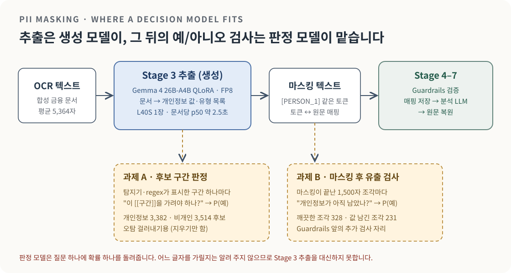

# 금융 문서 개인정보 마스킹에 판정 모델을 붙여 봤습니다: Gemma 4 Stage 3와 Strands Decider v2 실측

금융 데모 부스에서 돌리는 문서 분석 파이프라인은 OCR 결과에서 개인정보를 찾아 토큰으로 바꾼 뒤에야 분석 LLM에 넘깁니다. 이 개인정보 탐지 단계(Stage 3)는 지금 QLoRA로 조정한 Gemma 4 26B-A4B가 L40S 한 장에서 맡고 있습니다. 최근 RAGTruth 환각 검출 실험에서 Strands Decider v2가 질문 하나에 0.05~0.13초로 답하는 것을 보고, 더 가벼운 판정 모델로 이 단계를 바꾸거나 보강할 수 있는지 궁금해졌습니다. 그래서 2026년 11월 25일에 같은 GPU 한 장에서 추출 모델 두 개와 판정기 네 개(Decider 세 개와, 운영 Gemma를 판정기로 쓴 기준선)를 같은 합성 문서로 측정했습니다. 문서와 개인정보는 모두 LLM이 지어낸 가짜이고, 운영 적용 전에 방향을 잡기 위한 개발 단계 측정입니다.

<strong>먼저 결론: 판정 모델은 추출을 대신하지 못하지만, 예/아니오 검사는 더 잘했습니다</strong>Decider는 질문 하나에 확률 하나를 돌려주므로, 어느 글자를 가릴지 정하는 Stage 3 추출은 여전히 생성 모델이 맡아야 합니다. 추출 모델끼리 비교하면 Gemma 4 26B-A4B QLoRA가 Qwen3-8B LoRA보다 남긴 개인정보 글자가 적었고(26자 대 119자), 문서당 지연도 약 25% 짧았습니다. 예/아니오로 답할 수 있는 두 검사에서는 <strong>이 과제에 맞춰 따로 조정하지 않은 Decider v2 12B가, 같은 종류의 개인정보 추출 데이터로 미세 조정한 운영 Gemma에 같은 질문을 던진 기준선보다 높았습니다.</strong> 후보 구간 판정은 99.3% 대 97.3%, 마스킹 후 유출 검사는 95.7% 대 86.3%(balanced accuracy)이고, 요청당 84 ms와 173 ms, GPU 메모리 22 GiB였습니다. E4B는 유출 검사에서 기준선보다 높았고(92.7%) 후보 판정은 조금 높았으며(98.2%), E2B는 후보 판정은 괜찮았지만(95.2%) 유출 검사는 62.4%에 그쳤습니다. 다만 문턱값을 데이터로 맞추지 않고 0.5로 자르면 유출 검사 정확도가 59~86%로 떨어집니다. 운영 파이프라인은 바꾸지 않았고, 모두 오프라인 측정입니다.

<nav class="toc" markdown="1">

**목차**

1. [파이프라인에서 Stage 3가 하는 일](#pipeline)
2. [시험 환경과 데이터](#env)
3. [Stage 3 추출: Gemma 4와 Qwen3-8B](#extract)
4. [판정 모델을 놓을 두 자리](#tasks)
5. [과제 A: 후보 구간 판정](#span)
6. [과제 B: 마스킹 후 유출 검사](#leak)
7. [질문 언어와 부정형 질문](#phrasing)
8. [지연과 GPU 메모리](#latency)
9. [그래서 어디에 쓰나](#where)
10. [이번 측정의 한계](#limits)
11. [자료](#refs)

</nav>

<h2 id="pipeline">1. 파이프라인에서 Stage 3가 하는 일</h2>

파이프라인은 일곱 단계입니다. 문서를 읽고(1) OCR을 하고(2), Stage 3에서 개인정보를 찾아 `[PERSON_1]`, `[PHONE_2]` 같은 토큰으로 바꿉니다. Stage 4는 마스킹된 텍스트를 Amazon Bedrock Guardrails로 한 번 더 검사하고, 검증이 빠지거나 차단되면 분석으로 넘어가지 않습니다(fail-closed). Stage 5는 토큰과 원문의 매핑을 TTL이 있는 테이블에 저장하고, Stage 6 분석 LLM은 Stage 3가 찾은 값이 토큰으로 바뀐 텍스트를 받습니다. 탐지가 놓친 값은 그대로 남을 수 있어서 Stage 4 검사를 둡니다. Stage 7에서 결과에 원문을 되돌립니다.

Stage 3 모델이 내야 하는 답은 "문서에 개인정보가 있다"가 아니라 **어떤 문자열이 어떤 유형의 개인정보인지의 목록**입니다. 오케스트레이터는 그 목록으로 원문 위치를 찾아 토큰으로 바꿉니다. 모델이 낸 값 중 원문에 없는 것은 버리고(환각 필터), 다음 검사를 통과하지 못한 문서는 거부합니다.

- 같은 값이 다른 곳에 남아 있지 않은지(residue 게이트)
- 가려지지 않은 숫자열이 없는지(uncovered digit run 게이트)
- 개인 구간 경계가 애매하지 않은지(ambiguous boundary)

Strands Decider v2 같은 판정 모델은 상태(state)와 질문을 받아 예/아니오(`noul`), 선택(`choice`), 점수(`score`) 중 하나를 확률로 돌려줍니다. 한 번의 forward로 답을 읽고 토큰을 생성하지 않아 빠르지만, 출력이 질문당 확률 하나라 **어느 글자를 가려야 하는지**는 알려 주지 않습니다. 그래서 Stage 3 자체를 대신할 수는 없고, 이 글에서는 판정 모델을 Stage 3의 탐지 결과와 마스킹 결과, 예/아니오로 답할 수 있는 두 자리에 놓고 측정했습니다.

<figure class="diagram"><figcaption>과제 A는 Stage 3의 후보를, 과제 B는 마스킹이 끝난 텍스트를 판정 모델에 묻습니다.</figcaption></figure>

<h2 id="env">2. 시험 환경과 데이터</h2>

| 구분 | 내용 |
|---|---|
| GPU | `g6e.4xlarge` 한 대 (NVIDIA L40S 48 GB, 16 vCPU), 서울 리전, 기존 데모 VPC의 private 서브넷, 공인 IP 없음, inbound 규칙 없는 보안 그룹, 접속은 SSM만 사용 |
| 추출 모델 1 | Gemma 4 26B-A4B-it + Stage 3 QLoRA 병합본. vLLM 0.20.1, online FP8, `--reasoning-parser gemma4`, thinking off. 운영과 같은 이미지 digest와 인자 |
| 추출 모델 2 | Qwen3-8B + Stage 3 LoRA 병합본(11월 초까지 운영, 지금은 롤백용). vLLM 0.20.1, bf16, Qwen3-0.6B draft로 speculative decoding 3토큰 |
| 판정 모델 | `StrandsAgents/strands-decider-{E2B,E4B,12B}-gemma4-v2-2611`, bf16. 패키지는 GitHub main(`6d85079`, `0.4.1.dev12`), torch 2.15.0, transformers 5.24.1 |
| 판정 기준선 | 위 Gemma 4 Stage 3 모델을 그대로 판정기로 사용. 최대 1토큰만 생성하고, 그 토큰의 logprob에서 `Yes`/`No` 확률을 읽음. 질문 끝에 "Answer with one word: Yes or No."를 덧붙임 |

26B-A4B Decider는 bf16 가중치가 52 GB라 L40S 한 장에 올라가지 않아 뺐습니다. 31B도 같은 이유로 뺐습니다.

**데이터.** 공개 데이터셋에는 한국어 금융 OCR 문서와 개인정보 정답이 함께 있는 것이 없어, 이번 측정용 문서를 새로 만들었습니다. Amazon Bedrock의 작성 모델 두 개가 보험·주택담보대출·신용카드·증권 서류 묶음을 OCR 결과처럼 쓰면서, 개인정보마다 `⟦LABEL|값⟧` 표시를 달았습니다. 다른 계열의 모델이 표시를 지운 본문을 다시 읽어 개인정보를 나열했고, 두 목록이 맞고 형식 검사도 통과한 문서만 남겼습니다. 180건을 시도해 77건이 남았습니다(보험 28, 증권 23, 신용카드 17, 주택담보대출 9). 77건 중 62건은 한 작성 모델이 썼습니다. 문서 하나는 평균 5,364자이고, 사업자등록번호, 고객센터 번호, 기관 주소, 서식 코드처럼 개인정보와 헷갈리는 값을 일부러 많이 넣었습니다. 이 문서들은 Stage 3 모델 학습에 쓴 적이 없고, 작성 모델과 프롬프트도 학습 데이터 생성 때와 다릅니다.

<h2 id="extract">3. Stage 3 추출: Gemma 4와 Qwen3-8B</h2>

먼저 지금 쓰는 추출 모델을 같은 날 같은 GPU에서 다시 측정했습니다. 평가는 운영 오케스트레이터의 Stage 3 코드를 그대로 불러 실행합니다. 청크 분할, 요청 형식, 재시도, 응답 파싱, regex 보강, 환각 필터, 게이트가 모두 운영과 같고, 바뀌는 것은 모델 엔드포인트뿐입니다. 문서는 한 번에 하나씩 보냈습니다. 지연은 작업 PC에서 SSM 포트 포워딩으로 GPU 호스트의 vLLM을 부른 값이라, 터널 왕복과 오케스트레이터 코드 실행 시간이 들어 있습니다.

| 지표 (문서 77건) | Qwen3-8B LoRA | Gemma 4 26B-A4B QLoRA |
|---|---|---|
| 게이트 통과 문서 | 70 | 70 |
| 통과 문서의 개인정보 엔티티 완전 마스킹 | 3,397 / 3,428 (99.10%) | 3,423 / 3,428 (99.85%) |
| 통과 문서에 남은 정답 개인정보 글자 | 119 / 27,542 | 26 / 27,542 |
| 과잉 마스킹 글자 (통과 문서) | 14,981 | 15,010 |
| 바뀐 보호 글자 (기관명·일반 날짜) | 49 / 22,771 | 61 / 22,771 |
| 문서당 지연 p50 (두 묶음) | 3.26초, 3.26초 | 2.47초, 2.43초 |
| 문서당 지연 p95 (두 묶음) | 4.20초, 3.97초 | 3.10초, 3.13초 |

두 모델 모두 7건이 게이트에서 거부됐고, 사유별 건수도 known residue 4건, 애매한 경계 2건, 가려지지 않은 숫자열 1건으로 같았습니다. 모델 대신 정답 목록을 그대로 응답처럼 넣어 같은 경로로 돌려도 같은 사유별 건수로 7건이 거부됐습니다. 그러니 이 7건은 모델이 놓쳐서라기보다 게이트가 보수적으로 막는 문서이고, 운영에서는 분석으로 넘어가지 않고 실패로 끝납니다. 표의 마스킹 지표는 통과한 70건 기준입니다. 과잉 마스킹 글자 약 15,000자는 정답 목록을 넣었을 때도 14,953자가 나와, 모델보다는 파이프라인의 마스킹 규칙에서 나온 것입니다. 통과한 문서에서 Gemma가 남긴 개인정보 글자는 26자로 Qwen의 119자보다 적고, 지연은 p50 기준 약 25% 짧았습니다. draft 모델 없이도 8B dense 모델보다 빨랐습니다. 모델 카드 기준으로 26B-A4B는 전체 25.2B 파라미터 중 토큰마다 3.8B만 쓰는 MoE(전문가 128개 중 8개와 공유 전문가 1개)이고, 여기에 FP8을 쓴 것이 가장 그럴듯한 이유로 보입니다. 원인을 따로 나눠 측정하지는 않았습니다.

같은 비교를 11월 6일 운영 전환 때도 했습니다. 그때는 부스에서 쓰는 실제 데모 시나리오 문서(이 역시 합성)를 시나리오별로 20~40번씩 돌렸고, Stage 3 p50이 보험 3,066 → 2,305 ms, 주택담보대출 4,028 → 2,545 ms, 신용카드 2,179 → 1,566 ms, 증권 2,043 → 1,699 ms로 모두 짧아졌습니다. 이번 측정과 방향이 같습니다.

<h2 id="tasks">4. 판정 모델을 놓을 두 자리</h2>

**과제 A, 후보 구간 판정.** 탐지기나 규칙이 표시한 구간 하나를 보여 주고 "가려야 하는 개인정보인가"를 묻습니다. 탐지 모델의 오탐을 지우는 필터 자리입니다. 실제 탐지기 출력 대신 후보를 직접 만들었습니다. 정답 개인정보 구간 3,382개가 양성입니다. 음성은 3,514개로, 정답에 표시된 기관명·일반 날짜 2,104개, 운영 regex 보강 규칙이 정답 밖에서 잡은 주소·이름·전화번호 모양의 값 685개, 정답과 겹치지 않는 6자리 이상 숫자열(사업자등록번호, 고객센터 번호, 서식 코드, 금액 등) 725개입니다. 뒤의 표에서는 regex 오탐과 숫자열을 묶어 "규칙 오탐"이라고 부르겠습니다. 나이·가족 관계·거주 국가는 운영 정책상 남겨도 되는 경우가 있어 정답이 애매하므로 뺐습니다. 모든 판정기는 같은 상태와 질문을 받습니다(Gemma에는 답 형식 한 줄을 덧붙였습니다). 후보 앞 200자와 뒤 100자를 잘라 후보를 `[[ ]]`로 감싼 문자열이 상태(state)이고, 질문은 하나입니다.

> A detector highlighted the span inside [[ ]] in this OCR text from a Korean financial document. Is that span personal information of a private individual that must be masked: a person's name or part of one, a resident registration number, a personal phone number, a personal email address, a personal home address or part of one, a personal bank account or card number, or a date of birth? Company and institution values (business or corporate registration numbers, customer-centre numbers, institution names and addresses, form and product codes, ordinary dates, amounts) are not personal.

**과제 B, 마스킹 후 유출 검사.** 정답 개인정보를 모두 토큰으로 바꾼 문서를 1,500자 안팎의 조각으로 자르면, 그 조각들이 "깨끗한" 음성 328개가 됩니다. 양성은 같은 문서에서 개인정보 값 하나만 일부러 남겨 둔 조각 231개입니다. 문서마다 유형을 최대 세 개 골라 그 값의 모든 등장을 원문 그대로 두었습니다. 질문은 "토큰은 이미 가려진 값이다. 이 텍스트에 아직 읽을 수 있는 개인정보가 남아 있는가"입니다. Stage 4 Guardrails 앞에 둘 수 있는 추가 검사를 흉내 낸 것입니다.

**평가 방식.** RAGTruth 글의 방식을 따르되, 행 대신 문서 단위로 나눴습니다. 문서를 무작위로 반씩(39건, 38건) 나눠 한쪽(calibration)에서 모델마다 문턱값을 고르고, 다른 쪽(eval)에서 balanced accuracy를 계산합니다. balanced accuracy는 양성 재현율과 음성 재현율의 평균이라, 전부 "예"로 답하는 판정기도 50%가 나옵니다. 95% 신뢰구간은 eval 문서를 통째로 2,000번 다시 뽑는 bootstrap으로 구했고, AUC도 함께 적었습니다. 판정기마다 질문 하나를 요청 하나로 보내고, 요청은 한 번에 하나씩만 보냈습니다.

판정 모델 측정은 GPU 호스트 안에서 했습니다. Decider는 `strands-decider` 엔진을 같은 프로세스에서 불렀고, Gemma 기준선은 같은 호스트의 vLLM에 HTTP로 요청했습니다(최대 1토큰, `top_logprobs` 20). 3절의 Stage 3 추출 지연은 작업 PC에서 SSM 포트 포워딩으로 GPU 호스트를 불러 측정했고, 오케스트레이터 코드 실행 시간도 들어 있습니다. 그래서 3절의 문서당 지연과 아래 판정 지연은 같은 표에 놓고 비교할 수 없습니다.

**판정 기준선은 같은 조건이 아닙니다.** Gemma 기준선은 이 과제와 같은 종류의 개인정보 데이터로 미세 조정한 운영 추출 모델입니다. Decider는 이 과제에 맞춰 따로 미세 조정하지 않았고(학습 데이터에 비슷한 과제가 있는지는 확인하지 않았습니다), 모델 카드에 따르면 학습 데이터의 약 96%가 영어입니다. 아래 비교는 "새 모델을 들이는 것"과 "이미 띄워 둔 모델에 질문을 하나 더 하는 것"의 비교로 읽어 주세요.

<h2 id="span">5. 과제 A: 후보 구간 판정</h2>

eval 쪽 후보는 3,458개(개인정보 1,709, 기관명·날짜 1,049, 규칙 오탐 700)입니다. 질문은 영어 긍정형이고, 문턱값은 calibration 쪽에서 balanced accuracy가 가장 높은 값으로 골랐습니다.

| 판정기 | balanced accuracy [95% CI] | AUC | 문턱값 | 0.5로 자를 때 | 요청당 p50 |
|---|---|---|---|---|---|
| Decider v2 12B | **99.3%** [99.0, 99.5] | 0.999 | 0.609 | 99.0% | 84 ms |
| Decider v2 E4B | 98.2% [97.6, 98.8] | 0.994 | 0.554 | 98.0% | 75 ms |
| Gemma 4 Stage 3 모델 (기준선) | 97.3% [96.7, 97.8] | 0.995 | 0.982 | 95.5% | 55 ms |
| Decider v2 E2B | 95.2% [94.3, 96.1] | 0.987 | 0.469 | 95.1% | 51 ms |

같은 문서를 다시 뽑는 paired bootstrap으로 차이를 보면, 12B는 Gemma보다 2.0%p [1.4, 2.5], E4B보다 1.0%p [0.5, 1.5] 높고, E4B는 Gemma보다 1.0%p [0.3, 1.7] 높으며, Gemma는 E2B보다 2.1%p [1.1, 3.0] 높습니다. 이웃한 두 판정기 사이의 신뢰구간이 모두 0을 포함하지 않습니다. 다만 E4B와 Gemma는 AUC가 거의 같아(0.994, 0.995), 실질적으로는 비슷한 수준입니다. 참고로 같은 후보에 운영 regex 보강 규칙만 적용하면 52.7%입니다. 음성 일부가 그 규칙 자신의 오탐이라 낮게 나오는 것이 당연하고, 운영에서는 규칙 결과에 모델 결과를 합쳐 쓰므로 규칙 혼자 판정하는 구성은 아닙니다.

종류별로 보면 차이가 어디서 나는지 보입니다.

| 판정기 | 개인정보를 개인정보로 | 기관명·날짜를 비개인으로 | 규칙 오탐을 비개인으로 |
|---|---|---|---|
| Decider v2 12B | 1,702 / 1,709 | 1,049 / 1,049 | 681 / 700 |
| Decider v2 E4B | 1,693 / 1,709 | 1,045 / 1,049 | 659 / 700 |
| Gemma 4 Stage 3 모델 | 1,672 / 1,709 | 1,036 / 1,049 | 656 / 700 |
| Decider v2 E2B | 1,639 / 1,709 | 1,026 / 1,049 | 627 / 700 |

놓친 개인정보의 수로는 사람 이름이 가장 많았지만(E2B 70개 중 46개, Gemma 37개 중 26개), 사람 이름이 양성의 61%(1,040개)를 차지하므로 비율로 보면 특별하지 않습니다. 유형별로 놓친 비율을 보면 E2B는 주소 9.5%(12/126), 카드번호 7.1%(4/56), 사람 이름 4.4%(46/1,040) 순이었습니다. 12B는 7개를 놓쳤고 사람 이름 3개, 카드번호 3개, 주소 1개였습니다. 또 E2B가 놓친 사람 이름 46개 중 직원·담당자 이름 맥락은 30%로, 맞힌 쪽의 41%보다 낮았습니다. 질문의 "private individual" 표현 때문에 직원 이름을 빼먹은 것은 아닌 것으로 보입니다.

오탐을 지우는 필터는 진짜 개인정보를 지우면 안 됩니다. 그래서 calibration 쪽에서 **개인정보 재현율 99.5% 이상**을 지키는 가장 높은 문턱값을 고르고, eval 쪽에서 얼마나 지우는지도 측정했습니다.

| 판정기 | 남긴 개인정보 | 지운 규칙 오탐 | 지운 기관명·날짜 |
|---|---|---|---|
| Decider v2 12B | 1,704 / 1,709 (99.7%) | 677 / 700 (96.7%) | 1,048 / 1,049 |
| Decider v2 E4B | 1,702 / 1,709 (99.6%) | 617 / 700 (88.1%) | 999 / 1,049 |
| Gemma 4 Stage 3 모델 | 1,706 / 1,709 (99.8%) | 615 / 700 (87.9%) | 972 / 1,049 |
| Decider v2 E2B | 1,695 / 1,709 (99.2%) | 572 / 700 (81.7%) | 983 / 1,049 |

이 기준에서 12B는 규칙 오탐의 97%를 지우면서 개인정보 1,709개 중 5개만 놓쳤습니다. E4B와 Gemma는 비슷하게 88%를 지웠습니다.

<h2 id="leak">6. 과제 B: 마스킹 후 유출 검사</h2>

eval 쪽은 276개 조각(깨끗한 조각 162, 값 하나가 남은 조각 114)이라 신뢰구간이 넓습니다.

| 판정기 | balanced accuracy [95% CI] | AUC | 문턱값 | 0.5로 자를 때 | 요청당 p50 |
|---|---|---|---|---|---|
| Decider v2 12B | **95.7%** [92.8, 98.1] | 0.990 | 0.274 | 86.4% | 173 ms |
| Decider v2 E4B | 92.7% [89.9, 95.4] | 0.983 | 0.178 | 64.5% | 81 ms |
| Gemma 4 Stage 3 모델 (기준선) | 86.3% [81.9, 90.7] | 0.958 | 0.0036 | 65.4% | 79 ms |
| Decider v2 E2B | 62.4% [57.6, 67.2] | 0.722 | 0.332 | 59.3% | 55 ms |

paired bootstrap으로 보면 12B와 E4B는 각각 Gemma보다 9.4%p [4.2, 14.6], 6.4%p [1.1, 11.5] 높았습니다. 12B와 E4B의 차이 3.0%p [-0.7, 6.6]은 이 데이터로는 가르지 못했습니다. 12B와 E4B 모두 남은 카드·전화번호는 다 잡았습니다. 12B는 주소·사람 이름·주민등록번호를 2개씩, 생년월일을 1개 놓쳤고, E4B는 생년월일 3개와 주소·사람 이름·이메일 2개씩을 놓쳤습니다.

이 과제는 문턱값에 특히 민감했습니다. 고른 문턱값이 0.0036(Gemma)에서 0.33(E2B) 사이로 모두 0.5보다 낮았고, 0.5로 자르면 E4B와 Gemma는 65% 안팎으로 떨어집니다. 값 하나가 남은 조각에도 판정기들이 P(예)를 낮게 주었다는 뜻입니다. 어느 판정기를 쓰든 자기 데이터로 문턱값을 맞춰야 합니다.

양성 조각은 개인정보 값이 들어 있던 자리에서 나오므로, 판정기가 남은 값 대신 "개인정보가 많은 서식처럼 보이는 조각"을 고르고 있을 수도 있습니다. 이를 확인하려고 양성 231개마다 **같은 조각에서 남긴 값만 토큰으로 바꾼 짝**을 만들어 같은 질문을 했습니다. 두 조각은 그 값 하나만 다릅니다.

| 판정기 | 유출 조각이 짝보다 높은 점수 (231쌍) | 짝을 "남아 있다"고 잘못 본 수 |
|---|---|---|
| Decider v2 12B | 100.0% | 1 |
| Gemma 4 Stage 3 모델 | 99.6% | 9 |
| Decider v2 E4B | 98.7% | 18 |
| Decider v2 E2B | 88.5% | 117 |

12B, Gemma, E4B는 같은 조각 안에서는 남은 값 하나를 거의 틀림없이 알아봤습니다. 그러니 앞 표의 점수는 조각 종류보다는 주로 남은 값에 반응한 결과입니다. 짝 비교에는 문턱값을 고른 calibration 쪽 문서도 들어 있습니다. Gemma는 짝 비교가 99.6%로 좋은데도 balanced accuracy가 86.3%에 그쳤습니다. 조각 하나만 보고 "남았다"를 가르는 절대 점수가 문서마다 흔들려, 문턱값 하나로는 다 나누지 못한 것으로 보입니다. E2B는 짝의 절반을 "남아 있다"고 봤습니다.

<h2 id="phrasing">7. 질문 언어와 부정형 질문</h2>

RAGTruth 글에서는 E4B가 부정형 질문에서 AUC 0.43으로 무너졌습니다. 이번 데이터는 한국어 문서라서, 질문을 한국어로 바꾸는 경우도 함께 봤습니다. 부정형은 "가리지 않고 두어도 되는가"처럼 뒤집어 묻고, 점수는 1 − P(예)로 계산했습니다. 과제 A는 1차 문서 34건의 eval 쪽만, 과제 B는 전체 eval 쪽 기준입니다.

| 판정기 | 과제 A 영어 | A 영어 부정형 | A 한국어 | 과제 B 영어 | B 영어 부정형 | B 한국어 |
|---|---|---|---|---|---|---|
| Decider v2 12B | 99.1% | 97.6% | 98.7% | 95.7% | 94.6% | 90.7% |
| Decider v2 E4B | 98.4% | 96.2% | 97.5% | 92.7% | 89.2% | 84.0% |
| Gemma 4 Stage 3 모델 | 97.7% | 91.8% | 94.3% | 86.3% | 78.6% | 86.1% |
| Decider v2 E2B | 94.7% | 91.1% | 94.1% | 62.4% | 69.0% | 48.6% |

세 가지가 보였습니다. 첫째, 이번 데이터에서는 E4B가 부정형에서 무너지지 않았습니다(과제 A AUC 0.991, 과제 B 0.953). 둘째, E2B의 과제 B를 빼면 영어 긍정형이 대체로 가장 높았습니다. 다만 일부 차이(Gemma 과제 B 86.3%와 86.1%, 12B 과제 A 99.1%와 98.7%)는 신뢰구간 안입니다. 셋째, E2B는 과제 B를 한국어로 물으면 AUC가 0.392로 뒤집혔습니다. 114개 유출 조각 중 1개만 "남아 있다"고 답했으니, 사실상 질문을 이해하지 못한 것입니다. 이번 측정에서는 E2B가 문구에 가장 크게 흔들렸고, Gemma 기준선도 부정형에서 크게 떨어졌습니다(과제 A 97.7% → 91.8%, 과제 B 86.3% → 78.6%).

<h2 id="latency">8. 지연과 GPU 메모리</h2>

| 판정기 | GPU 메모리 | 과제 A p50 / p90 | 과제 B p50 / p90 | 첫 로드 |
|---|---|---|---|---|
| Decider v2 E2B (bf16) | 9.0 GiB | 51 / 52 ms | 55 / 56 ms | 32초 |
| Decider v2 E4B (bf16) | 14.2 GiB | 75 / 75 ms | 81 / 82 ms | 49초 |
| Decider v2 12B (bf16) | 22.3 GiB | 84 / 85 ms | 173 / 178 ms | 67초 |
| Gemma 4 Stage 3 모델 (vLLM FP8) | GPU의 90% 예약 (KV 캐시 11.2 GiB 포함) | 55 / 56 ms | 79 / 89 ms | 약 4분 |

Decider 메모리는 가중치를 올린 뒤 PyTorch가 할당한 양이고, 첫 로드는 그 모델을 처음 올릴 때 걸린 시간입니다(같은 모델을 다시 올리면 4~5초). 과제 A의 상태는 300자 안팎이고 과제 B는 1,500자 안팎이라, 입력이 긴 과제 B에서 12B의 지연이 두 배로 늘었습니다. 모델 카드가 H100에서 밝힌 질문당 지연(E4B 78 ms, 12B 80 ms)은 L40S에서도 짧은 입력 기준으로 거의 그대로 나왔습니다.

<h2 id="where">9. 그래서 어디에 쓰나</h2>

**Stage 3를 대신하지는 못합니다.** 판정 모델은 "이 문서에 개인정보가 있는가"에는 답하지만, 무엇을 어디서 가릴지는 알려 주지 않습니다. 추출은 지금처럼 생성 모델이 맡고, 그중에서는 Gemma 4 26B-A4B QLoRA가 Qwen3-8B보다 낫다는 11월 초 판단이 이번 측정에서도 유지됐습니다.

**유출 검사 자리가 가장 유력합니다.** Stage 4 Guardrails 앞에서 마스킹된 조각마다 "아직 남은 개인정보가 있나"를 묻는 검사는, 12B 기준 조각당 0.17초입니다. 평균 5,364자 문서는 1,500자 조각 네 개쯤이니 문서당 0.7초 정도가 더해집니다. 이 검사가 무언가를 잡으면 그 문서를 다시 Stage 3로 보내거나 실패로 끝내는 식으로, 지금의 fail-closed 원칙과 맞물려 쓸 수 있습니다. 다만 Decider는 어디가 남았는지 알려 주지 않으므로, 이 검사는 막는 용도로만 씁니다. 비용도 있습니다. 이 문턱값에서 12B는 깨끗한 조각의 2.5%(162개 중 4개)를 "남았다"고 봐서, 조각 네 개짜리 문서라면 약 10%가 불필요하게 막히거나 다시 처리될 수 있습니다. 반대로 값이 남은 조각의 6%(114개 중 7개)는 통과시켰으므로, Guardrails를 대신하지 않고 그 앞에 하나 더 두는 검사입니다.

**탐지 후보 필터에도 쓸 수 있습니다.** 탐지기가 과하게 잡은 사업자등록번호나 고객센터 번호를 지우는 필터로 쓰면, 12B는 개인정보 재현율을 99.7%로 지키면서 규칙 오탐의 97%를 지웠습니다. 다만 이 측정의 후보는 정답 경계를 그대로 쓴 것이라, 실제 탐지기 출력으로 다시 측정해야 합니다.

**GPU 자리가 문제입니다.** 운영 L40S는 vLLM이 메모리의 90%를 잡고 있어 12B(22 GiB)를 같이 올릴 수 없습니다. Gemma에 판정 질문을 하나 더 보내는 방식은 추가 메모리가 들지 않는 대신 정확도가 낮았습니다. Decider를 쓰려면 GPU를 하나 더 두거나, vLLM의 메모리 비율을 낮춰 E4B(14 GiB)를 함께 올리는 방법을 따로 측정해 봐야 합니다. 이번 숫자로 어림하면 E4B를 같이 올릴 때 Gemma의 KV 캐시는 11.2 GiB에서 1 GiB 안팎으로 줄어들어, 이 방법도 쉽지 않습니다.

<h2 id="limits">10. 이번 측정의 한계</h2>

- **데이터가 합성이고 작습니다.** 문서 77건이 두 작성 모델에서 나왔고(그중 62건이 한 모델), 실제 스캔 문서의 OCR 오류나 서식 다양성을 다 담지 못합니다. 과제 B의 eval 쪽은 276개 항목이라 신뢰구간이 넓습니다.
- **후보는 만든 것입니다.** 과제 A의 양성은 정답 구간 그대로라 경계가 깔끔합니다. 실제 탐지기는 구간을 길거나 짧게 자르므로, 운영 탐지기 출력에서는 숫자가 달라질 수 있습니다.
- **질문 문구는 하나씩입니다.** 영어 긍정형, 영어 부정형, 한국어 긍정형 세 가지만 썼고, 문구를 다듬지 않았습니다. Decider의 부정형·한국어 질문은 과제 A에서 1차 문서 34건에만 돌렸고, 7절의 비교표도 그 문서로 맞췄습니다.
- **요청은 하나씩만 보냈습니다.** 동시 요청과 배치 처리량은 측정하지 않았습니다. Decider는 요청 하나에 질문 여러 개를 묶을 수 있지만, 이번에는 질문 하나씩 보냈습니다.
- **Decider 26B-A4B와 31B는 빠졌습니다.** L40S 한 장에 bf16 가중치가 들어가지 않습니다.
- **운영에 붙인 결과가 아닙니다.** 판정기를 파이프라인에 넣어 Stage 4 Guardrails와 함께 돌린 결과는 아직 없습니다.

<h2 id="refs">11. 자료</h2>

- [결정 모델 소개와 오픈소스 8종의 환각 탐지 테스트](https://whchoi98.github.io/docs/techblog/aiml/decision-models-ragtruth-hallucination-test/) (이 측정의 계기가 된 RAGTruth 실험 글. 그 글의 "결정 모델"을 이 글에서는 "판정 모델"이라고 불렀습니다)
- [StrandsAgents/strands-decider-E4B-gemma4-v2-2611](https://huggingface.co/StrandsAgents/strands-decider-E4B-gemma4-v2-2611), [12B](https://huggingface.co/StrandsAgents/strands-decider-12B-gemma4-v2-2611), [E2B](https://huggingface.co/StrandsAgents/strands-decider-E2B-gemma4-v2-2611) 모델 카드 (Apache-2.0)
- [strands-labs/strands-decider](https://github.com/strands-labs/strands-decider) (엔진, 학습 데이터 카드)
- [google/gemma-4-26B-A4B-it](https://huggingface.co/google/gemma-4-26B-A4B-it)
- [vLLM](https://github.com/vllm-project/vllm)
